# Mardi Après-midi

> *JavaScript : donner vie à la page*

Ce matin, la page personnelle a pris forme avec le HTML (le contenu) et le CSS (l'apparence). Cet après-midi, place au **JavaScript** : le langage qui permet à une page de *réagir*, de *calculer* et de *changer* pendant qu'on l'utilise.

Les quatre chapitres construisent, pas à pas, un **compteur d'allumettes** dans MDN Playground. Chaque chapitre présente un concept déjà rencontré lundi dans MakeCode, cette fois écrit en JavaScript. L'atelier final réunit le tout : l'interface complète du jeu des allumettes, en équipe.

!!! info "Le tutoriel de référence"

    Cet après-midi suit la logique du tutoriel [Ajouter de l'interactivité](https://developer.mozilla.org/fr/docs/Learn_web_development/Getting_started/Your_first_website/Adding_interactivity){target="_blank"} de MDN, puis des chapitres du module [Script dynamique avec JavaScript](https://developer.mozilla.org/fr/docs/Learn_web_development/Core/Scripting){target="_blank"}. Chaque étape renvoie vers la page MDN correspondante.

!!! tip "Lundi en blocs, mardi en texte"

    Pour chaque concept, trois onglets montrent **la même idée** de trois façons :

    - **JavaScript** : le code à écrire dans MDN Playground
    - **Schéma** : le fonctionnement, en image
    - **MakeCode** : les blocs utilisés lundi pour le jeu des allumettes

    MakeCode et le navigateur parlent presque le même langage, mais pas avec les mêmes instructions : `game.splash(...)` n'existe que dans MakeCode, `document.querySelector(...)` n'existe que dans le navigateur.

---

## JavaScript : les variables

### Étape 1 : La console

La **console** est l'endroit où JavaScript écrit ses messages. C'est l'outil n°1 pour comprendre ce que fait un programme.

1. Ouvrir [MDN Playground](https://developer.mozilla.org/fr/play){target="_blank"} (ou cliquer sur **Effacer** après avoir gardé son travail du matin)
2. Écrire dans la zone **JavaScript** :

    ```js
    console.log("Bonjour la console !");
    ```

3. Le message apparaît dans la zone **Console**, sous l'aperçu

| Morceau | Rôle |
|---------|------|
| `console.log(...)` | Afficher ce qui est entre parenthèses dans la console |
| `"Bonjour la console !"` | Un texte, toujours entre guillemets (on dit une *chaîne de caractères*) |
| `;` | La fin de l'instruction |

??? info "Afficher la capture d'écran illustrant l'étape"

    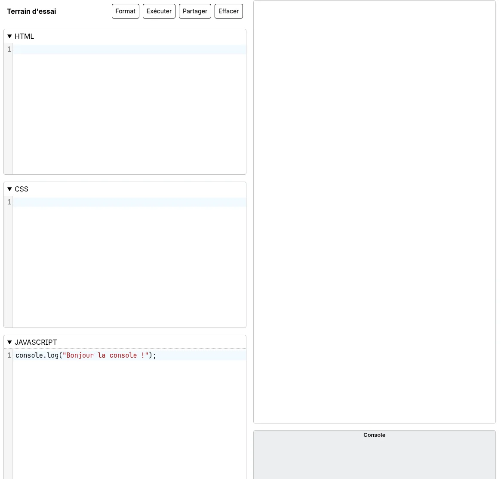

### Étape 2 : Une variable

Une **variable** est une boîte avec un nom, qui contient une valeur. Lundi, la variable `allumettes` gardait le nombre d'allumettes restantes. En JavaScript, on la crée avec `let` :

```js
let allumettes = 20;
console.log(allumettes);

allumettes = allumettes - 1;
console.log(allumettes);
```

La console affiche `20`, puis `19`. La deuxième ligne se lit de droite à gauche : *calculer `allumettes - 1`, puis ranger le résultat dans `allumettes`*.

??? info "Afficher la capture d'écran illustrant l'étape"

    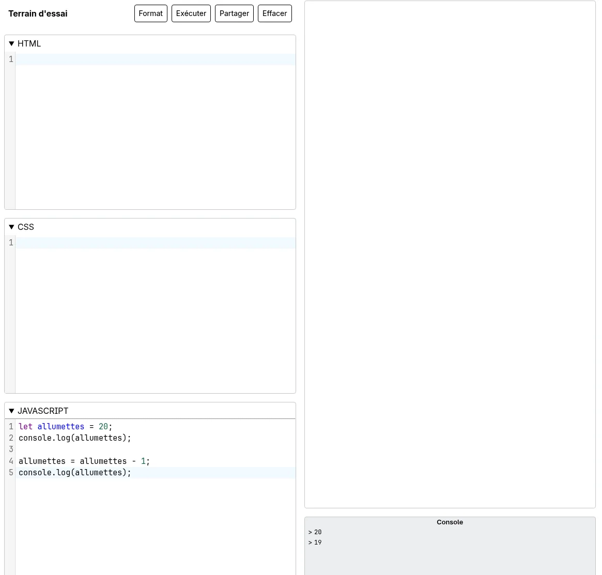

=== "JavaScript"

    ```js
    let allumettes = 20;
    allumettes = allumettes - 1;
    ```

=== "Schéma"

    ```mermaid
    flowchart LR
        A["allumettes = 20"] -->|"allumettes - 1"| B["allumettes = 19"]
    ```

=== "MakeCode"

    ```blocks
    allumettes = 20
    allumettes += -1
    ```

!!! question "À essayer"

    Ajouter les lignes nécessaires pour retirer encore 3 allumettes, puis afficher le résultat. La console doit afficher `16`.

??? success "Solution"

    ```js
    allumettes = allumettes - 3;
    console.log(allumettes);
    ```

    Il existe aussi un raccourci : `allumettes -= 3;` fait exactement la même chose.

### Étape 3 : Le bug de la faute de frappe

!!! bug "Bug volontaire"

    Dans le dernier `console.log`, écrire le nom de la variable avec un seul `t` :

    ```js
    console.log(allumetes);
    ```

    Que se passe-t-il dans la console ?

??? success "Explication et correction"

    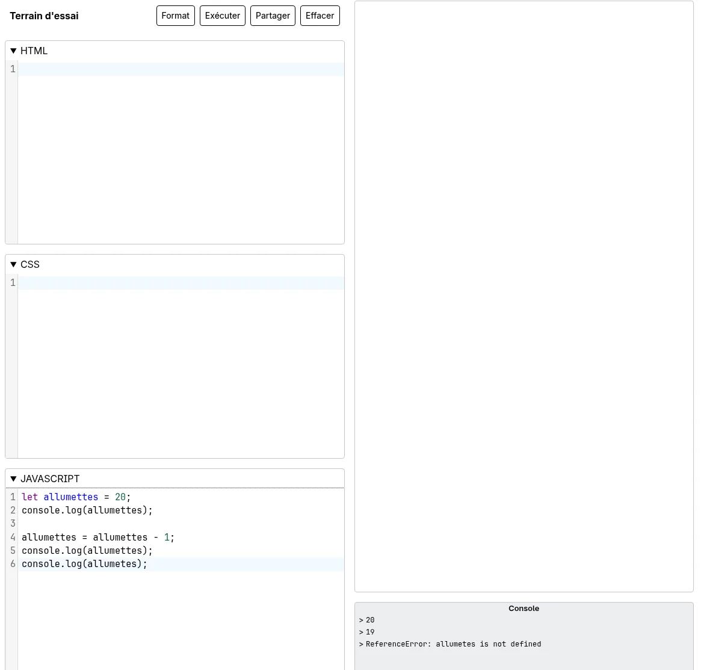

    La console affiche un message d'erreur :

    ```text
    ReferenceError: allumetes is not defined
    ```

    *« Erreur de référence : `allumetes` n'est pas défini. »* JavaScript ne connaît aucune variable qui s'appelle `allumetes` : pour lui, `allumettes` et `allumetes` sont deux noms complètement différents.

    **Correction** : écrire le nom exactement comme lors de sa création, avec deux `t`.

    **À retenir** : contrairement au HTML et au CSS, **JavaScript signale ses erreurs**. Le message, en anglais, donne le *type* d'erreur et le *nom* du coupable : c'est le premier indice à lire.

→ Sur MDN : [Qu'est-ce qui n'a pas fonctionné ?](https://developer.mozilla.org/fr/docs/Learn_web_development/Core/Scripting/What_went_wrong){target="_blank"}

### Étape 4 : `let` ou `const` ?

Certaines valeurs ne changent jamais, comme le nom de son équipe. On les range dans une **constante**, créée avec `const` :

```js
const equipe = "Pomme";
console.log("Équipe " + equipe);
```

La console affiche `Équipe Pomme`. Le `+` entre deux textes les colle l'un à l'autre (lundi, dans MakeCode, c'était le bloc `concaténation`).

!!! bug "Bug volontaire"

    Ajouter ces deux lignes à la fin, pour essayer de changer d'équipe :

    ```js
    equipe = "Kiwi";
    console.log("Équipe " + equipe);
    ```

    Que dit la console ?

??? success "Explication et correction"

    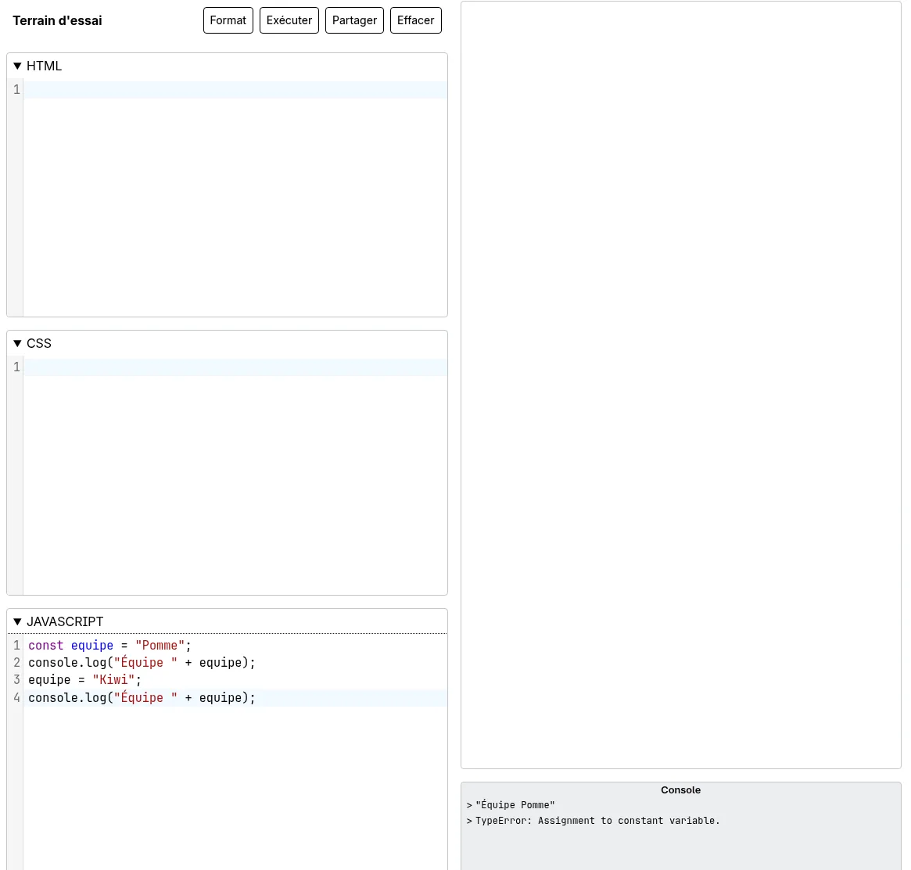

    ```text
    TypeError: Assignment to constant variable.
    ```

    *« On ne peut pas donner une nouvelle valeur à une constante. »* C'est voulu : `const` protège la valeur contre les changements par erreur.

    **Correction** : supprimer les deux lignes ajoutées. Si une valeur doit vraiment changer, la créer avec `let`.

    **À retenir** : `let` pour ce qui change (le nombre d'allumettes), `const` pour ce qui ne change pas (le nom de l'équipe).

### Étape 5 : Afficher dans la page

La console, c'est pour les développeuses. Pour que les joueuses voient le nombre d'allumettes, il faut l'écrire **dans la page**.

1. Dans la zone **HTML**, écrire :

    ```html
    <h1>Jeu des allumettes</h1>
    <p>Il reste <span id="compteur"></span> allumettes.</p>
    ```

2. Dans la zone **JavaScript**, remplacer tout le code par :

    ```js
    let allumettes = 20;
    const compteur = document.querySelector("#compteur");
    compteur.textContent = allumettes;
    ```

La page affiche *Il reste 20 allumettes.*

??? info "Afficher la capture d'écran illustrant l'étape"

    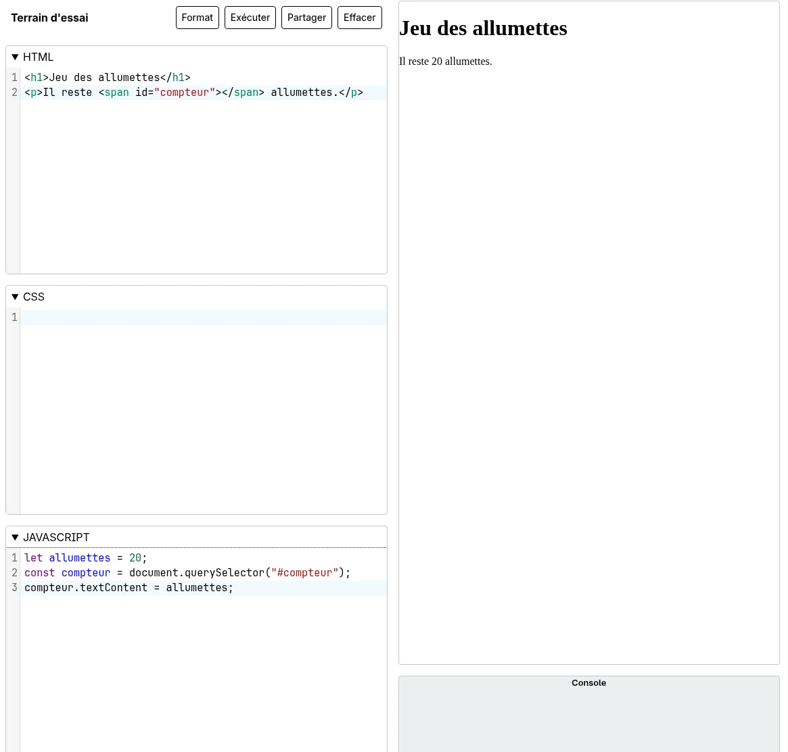

| Instruction | Rôle |
|-------------|------|
| `id="compteur"` | Donne un nom **unique** à un élément HTML |
| `document.querySelector("#compteur")` | Va chercher dans la page l'élément dont l'`id` est `compteur`. Le `#` désigne un `id`, comme le `.` désignait une classe en CSS ce matin |
| `compteur.textContent = allumettes` | Remplace le texte de cet élément par la valeur de `allumettes` |

!!! note "`<span>`, un élément invisible"

    `<span>` n'a aucun effet visuel : il sert juste à entourer un morceau de texte pour pouvoir le retrouver ensuite, ici depuis JavaScript.

→ Sur MDN : [Stocker les informations nécessaires — les variables](https://developer.mozilla.org/fr/docs/Learn_web_development/Core/Scripting/Variables){target="_blank"}

---

## Les événements : réagir aux boutons

Un **événement**, c'est quelque chose qui se produit dans la page : un clic, une touche du clavier, la souris qui passe sur un élément. Lundi, le bloc `quand bouton A est appuyé` réagissait à un événement. En JavaScript, on *écoute* un événement avec `addEventListener`.

### Étape 1 : Un bouton qui retire une allumette

1. Dans la zone **HTML**, ajouter un bouton à la fin :

    ```html
    <button id="retirer">Retirer 1 allumette</button>
    ```

2. Dans la zone **JavaScript**, remplacer tout le code par :

    ```js
    let allumettes = 20;
    const compteur = document.querySelector("#compteur");
    const bouton = document.querySelector("#retirer");
    compteur.textContent = allumettes;

    bouton.addEventListener("click", function () {
      allumettes = allumettes - 1;
      compteur.textContent = allumettes;
    });
    ```

3. Cliquer plusieurs fois sur le bouton : le compteur diminue

La dernière instruction se lit ainsi : *quand on fait un `"click"` sur `bouton`, exécuter tout ce qui se trouve entre les accolades `{ }`*.

??? info "Afficher la capture d'écran illustrant l'étape"

    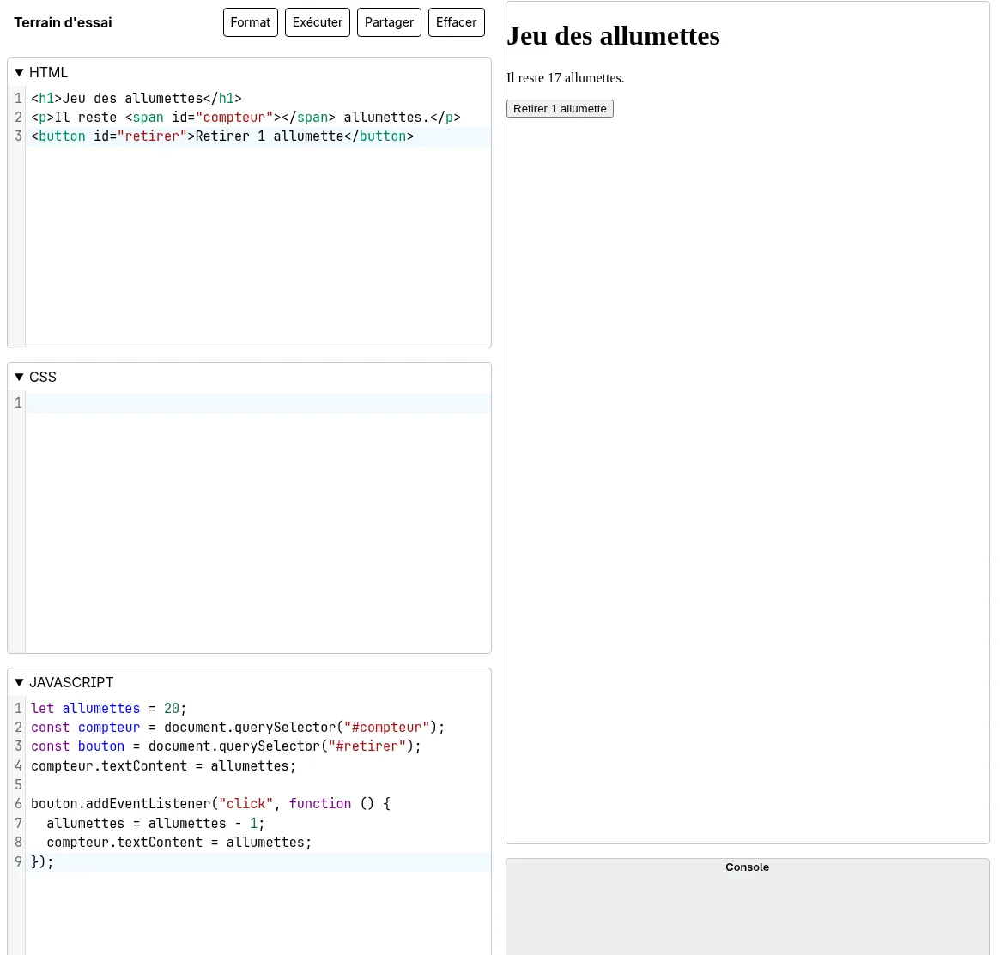

=== "JavaScript"

    ```js
    bouton.addEventListener("click", function () {
      allumettes = allumettes - 1;
      compteur.textContent = allumettes;
    });
    ```

=== "Schéma"

    ```mermaid
    flowchart LR
        E(["Clic sur le bouton"]) -->|déclenche| A["allumettes - 1"]
        A --> B["Afficher le compteur"]
    ```

=== "MakeCode"

    ```blocks
    controller.A.onEvent(ControllerButtonEvent.Pressed, function () {
        allumettes += -1
        info.setScore(allumettes)
    })
    ```

!!! info "Le même moule"

    Dans l'onglet **JavaScript** de MakeCode, le bloc de lundi s'écrit `controller.A.onEvent(ControllerButtonEvent.Pressed, function () { ... })`. Même forme que `bouton.addEventListener("click", function () { ... })` : *quoi écouter*, puis *quoi faire* entre accolades.

### Étape 2 : Le bug du `#` oublié

!!! bug "Bug volontaire"

    Dans la ligne qui va chercher le bouton, **retirer le `#`** :

    ```js
    const bouton = document.querySelector("retirer");
    ```

    Cliquer sur le bouton. Que se passe-t-il ? Que dit la console ?

??? success "Explication et correction"

    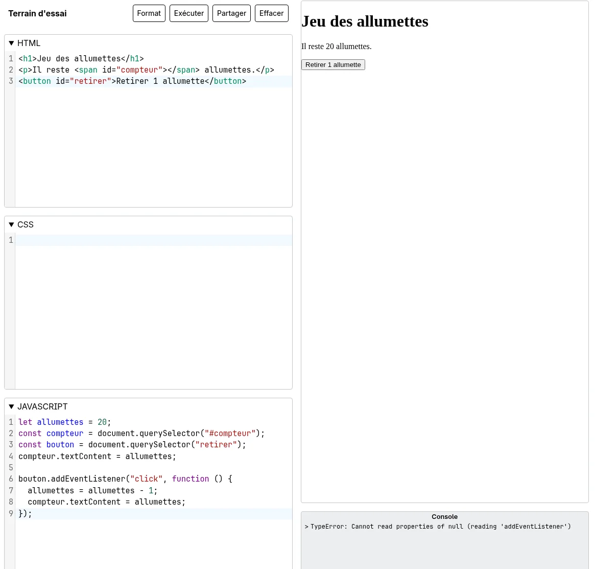

    Le bouton ne fait plus rien, et la console affiche :

    ```text
    TypeError: Cannot read properties of null (reading 'addEventListener')
    ```

    Sans `#`, `querySelector` cherche un élément HTML qui s'appellerait `<retirer>`. Il n'en trouve aucun et renvoie `null`, c'est-à-dire *rien*. Ensuite, impossible d'écouter les clics de *rien* : JavaScript s'arrête avec une erreur.

    **Correction** : remettre le `#`, qui veut dire « l'élément dont l'`id` est ».

    **À retenir** : quand un message d'erreur parle de `null`, c'est très souvent qu'un `querySelector` n'a rien trouvé. Vérifier le `#` et l'orthographe de l'`id`, dans le HTML **et** dans le JavaScript.

### Étape 3 : Le bug de l'affichage oublié

!!! bug "Bug volontaire"

    Dans la fonction du bouton, **remplacer** la ligne `compteur.textContent = allumettes;` par un `console.log` :

    ```js
    bouton.addEventListener("click", function () {
      allumettes = allumettes - 1;
      console.log(allumettes);
    });
    ```

    Cliquer plusieurs fois. Que montre la page ? Que montre la console ?

??? success "Explication et correction"

    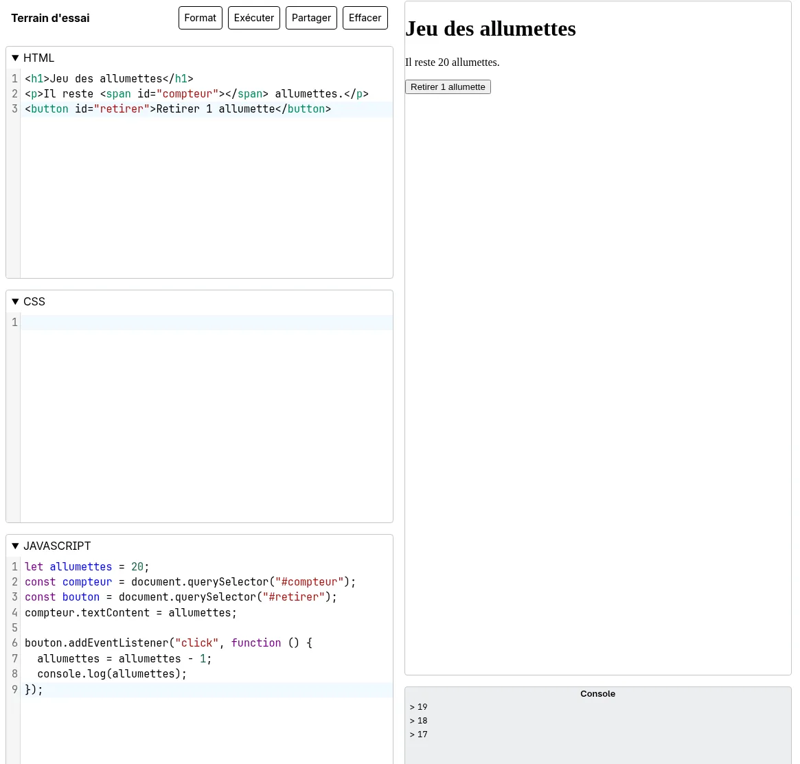

    La page reste bloquée sur *20*, alors que la console affiche `19`, `18`, `17`... La variable change bien, mais **personne ne met la page à jour**. Cette fois, il n'y a aucun message d'erreur : le programme fait exactement ce qui est écrit, mais pas ce qu'on voulait. C'est un **bug de logique**.

    **Correction** : remettre `compteur.textContent = allumettes;` dans la fonction. Le `console.log` peut rester : il ne gêne pas les joueuses.

    **À retenir** : la page ne se met jamais à jour toute seule. Et pour comprendre un bug sans message d'erreur, un `console.log` placé au bon endroit montre ce que contiennent les variables.

### Étape 4 : Trois boutons

Lundi, il y avait trois boutons : A pour retirer 1 allumette, B pour 2, la flèche haut pour 3.

!!! question "À essayer"

    Ajouter deux boutons, **Retirer 2 allumettes** et **Retirer 3 allumettes**, qui fonctionnent. Attention : chaque bouton a besoin de son propre `id`.

??? success "Solution"

    **HTML**

    ```html
    <button id="retirer">Retirer 1 allumette</button>
    <button id="retirer2">Retirer 2 allumettes</button>
    <button id="retirer3">Retirer 3 allumettes</button>
    ```

    **JavaScript** (à ajouter à la fin)

    ```js
    const bouton2 = document.querySelector("#retirer2");
    const bouton3 = document.querySelector("#retirer3");

    bouton2.addEventListener("click", function () {
      allumettes = allumettes - 2;
      compteur.textContent = allumettes;
    });

    bouton3.addEventListener("click", function () {
      allumettes = allumettes - 3;
      compteur.textContent = allumettes;
    });
    ```

    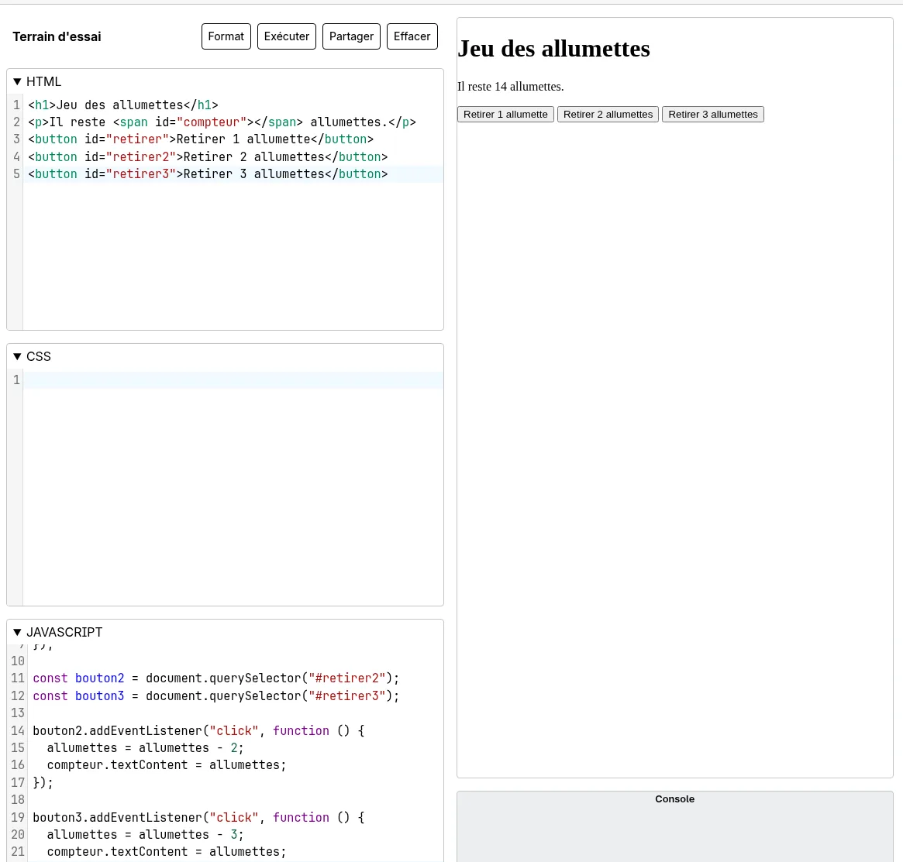

    Comme lundi avec la duplication des blocs, le code se répète presque à l'identique. Pour la suite du tutoriel, un seul bouton suffit : les trois boutons reviendront dans l'atelier.

??? abstract "Code complet à la fin du chapitre (un bouton)"

    **HTML**

    ```html
    <h1>Jeu des allumettes</h1>
    <p>Il reste <span id="compteur"></span> allumettes.</p>
    <button id="retirer">Retirer 1 allumette</button>
    ```

    **JavaScript**

    ```js
    let allumettes = 20;
    const compteur = document.querySelector("#compteur");
    const bouton = document.querySelector("#retirer");
    compteur.textContent = allumettes;

    bouton.addEventListener("click", function () {
      allumettes = allumettes - 1;
      compteur.textContent = allumettes;
    });
    ```

→ Sur MDN : [Introduction aux évènements](https://developer.mozilla.org/fr/docs/Learn_web_development/Core/Scripting/Events){target="_blank"} · [Manipuler des documents](https://developer.mozilla.org/fr/docs/Learn_web_development/Core/Scripting/DOM_scripting){target="_blank"}

---

## Les conditions : détecter la fin de partie

Pour l'instant, on peut cliquer à l'infini : le compteur passe à 0, puis à -1, -2... Il faut que le programme **prenne une décision** : *si* plus aucune allumette ne reste, *alors* la partie est finie, *sinon* c'est au tour de l'autre joueuse. C'est une **condition**.

### Étape 1 : Qui a perdu ?

1. Dans la zone **HTML**, ajouter un paragraphe pour les messages, juste sous le titre :

    ```html
    <p id="message">Au tour de la joueuse 1</p>
    ```

2. Dans la zone **JavaScript**, remplacer tout le code par :

    ```js
    let allumettes = 20;
    let joueuse = 1;
    const compteur = document.querySelector("#compteur");
    const message = document.querySelector("#message");
    const bouton = document.querySelector("#retirer");
    compteur.textContent = allumettes;

    bouton.addEventListener("click", function () {
      allumettes = allumettes - 1;

      if (allumettes == 0) {
        message.textContent = "La joueuse " + joueuse + " a perdu !";
        bouton.disabled = true;
      } else {
        if (joueuse == 1) {
          joueuse = 2;
        } else {
          joueuse = 1;
        }
        message.textContent = "Au tour de la joueuse " + joueuse;
      }

      compteur.textContent = allumettes;
    });
    ```

3. Jouer une partie à deux, jusqu'à la dernière allumette (astuce pour aller plus vite : commencer avec `let allumettes = 5;`)

??? info "Afficher la capture d'écran illustrant l'étape"

    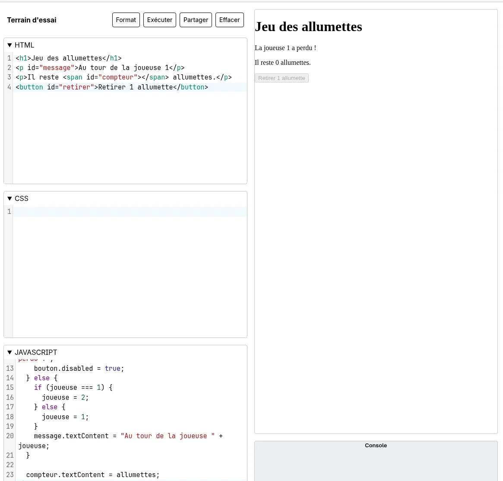

À chaque clic, le programme se pose une question :

=== "JavaScript"

    ```js
    if (allumettes == 0) {
      message.textContent = "La joueuse " + joueuse + " a perdu !";
    } else {
      if (joueuse == 1) {
        joueuse = 2;
      } else {
        joueuse = 1;
      }
      message.textContent = "Au tour de la joueuse " + joueuse;
    }
    ```

=== "Schéma"

    ```mermaid
    flowchart TD
        Q{"allumettes == 0 ?"} -->|oui| P["La joueuse a perdu !"]
        Q -->|non| J{"joueuse == 1 ?"}
        J -->|oui| J2["joueuse = 2"]
        J -->|non| J1["joueuse = 1"]
        J2 --> M["Au tour de la joueuse..."]
        J1 --> M
    ```

=== "MakeCode"

    ```blocks
    if (allumettes <= 0) {
        game.splash("Joueuse " + joueuse + " a perdu !")
        game.reset()
    } else {
        if (joueuse == 1) {
            joueuse = 2
        } else {
            joueuse = 1
        }
        game.splash("Au tour de joueuse " + joueuse)
    }
    ```

| Comparaison | Signification |
|-------------|---------------|
| `==` | Est égal à |
| `!=` | Est différent de |
| `<` / `>` | Plus petit que / plus grand que |
| `<=` / `>=` | Plus petit ou égal / plus grand ou égal |

`bouton.disabled = true;` désactive le bouton : la partie est finie, on ne peut plus cliquer.

### Étape 2 : Le bug du signe égal

!!! bug "Bug volontaire"

    Dans la condition, écrire **un seul** signe `=` au lieu de deux :

    ```js
    if (allumettes = 0) {
    ```

    Recommencer une partie et cliquer **une seule fois**. Que montre le compteur ? Quelqu'un a-t-il perdu ?

??? success "Explication et correction"

    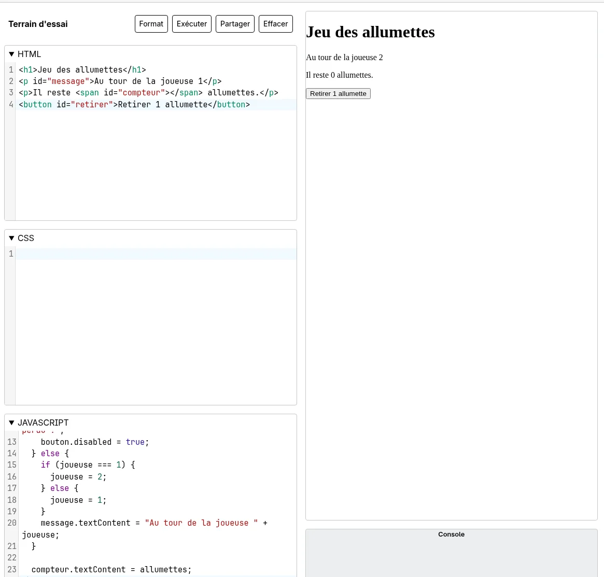

    Dès le premier clic, le compteur tombe à **0**, mais personne n'a perdu et la partie continue (*Au tour de la joueuse 2*).

    Un seul `=` ne *compare* pas : il *range* une valeur, comme dans `let allumettes = 20`. La condition `allumettes = 0` met donc 0 dans `allumettes`... et JavaScript considère que 0 veut dire « faux » : c'est le bloc `else` qui s'exécute. Aucun message d'erreur, puisque le code est valide : c'est encore un bug de logique.

    **Correction** : `==` pour comparer.

    **À retenir** : `=` range une valeur dans une variable, `==` compare deux valeurs. Confondre les deux est l'un des bugs les plus courants, même chez les développeuses expérimentées.

### Étape 3 : Et avec trois allumettes d'un coup ?

!!! question "Réfléchir"

    Imaginer qu'il reste **2** allumettes et qu'une joueuse en retire **3** (avec le bouton de l'étape 4 du chapitre précédent). Que vaut `allumettes` ? La condition `allumettes == 0` est-elle vraie ?

??? success "Réponse"

    `allumettes` vaut `-1`, et `-1 == 0` est faux : la partie continue avec un nombre négatif d'allumettes !

    Solution : tester `allumettes <= 0` (*plus petit ou égal à zéro*), comme lundi dans MakeCode. On peut aussi remettre le compteur à 0 pour ne pas afficher de nombre négatif :

    ```js
    if (allumettes <= 0) {
      allumettes = 0;
      message.textContent = "La joueuse " + joueuse + " a perdu !";
      bouton.disabled = true;
    }
    ```

??? abstract "Code complet à la fin du chapitre"

    **HTML**

    ```html
    <h1>Jeu des allumettes</h1>
    <p id="message">Au tour de la joueuse 1</p>
    <p>Il reste <span id="compteur"></span> allumettes.</p>
    <button id="retirer">Retirer 1 allumette</button>
    ```

    **JavaScript**

    ```js
    let allumettes = 20;
    let joueuse = 1;
    const compteur = document.querySelector("#compteur");
    const message = document.querySelector("#message");
    const bouton = document.querySelector("#retirer");
    compteur.textContent = allumettes;

    bouton.addEventListener("click", function () {
      allumettes = allumettes - 1;

      if (allumettes <= 0) {
        allumettes = 0;
        message.textContent = "La joueuse " + joueuse + " a perdu !";
        bouton.disabled = true;
      } else {
        if (joueuse == 1) {
          joueuse = 2;
        } else {
          joueuse = 1;
        }
        message.textContent = "Au tour de la joueuse " + joueuse;
      }

      compteur.textContent = allumettes;
    });
    ```

→ Sur MDN : [Prendre des décisions dans le code — conditions](https://developer.mozilla.org/fr/docs/Learn_web_development/Core/Scripting/Conditionals){target="_blank"}

---

## Les boucles : dessiner les allumettes

Afficher « Il reste 20 allumettes », c'est bien. **Voir** les 20 allumettes, c'est mieux ! Écrire 20 fois la même ligne de code serait fastidieux : une **boucle** répète une instruction autant de fois que nécessaire.

### Étape 1 : Dessiner une allumette

1. Dans la zone **HTML**, ajouter un emplacement pour le tas d'allumettes, juste sous le message :

    ```html
    <div id="tas"></div>
    ```

2. Dans la zone **CSS**, ajouter le style d'une allumette (une boîte fine, avec une bordure rouge en haut pour la tête) :

    ```css
    .allumette {
      display: inline-block;
      width: 8px;
      height: 60px;
      margin: 0 4px;
      background-color: burlywood;
      border-top: 14px solid crimson;
      border-radius: 6px 6px 2px 2px;
    }
    ```

3. Dans la zone **JavaScript**, ajouter à la fin :

    ```js
    const tas = document.querySelector("#tas");
    tas.innerHTML = '<span class="allumette"></span>';
    ```

??? info "Afficher la capture d'écran illustrant l'étape"

    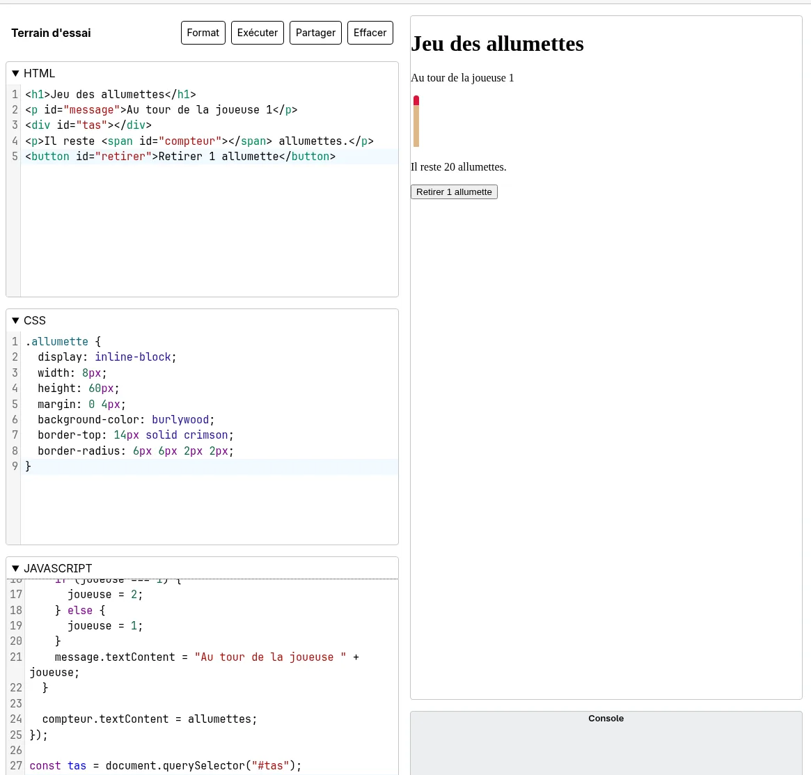

Une allumette apparaît ! `innerHTML` remplace le contenu d'un élément par du HTML, écrit comme un texte. Ici, le texte est entre apostrophes `' '`, parce qu'il contient lui-même des guillemets `" "`.

### Étape 2 : La boucle `for`

Remplacer la ligne `tas.innerHTML = ...` par une boucle :

```js
for (let i = 0; i < allumettes; i++) {
  tas.innerHTML = tas.innerHTML + '<span class="allumette"></span>';
}
```

Les 20 allumettes apparaissent. À chaque tour de boucle, on ajoute une allumette à ce qui est déjà dans le tas.

??? info "Afficher la capture d'écran illustrant l'étape"

    

| Partie | Rôle |
|--------|------|
| `let i = 0` | **Départ** : un compteur `i` commence à 0 |
| `i < allumettes` | **Condition** : on continue tant que `i` est plus petit que le nombre d'allumettes |
| `i++` | **Après chaque tour** : `i` augmente de 1 |

Avec `allumettes = 3`, la boucle se déroule ainsi :

| Tour | `i` | `i < 3` ? | Action |
|------|-----|-----------|--------|
| 1 | 0 | oui | Dessiner une allumette |
| 2 | 1 | oui | Dessiner une allumette |
| 3 | 2 | oui | Dessiner une allumette |
| — | 3 | **non** | Fin de la boucle : 3 allumettes dessinées |

=== "JavaScript"

    ```js
    for (let i = 0; i < allumettes; i++) {
      tas.innerHTML = tas.innerHTML + '<span class="allumette"></span>';
    }
    ```

=== "Schéma"

    ```mermaid
    flowchart TD
        D["i = 0"] --> Q{"i < allumettes ?"}
        Q -->|oui| A["Dessiner une allumette"]
        A --> I["i + 1"]
        I --> Q
        Q -->|non| F(["Fin de la boucle"])
    ```

=== "MakeCode"

    ```blocks
    let imageAllumette: Image = null
    let allumette: Sprite = null
    for (let index = 0; index <= allumettes - 1; index++) {
        allumette = sprites.create(imageAllumette, SpriteKind.Food)
        allumette.setPosition(14 + index * 7, 60)
    }
    ```

!!! note "Deux façons de dire la même chose"

    MakeCode compte « de 0 à `allumettes - 1` », JavaScript « tant que `i < allumettes` ». Dans les deux cas, on fait exactement `allumettes` tours.

### Étape 3 : Le bug de l'allumette en trop

!!! bug "Bug volontaire"

    Dans la boucle, remplacer `<` par `<=` :

    ```js
    for (let i = 0; i <= allumettes; i++) {
    ```

    Compter les allumettes dessinées. Combien y en a-t-il ?

??? success "Explication et correction"

    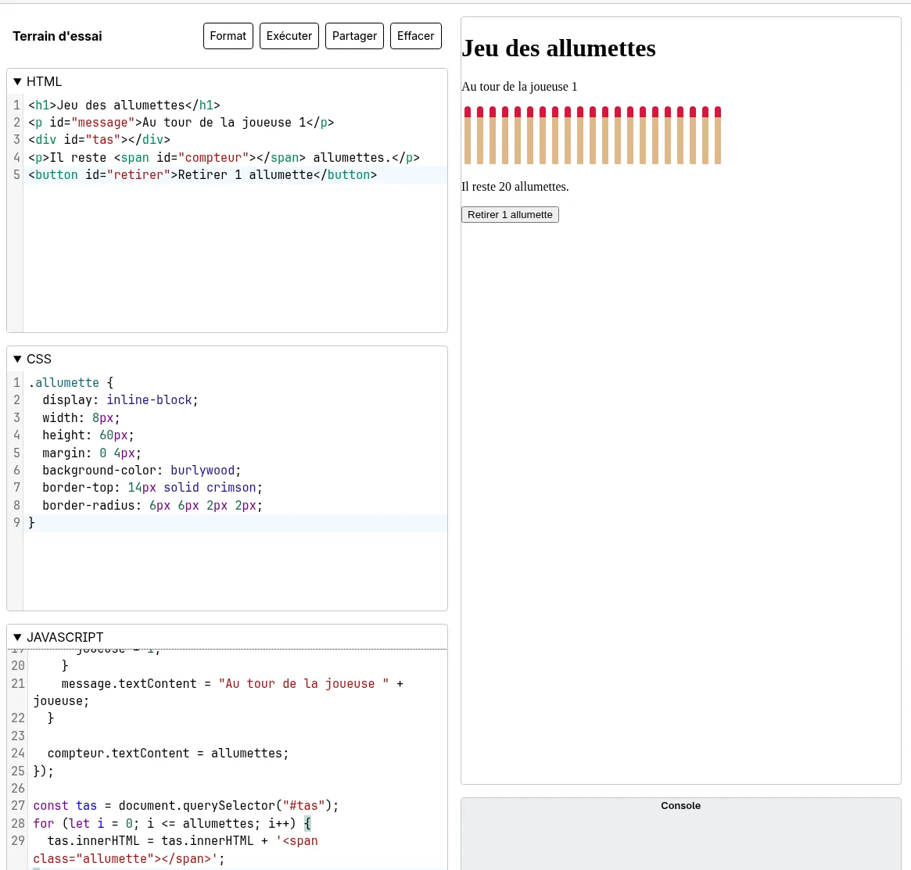

    Il y en a **21** ! Avec `<=`, la boucle fait aussi le tour où `i` vaut 20 : de 0 à 20, cela fait 21 tours.

    **Correction** : remettre `<`.

    **À retenir** : c'est l'*erreur de un*, un grand classique de la programmation. En cas de doute, dérouler la boucle à la main avec un petit nombre, comme dans le tableau de l'étape 2.

!!! warning "Attention à la boucle infinie"

    Sans `i++`, `i` reste à 0 pour toujours : la condition `i < allumettes` est toujours vraie, et la boucle ne s'arrête jamais. L'onglet se fige et le travail peut être perdu. Avant de modifier une boucle : **Partager → Copier le Markdown** !

### Étape 4 : Redessiner après chaque clic

Pour l'instant, le tas ne change pas quand on clique sur le bouton. Il faut le **vider**, puis le **redessiner** avec le nouveau nombre d'allumettes. Dans la fonction du bouton, juste avant `compteur.textContent = allumettes;`, ajouter :

```js
  tas.innerHTML = "";
  for (let i = 0; i < allumettes; i++) {
    tas.innerHTML = tas.innerHTML + '<span class="allumette"></span>';
  }
```

À chaque clic, une allumette disparaît du tas.

??? info "Afficher la capture d'écran illustrant l'étape"

    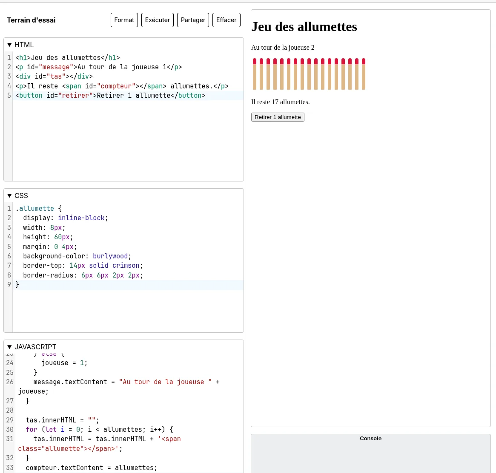

??? info "Pour aller plus loin : écrire la boucle une seule fois"

    La boucle est maintenant écrite deux fois : au démarrage et dans le bouton. Lundi, la même question se posait avec les blocs dupliqués. La réponse est une **fonction** : un morceau de code avec un nom, que l'on peut appeler autant de fois que l'on veut.

    ```js
    function dessiner() {
      tas.innerHTML = "";
      for (let i = 0; i < allumettes; i++) {
        tas.innerHTML = tas.innerHTML + '<span class="allumette"></span>';
      }
      compteur.textContent = allumettes;
    }
    ```

    Ensuite, il suffit d'écrire `dessiner();` au démarrage et dans le bouton. Les fonctions données à `addEventListener` sont d'ailleurs déjà des fonctions, simplement sans nom.

    → Sur MDN : [Fonctions — des blocs de code réutilisables](https://developer.mozilla.org/fr/docs/Learn_web_development/Core/Scripting/Functions){target="_blank"}

??? abstract "Code complet à la fin du chapitre"

    **HTML**

    ```html
    <h1>Jeu des allumettes</h1>
    <p id="message">Au tour de la joueuse 1</p>
    <div id="tas"></div>
    <p>Il reste <span id="compteur"></span> allumettes.</p>
    <button id="retirer">Retirer 1 allumette</button>
    ```

    **CSS**

    ```css
    .allumette {
      display: inline-block;
      width: 8px;
      height: 60px;
      margin: 0 4px;
      background-color: burlywood;
      border-top: 14px solid crimson;
      border-radius: 6px 6px 2px 2px;
    }
    ```

    **JavaScript**

    ```js
    let allumettes = 20;
    let joueuse = 1;
    const compteur = document.querySelector("#compteur");
    const message = document.querySelector("#message");
    const bouton = document.querySelector("#retirer");
    const tas = document.querySelector("#tas");

    compteur.textContent = allumettes;
    for (let i = 0; i < allumettes; i++) {
      tas.innerHTML = tas.innerHTML + '<span class="allumette"></span>';
    }

    bouton.addEventListener("click", function () {
      allumettes = allumettes - 1;

      if (allumettes <= 0) {
        allumettes = 0;
        message.textContent = "La joueuse " + joueuse + " a perdu !";
        bouton.disabled = true;
      } else {
        if (joueuse == 1) {
          joueuse = 2;
        } else {
          joueuse = 1;
        }
        message.textContent = "Au tour de la joueuse " + joueuse;
      }

      tas.innerHTML = "";
      for (let i = 0; i < allumettes; i++) {
        tas.innerHTML = tas.innerHTML + '<span class="allumette"></span>';
      }
      compteur.textContent = allumettes;
    });
    ```

→ Sur MDN : [Les boucles dans le code](https://developer.mozilla.org/fr/docs/Learn_web_development/Core/Scripting/Loops){target="_blank"}

---

## Atelier : l'interface du jeu des allumettes

C'est le moment de tout assembler, **en équipe**, pour créer sa propre version du jeu des allumettes. C'est ce projet que l'équipe envoie avant **16h30** et qui sera publié dans la galerie.

Voici un exemple de résultat, au cours d'une partie complète. Chaque équipe crée **sa** version : les couleurs, les textes et la disposition peuvent être complètement différents.

→ [Voir la version d'exemple en ligne](https://heig-vd-msci-course.github.io/heig-vd-msci-matches-webapp/){target="_blank"}

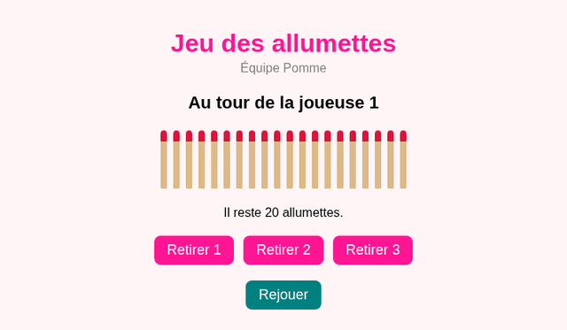

??? info "Afficher les captures d'écran : partie en cours et fin de partie"

    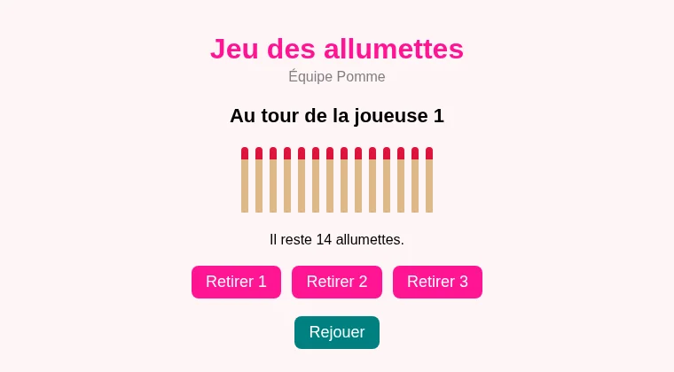

    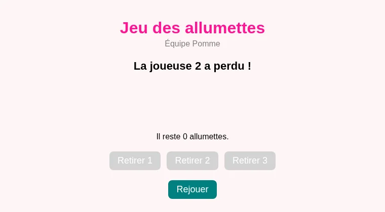

### Organisation

- Une seule page par équipe, dans **un seul** MDN Playground
- Comme lundi dans l'activité « Donner des instructions » : **une personne au clavier**, les autres guident et relisent. Changer de rôle toutes les 15 minutes
- Pour passer le clavier à quelqu'un d'autre : **Partager → Copier le Markdown**, envoyer le code, puis le recoller sur l'autre ordinateur
- Point de départ conseillé : le [code complet du chapitre « Les boucles »](#les-boucles-dessiner-les-allumettes)

### Cahier des charges

Le jeu doit respecter les règles de lundi : 20 allumettes, chaque joueuse retire 1, 2 ou 3 allumettes à son tour, celle qui prend la dernière a perdu.

- [ ] Un titre avec le **nom de l'équipe**
- [ ] Les allumettes restantes sont **dessinées** (boucle)
- [ ] Le **nombre** d'allumettes restantes est affiché
- [ ] **Trois boutons** : retirer 1, 2 ou 3 allumettes (événements)
- [ ] Un message indique **à qui le tour** : joueuse 1 ou joueuse 2 (conditions)
- [ ] En fin de partie, un message indique **qui a perdu**, et les boutons sont **désactivés**
- [ ] Un bouton **Rejouer** remet tout à zéro
- [ ] Un **style personnalisé** : couleurs, polices, mise en page aux couleurs de l'équipe (CSS)

### Indices

Ouvrir un indice seulement en cas de blocage.

??? tip "Indice : les trois boutons"

    Chaque bouton a son propre `id` dans le HTML (`retirer1`, `retirer2`, `retirer3`), sa propre constante dans le JavaScript, et son propre `addEventListener`. Seul le nombre retiré change d'un bouton à l'autre. Voir l'étape 4 du chapitre « Les événements ».

??? tip "Indice : désactiver tous les boutons"

    `bouton.disabled = true;` désactive un bouton, `bouton.disabled = false;` le réactive. En fin de partie, il faut le faire pour les **trois** boutons.

??? tip "Indice : le bouton Rejouer"

    Au clic sur **Rejouer**, il faut remettre les variables à leur valeur de départ (`allumettes = 20;` et `joueuse = 1;`), remettre le message de départ, réactiver les boutons et redessiner les allumettes.

??? tip "Indice : moins de code répété"

    Le même code se répète dans chaque bouton ? C'est le moment d'utiliser des **fonctions** (voir « Pour aller plus loin » dans le chapitre « Les boucles ») : une fonction `dessiner()` pour le tas, et une fonction `retirer(nombre)` pour un coup de la joueuse :

    ```js
    function retirer(nombre) {
      allumettes = allumettes - nombre;
      // ... la condition de fin de partie et le changement de joueuse
      dessiner();
    }

    bouton1.addEventListener("click", function () {
      retirer(1);
    });
    ```

### Personnaliser

- Les couleurs et les polices de l'équipe, un fond, des bordures arrondies
- Un style pour les boutons, et pour les boutons désactivés avec le sélecteur `button:disabled`
- Un effet au survol avec `:hover`
- Des emojis dans les messages 🔥
- Des allumettes d'une autre forme ou d'une autre couleur

### Aller plus loin

- **Empêcher les coups impossibles** : désactiver **Retirer 3** quand il reste moins de 3 allumettes (`bouton3.disabled = allumettes < 3;`)
- **Jouer contre l'ordinateur** : après chaque coup de la joueuse, l'ordinateur joue avec la stratégie gagnante de lundi, `(allumettes - 1) % 4` (et 1 si le résultat vaut 0). Pour qu'il « réfléchisse » une seconde avant de jouer : `setTimeout(tourOrdinateur, 1000);`
- **Un historique** des coups joués, dans une liste `<ul>`

### Avant d'envoyer

- [ ] Jouer **une partie complète** jusqu'au message de fin
- [ ] Tester le bouton **Rejouer**
- [ ] Vérifier que la **console** n'affiche aucune erreur
- [ ] Vérifier le **nom de l'équipe** dans le titre

<!-- LIEN SOLUTION - Décommenter pour activer
!!! tip "Besoin d'aide ?"

    → [Voir la solution complète](../../code-templates/jeu-allumettes-web/solution.md){target="_blank"}
-->

---

## Rendre son projet

Le projet web de chaque équipe est publié en ligne par l'équipe enseignante, dans une galerie avec tous les projets. Seul le **nom de l'équipe** apparaît, jamais les prénoms.

!!! warning "À envoyer au plus tard mardi à 16h30"

    Un seul e-mail par équipe.

### 1. Copier son code

Dans [MDN Playground](https://developer.mozilla.org/fr/play){target="_blank"}, cliquer sur **Partager**, puis **Copier le Markdown**. Tout le code (HTML, CSS et JavaScript) est copié d'un coup.

### 2. Envoyer l'e-mail

Envoyer un e-mail à **[clarisse.fleurimont@heig-vd.ch](mailto:clarisse.fleurimont@heig-vd.ch) et [vincent.guidoux1@heig-vd.ch](mailto:vincent.guidoux1@heig-vd.ch)** (les deux adresses dans le même e-mail), en suivant **exactement** ce modèle. Remplacer `Pomme` par le nom de l'équipe et compléter les lignes, sans changer les mots avant les deux-points.

````text
Objet : [MSCI 2026] Projet web - Équipe Pomme

Équipe : Pomme
Titre du projet : ...
Description (une phrase) : ...
Nous acceptons que le projet soit publié en ligne : oui

Code (Partager → Copier le Markdown, puis coller ici) :
```html
...
```

```css
...
```

```js
...
```
````

À la place des trois blocs `...`, coller simplement ce qui a été copié à l'étape 1 : les trois blocs sont déjà dans le bon format.

### 3. Recevoir le lien

Le projet est publié dans la soirée. L'équipe reçoit son lien par e-mail, et tous les projets sont visibles dans la [galerie des projets MSCI](https://heig-vd-msci-course.github.io/heig-vd-msci-projets/){target="_blank"}.

---

## Synthèse de la journée

### Du bloc au texte

| Concept | Lundi : MakeCode | Mardi : JavaScript |
|---------|------------------|--------------------|
| **Variable** | `définir allumettes à 20` | `let allumettes = 20;` |
| **Événement** | `quand bouton A est appuyé` | `bouton.addEventListener("click", function () { ... });` |
| **Condition** | `si ... alors ... sinon` | `if (...) { ... } else { ... }` |
| **Boucle** | `pour index variant de 0 à ...` | `for (let i = 0; i < ...; i++) { ... }` |

Les idées sont les mêmes : seule l'écriture change. Ce qui a été compris lundi avec les blocs fonctionne aussi avec du texte, et dans n'importe quel langage de programmation.

### Les bugs de la journée

| Langage | Une erreur... | Comment la trouver |
|---------|---------------|--------------------|
| **HTML** | n'affiche aucun message, le navigateur fait de son mieux | Observer la page, relire le code autour |
| **CSS** | est ignorée sans message | **Inspecter** : les déclarations ignorées sont barrées |
| **JavaScript** | s'affiche dans la **console** (sauf les bugs de logique) | Lire le message d'erreur, ajouter des `console.log` |

!!! success "À retenir"

    - HTML = contenu, CSS = apparence, JavaScript = comportement
    - Variables, événements, conditions et boucles : les mêmes concepts en blocs et en texte
    - Un bug n'est pas un échec : c'est une information. Le lire, le comprendre, le corriger

### Quiz

Le quiz de la journée se fait sur **Wooclap**, avec le code donné en classe.

### Pour aller plus loin

| Ressource | Description |
|-----------|-------------|
| [Elevator Saga](https://play.elevatorsaga.com){target="_blank"} | Programmer en JavaScript des ascenseurs qui transportent le plus de personnes possible, niveau après niveau (en anglais) |
| [Apprendre le développement web](https://developer.mozilla.org/fr/docs/Learn_web_development){target="_blank"} | Le parcours complet de MDN, pour continuer à apprendre après la semaine |

---

## Navigation

- [← Mardi matin](matin.md){target="_blank"}
- [← Retour au programme du Mardi](index.md){target="_blank"}
- [Mercredi →](../mercredi/index.md){target="_blank"}
