# Mardi Matin

> *HTML et CSS : créer et personnaliser sa page*

## Le web et MDN Playground

Avant d'écrire sa première page, un petit tour de ce qui se passe quand on ouvre un site, puis la découverte de l'outil de la journée.

### Comment fonctionne le web

Quand on tape une adresse dans le navigateur, celui-ci **demande** la page à un ordinateur distant, le **serveur**, qui la lui **envoie**. Le navigateur assemble ensuite tout ce qu'il a reçu pour afficher la page.

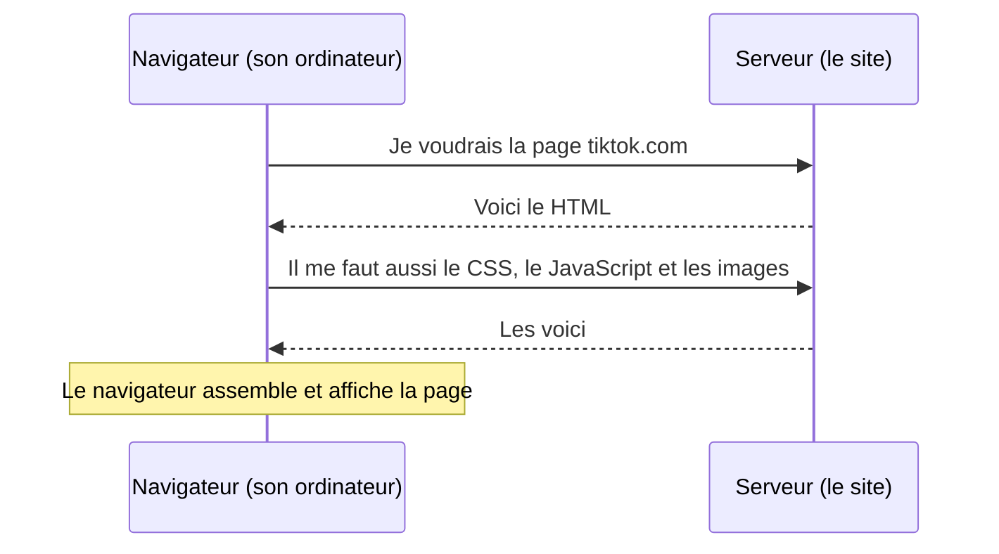

| Mot | Signification |
|-----|---------------|
| **Navigateur** | Le logiciel qui affiche les pages : Firefox, Chrome, Safari, Edge... |
| **Serveur** | Un ordinateur, quelque part, qui stocke le site et l'envoie à qui le demande |
| **URL** | L'adresse d'une page, par exemple `https://developer.mozilla.org/fr/` |

→ Sur MDN : [Comment fonctionne le Web](https://developer.mozilla.org/fr/docs/Learn_web_development/Getting_started/Web_standards/How_the_web_works){target="_blank"}

### Trois langages, trois rôles

Toutes les pages web, de TikTok à Spotify, reposent sur les trois mêmes langages :

| Langage | Rôle | Comme pour une tenue... |
|---------|------|------------------------|
| **HTML** | Le **contenu** : titres, textes, images, boutons | Les vêtements que l'on porte |
| **CSS** | L'**apparence** : couleurs, polices, disposition | Le style : couleurs, coupe, accessoires |
| **JavaScript** | Le **comportement** : réagir aux clics, calculer, animer | Les mouvements : marcher, danser, poser |

Ce matin : HTML et CSS. Cet après-midi : JavaScript.

### Expérience : modifier une vraie page

Le navigateur contient des **outils de développement** qui montrent le HTML et le CSS de n'importe quelle page, et permettent même de les modifier.

1. Ouvrir un site connu dans un nouvel onglet (un site d'actualité, de musique, de mode...)
2. Faire un **clic droit** sur un titre, puis **Inspecter** : un panneau s'ouvre avec le code HTML, l'élément choisi est surligné
3. **Double-cliquer** sur le texte du titre dans le panneau, le remplacer par autre chose, puis appuyer sur ++enter++
4. Observer la page : le titre a changé !
5. Recharger la page (++f5++)

??? success "Que s'est-il passé ?"

    La modification n'a eu lieu que **dans son propre navigateur**, sur la copie de la page reçue du serveur. Le vrai site n'a pas changé, et personne d'autre ne voit la modification. En rechargeant la page, le navigateur redemande l'original au serveur : tout revient comme avant.

    **À retenir** : une capture d'écran d'un site peut être modifiée de cette façon en quelques secondes. Une capture d'écran n'est pas une preuve : mieux vaut vérifier à la source.

→ Sur MDN : [Que sont les outils de développement du navigateur ?](https://developer.mozilla.org/fr/docs/Learn_web_development/Howto/Tools_and_setup/What_are_browser_developer_tools){target="_blank"}

### Découvrir MDN Playground

Pour écrire ses propres pages, la journée se déroule dans **[MDN Playground](https://developer.mozilla.org/fr/play){target="_blank"}** : un éditeur en ligne, gratuit, sans compte et sans rien à installer, proposé par Mozilla (l'organisation qui développe Firefox).


| Bouton | Action |
|--------|--------|
| **Format** | Remet le code en forme (indentation, retours à la ligne) |
| **Exécuter** | Met à jour l'aperçu |
| **Partager** | Copie le code pour le garder ou l'envoyer (voir plus bas) |
| **Effacer** | Vide **tout** : HTML, CSS et JavaScript. À utiliser avec précaution ! |

!!! info "MDN, la référence du web"

    MDN Playground fait partie de **MDN Web Docs**, la documentation de référence du web, écrite par Mozilla et une grande communauté. Elle est gratuite, en français et utilisée par les développeuses et développeurs du monde entier. Tout au long de la journée, les liens « → Sur MDN » mènent vers ses pages pour aller plus loin.

    Point de départ : [Apprendre le développement web](https://developer.mozilla.org/fr/docs/Learn_web_development){target="_blank"}

### Premier essai : les trois langages ensemble

Copier chaque bloc dans la bonne zone de MDN Playground, puis cliquer sur le bouton qui apparaît dans l'aperçu.

=== "HTML"

    ```html
    <h1>Bonjour !</h1>
    <button id="bouton">Cliquer ici</button>
    ```

=== "CSS"

    ```css
    h1 {
      color: teal;
    }

    button {
      font-size: 20px;
    }
    ```

=== "JavaScript"

    ```js
    document.querySelector("#bouton").addEventListener("click", () => {
      document.querySelector("h1").textContent = "Bienvenue en MSCI !";
      console.log("Le bouton a été cliqué");
    });
    ```

En cliquant sur le bouton, le titre change, et un message apparaît dans la **console**. Pas besoin de comprendre le JavaScript pour l'instant : c'est le programme de l'après-midi.

??? info "Afficher la capture d'écran illustrant l'étape"

    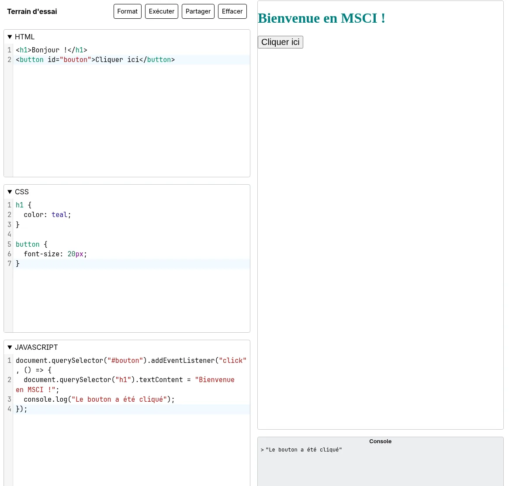

!!! question "Petit défi"

    Sans rien connaître encore, essayer de deviner quoi modifier pour :

    - changer la couleur du titre ;
    - changer le texte du bouton ;
    - changer le message qui s'affiche après le clic.

### Garder son travail

MDN Playground ne garde pas le code pour toujours. Avant de fermer l'onglet, et à la fin de chaque chapitre :

1. Cliquer sur **Partager**
2. Cliquer sur **Copier le Markdown** : le HTML, le CSS et le JavaScript sont copiés d'un coup
3. Coller le tout dans un fichier texte ou un e-mail à soi-même

Pour reprendre plus tard, il suffit de recoller chaque bloc dans la bonne zone.

!!! success "À retenir"

    - Le navigateur demande les pages à un serveur, puis les affiche
    - HTML = contenu, CSS = apparence, JavaScript = comportement
    - **Inspecter** montre le code de n'importe quelle page
    - Dans MDN Playground : penser à **Partager → Copier le Markdown** pour garder son travail

---

## Rappel HTML : sa page personnelle

Le **HTML** décrit le *contenu* d'une page web : des titres, des paragraphes, des listes, des liens, des images. Dans ce tutoriel, chaque personne crée **sa page personnelle** en partant d'une page qui fonctionne déjà, puis en la modifiant étape par étape.

Au passage, quelques erreurs sont glissées **exprès** : c'est en cassant une page qu'on comprend comment elle fonctionne, et comment la réparer.

!!! info "Le tutoriel de référence"

    Ce chapitre suit la logique du tutoriel [Créer le contenu](https://developer.mozilla.org/fr/docs/Learn_web_development/Getting_started/Your_first_website/Creating_the_content){target="_blank"} de MDN, la documentation de référence du web, écrite par Mozilla et sa communauté. Chaque étape renvoie vers la page MDN correspondante pour aller plus loin.

### Étape 1 : Une page qui fonctionne

1. Ouvrir [MDN Playground](https://developer.mozilla.org/fr/play){target="_blank"}
2. Copier le code ci-dessous et le coller dans la zone **HTML**
3. Observer le résultat à droite (cliquer sur **Exécuter** s'il ne s'affiche pas)

```html
<h1>Salut, moi c'est Alex !</h1>
<p>J'ai 17 ans et j'adore la <strong>musique</strong>.</p>

<h2>Ce que j'aime</h2>
<ul>
  <li>Le rap</li>
  <li>Les séries</li>
</ul>
```

??? info "Afficher la capture d'écran illustrant l'étape"

    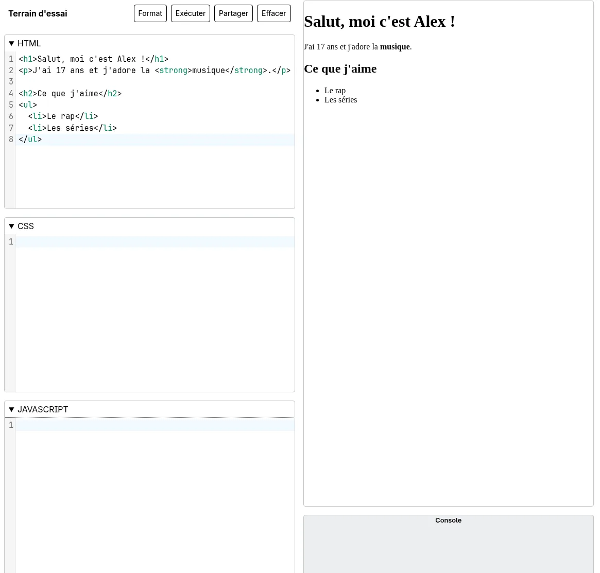

Chaque morceau de la page est un **élément**, construit de la même façon :

```text
<p>J'ai 17 ans</p>
 │      │       │
 │      │       └── balise fermante (avec une barre /)
 │      └── contenu
 └── balise ouvrante
```

| Balise | Rôle |
|--------|------|
| `<h1>` | Titre principal de la page (un seul par page) |
| `<h2>` | Sous-titre |
| `<p>` | Paragraphe |
| `<strong>` | Texte important (affiché en gras) |
| `<ul>` et `<li>` | Liste à puces (`ul`) et chacun de ses éléments (`li`) |

Les éléments s'emboîtent les uns dans les autres, comme des poupées russes : la page forme un **arbre**.

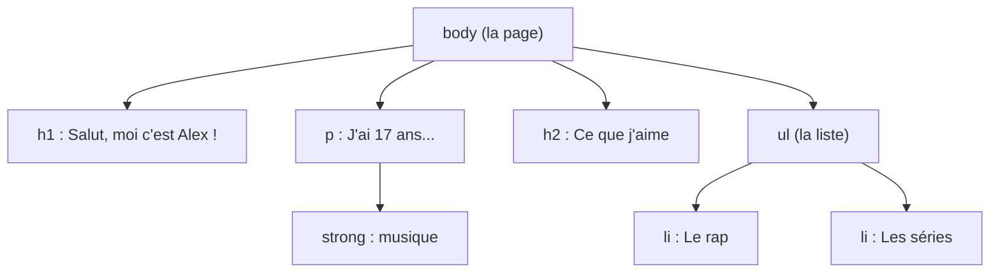

!!! note "Et le reste de la page ?"

    Une vraie page HTML contient aussi `<!doctype html>`, `<html>`, `<head>` et `<body>`. MDN Playground les ajoute tout seul : la zone HTML correspond au contenu de `<body>`.

→ Sur MDN : [Syntaxe de base du HTML](https://developer.mozilla.org/fr/docs/Learn_web_development/Core/Structuring_content/Basic_HTML_syntax){target="_blank"}

### Étape 2 : En faire sa page

Modifier le code pour qu'il parle de soi :

1. Remplacer `Alex` par son prénom ou un pseudo
2. Remplacer l'âge et la passion
3. Ajouter **au moins deux** éléments `<li>` dans la liste : musique, artistes, séries, jeux, mode...

??? info "Afficher la capture d'écran illustrant l'étape"

    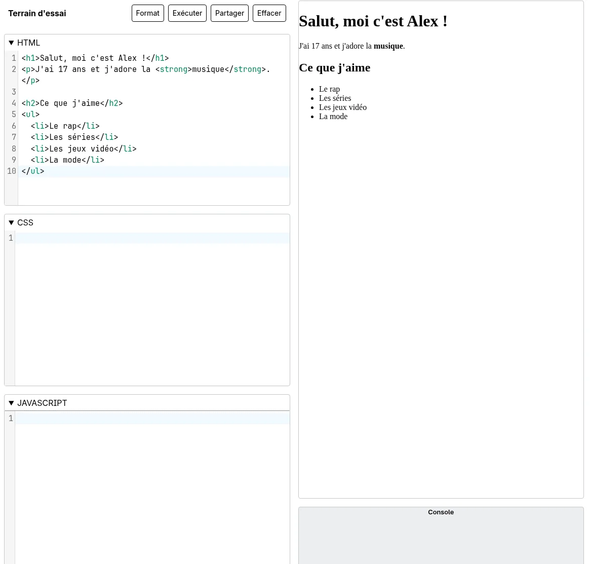

!!! tip "Astuce de MDN Playground"

    En tapant `<li>`, l'éditeur ajoute tout seul la balise fermante `</li>`. Il suffit d'écrire le texte entre les deux, sans retaper `</li>` : sinon, la balise fermante apparaît en double.

→ Sur MDN : [Titres et paragraphes](https://developer.mozilla.org/fr/docs/Learn_web_development/Core/Structuring_content/Headings_and_paragraphs){target="_blank"} · [Listes](https://developer.mozilla.org/fr/docs/Learn_web_development/Core/Structuring_content/Lists){target="_blank"}

### Étape 3 : Le bug de la balise oubliée

!!! bug "Bug volontaire"

    Dans le paragraphe, **supprimer** la balise fermante `</strong>` :

    ```html
    <p>J'ai 17 ans et j'adore la <strong>musique.</p>
    ```

    Observer la page. Que s'est-il passé ? Pourquoi ?

??? success "Explication et correction"

    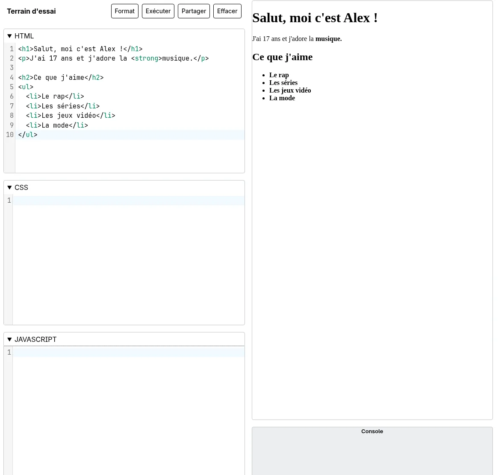

    Toute la suite de la page est passée **en gras**, jusqu'à la liste. Sans balise fermante, le navigateur ne sait pas où s'arrête le texte important : il continue jusqu'à la fin.

    **Correction** : remettre `</strong>` juste après le mot concerné.

    **À retenir** : le HTML n'affiche **jamais** de message d'erreur. Le navigateur fait de son mieux et affiche quelque chose, même avec une erreur. Pour trouver un bug en HTML, il faut donc **observer** la page et relire le code autour de l'endroit qui s'affiche mal.

??? abstract "Code complet à la fin de l'étape 3"

    ```html
    <h1>Salut, moi c'est Alex !</h1>
    <p>J'ai 17 ans et j'adore la <strong>musique</strong>.</p>

    <h2>Ce que j'aime</h2>
    <ul>
      <li>Le rap</li>
      <li>Les séries</li>
      <li>Les jeux vidéo</li>
      <li>La mode</li>
    </ul>
    ```

### Étape 4 : Ajouter un lien

Un lien utilise la balise `<a>` et un **attribut** `href`, qui indique l'adresse vers laquelle aller. Un attribut s'écrit dans la balise ouvrante : `nom="valeur"`.

Ajouter ce paragraphe à la fin de la page, avec un vrai lien vers une chanson, une vidéo ou un site aimé :

```html
<p>Ma chanson du moment : <a href="https://www.youtube.com" target="_blank">le titre de la chanson</a></p>
```

| Attribut | Rôle |
|----------|------|
| `href` | L'adresse du lien |
| `target="_blank"` | Ouvrir le lien dans un nouvel onglet |

??? info "Afficher la capture d'écran illustrant l'étape"

    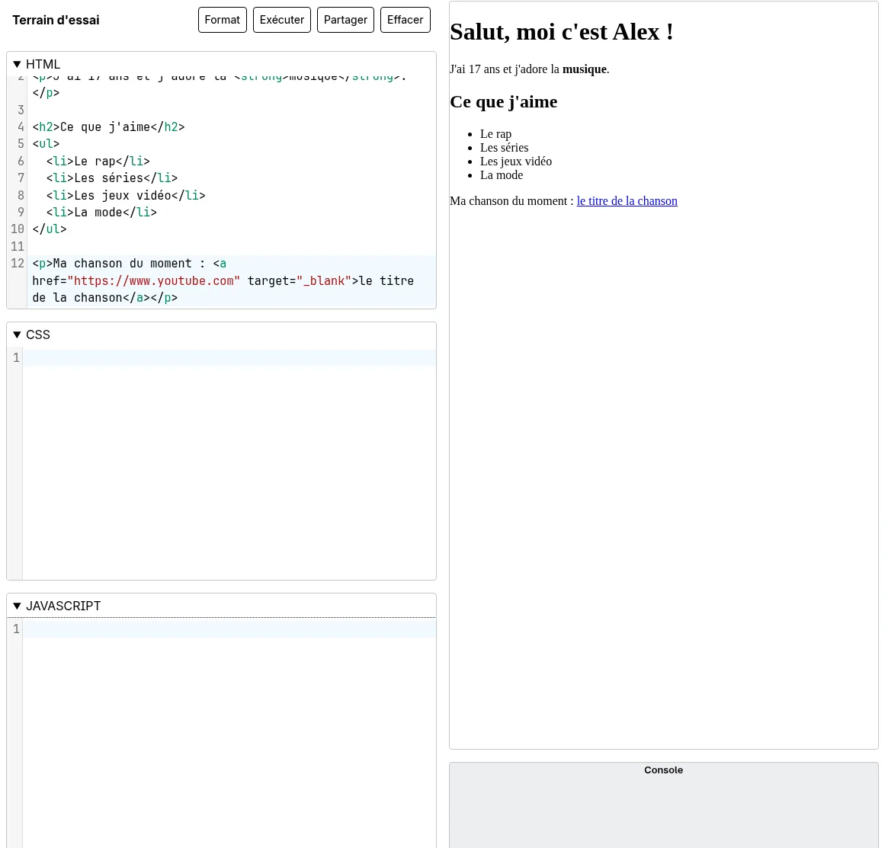

!!! bug "Bug volontaire"

    Dans la balise `<a>`, écrire `herf` au lieu de `href` :

    ```html
    <a herf="https://www.youtube.com" target="_blank">le titre de la chanson</a>
    ```

    Que devient le lien ?

??? success "Explication et correction"

    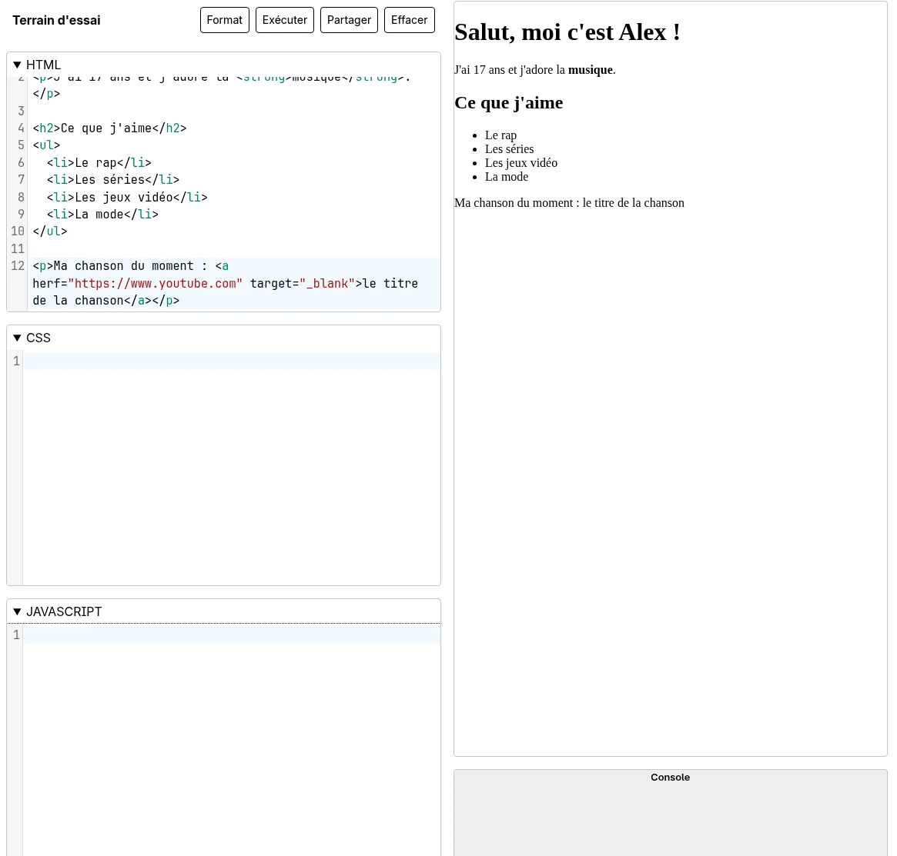

    Le texte n'est plus bleu ni souligné, et on ne peut plus cliquer dessus. Le navigateur ne connaît pas d'attribut `herf` : il l'ignore sans rien dire. L'élément `<a>` n'a donc plus d'adresse, et ce n'est plus un lien.

    **Correction** : écrire `href` (pour *hypertext reference*).

    **À retenir** : une seule lettre inversée suffit à casser une page. L'ordinateur exécute *exactement* ce qui est écrit, comme dans l'activité « Donner des instructions » du lundi.

→ Sur MDN : [Créer des liens](https://developer.mozilla.org/fr/docs/Learn_web_development/Core/Structuring_content/Creating_links){target="_blank"}

### Étape 5 : Ajouter une image

Ajouter cette image juste sous le titre `<h1>` :

```html

```

| Attribut | Rôle |
|----------|------|
| `src` | L'adresse de l'image (ici, un site qui donne une photo au hasard) |
| `alt` | Un texte qui décrit l'image |

??? info "Afficher la capture d'écran illustrant l'étape"

    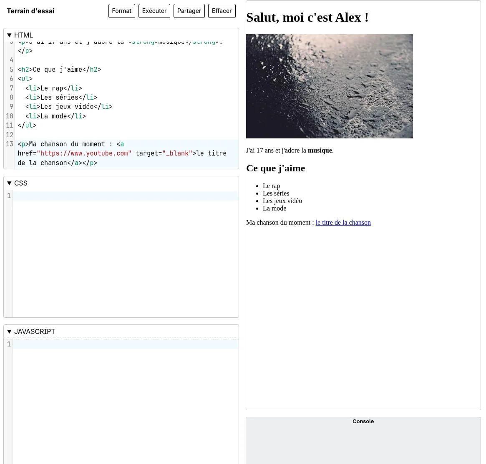

!!! note "Une balise sans fermeture"

    `` n'a **pas** de balise fermante : l'élément n'a pas de contenu, tout est dans ses attributs. On parle d'élément *vide*.

!!! bug "Bug volontaire"

    Retirer le `s` de `photos` dans l'adresse :

    ```html
    
    ```

    Qu'affiche maintenant la page à la place de l'image ?

??? success "Explication et correction"

    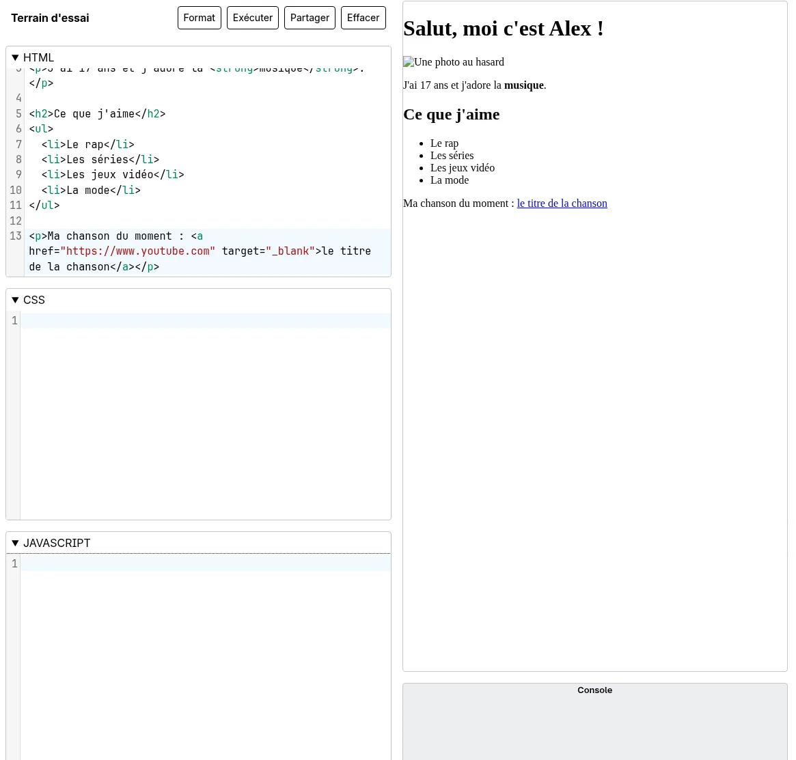

    Le navigateur ne trouve pas l'image à cette adresse : il affiche une **icône d'image cassée** et, à côté, le texte de l'attribut `alt`.

    C'est tout le rôle de `alt` : décrire l'image quand elle ne s'affiche pas, et surtout pour les personnes aveugles ou malvoyantes, dont le lecteur d'écran lit ce texte à voix haute. Une image sans `alt` est invisible pour elles.

    **Correction** : remettre `photos`. Pour utiliser sa propre image, remplacer l'adresse par celle d'une image trouvée en ligne (clic droit sur l'image → *Copier l'adresse de l'image*).

→ Sur MDN : [Les images en HTML](https://developer.mozilla.org/fr/docs/Learn_web_development/Core/Structuring_content/HTML_images){target="_blank"}

??? abstract "Code complet à la fin de l'étape 5"

    ```html
    <h1>Salut, moi c'est Alex !</h1>
    
    <p>J'ai 17 ans et j'adore la <strong>musique</strong>.</p>

    <h2>Ce que j'aime</h2>
    <ul>
      <li>Le rap</li>
      <li>Les séries</li>
      <li>Les jeux vidéo</li>
      <li>La mode</li>
    </ul>

    <p>Ma chanson du moment : <a href="https://www.youtube.com" target="_blank">le titre de la chanson</a></p>
    ```

### Étape 6 : À vous de jouer

Compléter sa page librement. Quelques idées :

- Une section `<h2>Mes projets</h2>` avec ce que l'on aimerait créer
- Une liste numérotée `<ol>` de son top 3 (chansons, films, jeux...)
- Un mot important avec `<em>` (mis en avant, en italique)
- Une deuxième image, avec un vrai texte `alt`

!!! tip "Chercher sur MDN avant d'utiliser une nouvelle balise"

    `<ol>` et `<em>` n'ont pas encore été utilisées dans ce tutoriel. Avant de les écrire, chercher sur internet **« MDN ol »** (ou **« MDN em »**), puis lire l'exemple de la page MDN : à quoi sert la balise, et comment l'écrire.

    Chercher soi-même dans la documentation est un réflexe à prendre dès maintenant : c'est ce que font au quotidien toutes les personnes qui programment.

??? success "Vérifier : comment s'écrit une liste numérotée ?"

    Exactement comme la liste à puces de l'étape 1 : **une seule** balise `<ol>` autour de la liste, et une balise `<li>` pour chaque élément.

    ```html
    <ol>
      <li>Une chanson</li>
      <li>Un film</li>
      <li>Un jeu</li>
    </ol>
    ```

    Écrire une balise `<ol>` par élément, sans `<li>`, ne crée pas de liste : aucun numéro ne s'affiche, le texte est seulement décalé vers la droite.

!!! question "Défi : chasse au bug"

    Échanger d'ordinateur avec sa voisine : chacune glisse **une** erreur dans la page de l'autre (une balise fermante oubliée, une faute dans un attribut...), puis on se rend les ordinateurs. Qui trouve et corrige le bug le plus vite ?

→ Sur MDN : [Déboguer le HTML](https://developer.mozilla.org/fr/docs/Learn_web_development/Core/Structuring_content/Debugging_HTML){target="_blank"}

### Récapitulatif

| Élément | Exemple | Rôle |
|---------|---------|------|
| Titres | `<h1>`, `<h2>` | Structurer la page |
| Paragraphe | `<p>` | Un bloc de texte |
| Mise en avant | `<strong>`, `<em>` | Texte important, texte accentué |
| Listes | `<ul>`, `<ol>`, `<li>` | Listes à puces, numérotées |
| Lien | `<a href="...">` | Aller vers une autre page |
| Image | `` | Afficher une image (élément vide) |

!!! success "À retenir"

    - Un élément = balise ouvrante + contenu + balise fermante
    - Les attributs (`href`, `src`, `alt`...) donnent des informations en plus
    - Le HTML n'affiche pas d'erreur : un bug se repère en **observant** la page

!!! tip "Garder son travail"

    Avant de fermer l'onglet : **Partager → Copier le Markdown**, puis coller le code dans un fichier ou un e-mail à soi-même.

---

## Rappel CSS : mettre en forme sa page

Le **CSS** décrit l'*apparence* d'une page : les couleurs, les polices, les espacements, les bordures. Le HTML dit *ce qu'il y a* sur la page, le CSS dit *à quoi ça ressemble*.

Ce tutoriel reprend la page personnelle du chapitre précédent et lui donne un style. Comme pour le HTML, quelques erreurs sont glissées **exprès**.

!!! info "Le tutoriel de référence"

    Ce chapitre suit la logique du tutoriel [Mettre en forme le contenu](https://developer.mozilla.org/fr/docs/Learn_web_development/Getting_started/Your_first_website/Styling_the_content){target="_blank"} de MDN. Chaque étape renvoie vers la page MDN correspondante pour aller plus loin.

### Étape 1 : Une première règle

1. Garder sa page personnelle dans la zone **HTML** de MDN Playground (sinon, coller le [code complet de la fin du chapitre HTML](#etape-5-ajouter-une-image))
2. Copier le code ci-dessous et le coller dans la zone **CSS**
3. Observer le résultat

```css
body {
  font-family: sans-serif;
  background-color: lavender;
}

h1 {
  color: deeppink;
}
```

??? info "Afficher la capture d'écran illustrant l'étape"

    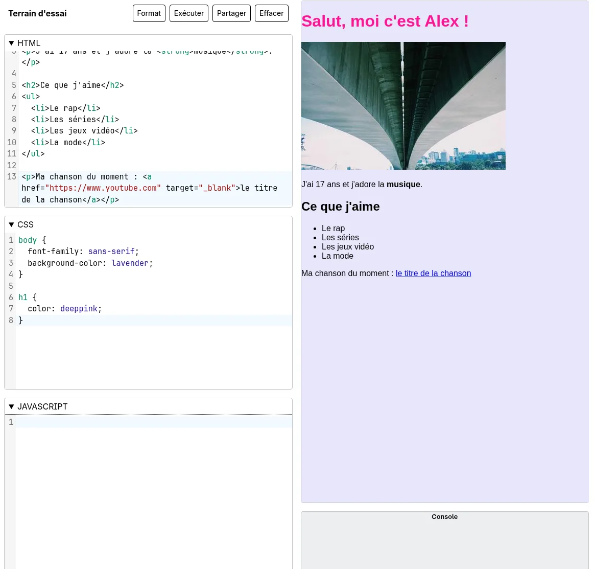

Chaque morceau de CSS est une **règle**, construite de la même façon :

```text
h1 {  color: deeppink;  }
│     │      │       │
│     │      │       └── point-virgule : fin de la déclaration
│     │      └── valeur
│     └── propriété
└── sélecteur : les éléments HTML concernés
```

| Terme | Rôle | Exemple |
|-------|------|---------|
| **Sélecteur** | Quels éléments modifier | `h1`, `body` |
| **Propriété** | Quoi modifier | `color`, `background-color`, `font-family` |
| **Valeur** | Comment le modifier | `deeppink`, `lavender`, `sans-serif` |
| **Déclaration** | Une propriété et sa valeur, terminée par `;` | `color: deeppink;` |

→ Sur MDN : [Qu'est-ce que le CSS ?](https://developer.mozilla.org/fr/docs/Learn_web_development/Core/Styling_basics/What_is_CSS){target="_blank"} · [Premiers pas en CSS](https://developer.mozilla.org/fr/docs/Learn_web_development/Core/Styling_basics/Getting_started){target="_blank"}

### Étape 2 : Ses couleurs, sa police

Modifier le style pour qu'il corresponde à sa personnalité :

1. Changer les couleurs de `body` et de `h1`. Il existe [140 noms de couleurs](https://developer.mozilla.org/fr/docs/Web/CSS/named-color){target="_blank"} (`tomato`, `teal`, `gold`, `midnightblue`...) ou des codes comme `#ff6b6b`
2. Ajouter une déclaration dans la règle `h1` pour écrire le titre en majuscules :

    ```css
    h1 {
      color: deeppink;
      text-transform: uppercase;
    }
    ```

3. Essayer d'autres polices pour `body` : `serif`, `monospace`, `cursive`, `system-ui`...

??? info "Afficher la capture d'écran illustrant l'étape"

    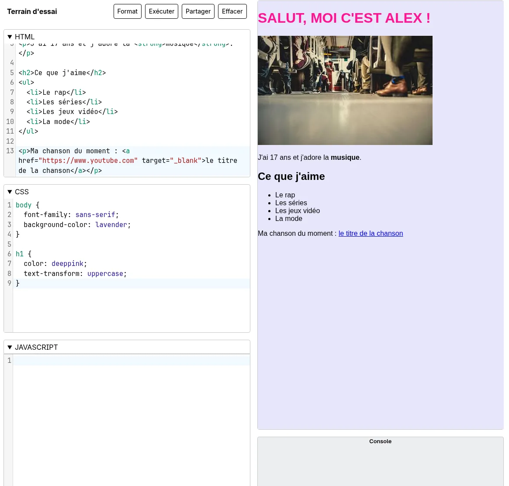

→ Sur MDN : [Valeurs et unités](https://developer.mozilla.org/fr/docs/Learn_web_development/Core/Styling_basics/Values_and_units){target="_blank"}

### Étape 3 : Le bug du point-virgule

!!! bug "Bug volontaire"

    Dans la règle `h1`, **supprimer** le point-virgule après `deeppink` :

    ```css
    h1 {
      color: deeppink
      text-transform: uppercase;
    }
    ```

    Observer le titre. Que s'est-il passé ? Pourquoi les **deux** déclarations ne fonctionnent-elles plus ?

??? success "Explication et correction"

    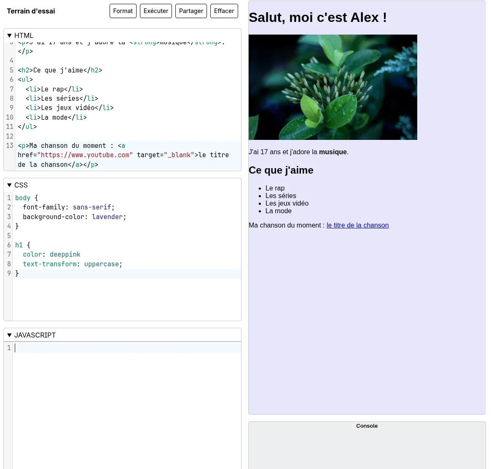

    Le titre perd sa couleur **et** ses majuscules. Sans point-virgule, le navigateur ne voit pas où s'arrête la première déclaration : il lit `color: deeppink text-transform: uppercase`, une couleur qui n'existe pas. Il ignore donc toute la déclaration, sans rien dire.

    **Correction** : remettre le `;` à la fin de chaque déclaration.

    **À retenir** : comme le HTML, le CSS n'affiche pas de message d'erreur. Une déclaration incorrecte est simplement ignorée, et la page s'affiche sans ce style.

??? abstract "Code CSS complet à la fin de l'étape 3"

    ```css
    body {
      font-family: sans-serif;
      background-color: lavender;
    }

    h1 {
      color: deeppink;
      text-transform: uppercase;
    }
    ```

### Étape 4 : Cibler un élément précis

Un sélecteur comme `li` modifie **tous** les éléments `<li>`. Pour n'en modifier qu'un seul, on lui donne une **classe** dans le HTML, puis on la cible en CSS avec un **point** devant son nom.

1. Dans la zone **HTML**, ajouter une classe à son élément de liste préféré :

    ```html
    <li class="coup-de-coeur">Les séries</li>
    ```

2. Dans la zone **CSS**, ajouter ces deux règles :

    ```css
    li {
      color: midnightblue;
    }

    .coup-de-coeur {
      background-color: gold;
      font-weight: bold;
    }
    ```

Les deux règles ne visent pas les mêmes éléments de l'arbre :

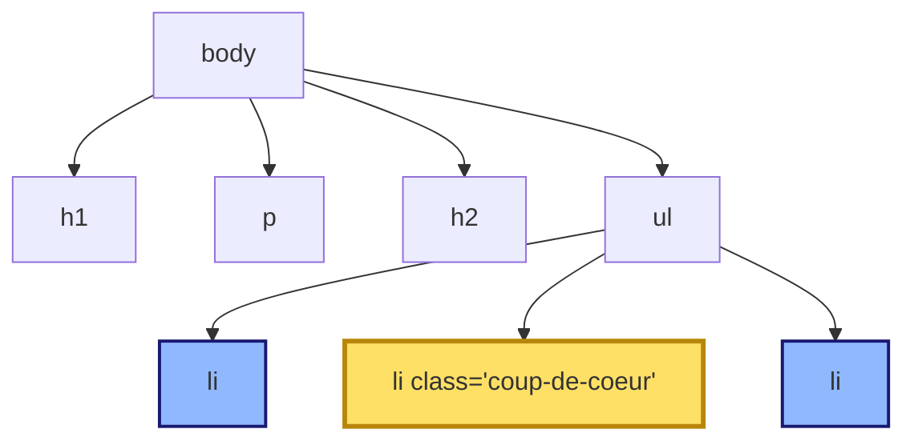

*En bleu : les éléments visés par `li`. En jaune : celui visé par `li` **et** `.coup-de-coeur`.*

??? info "Afficher la capture d'écran illustrant l'étape"

    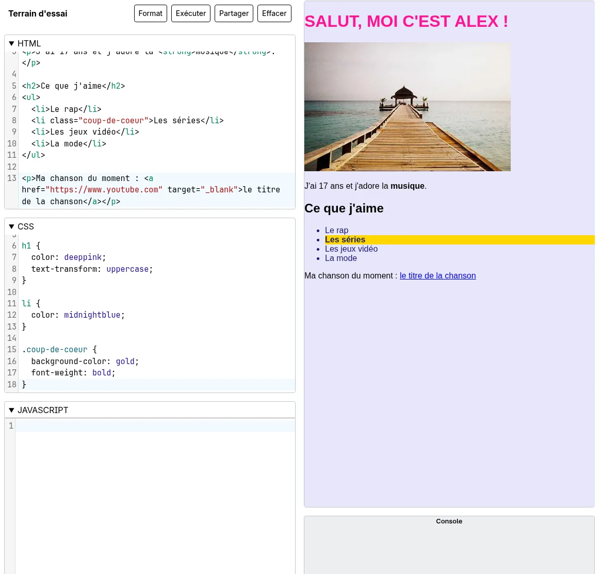

!!! bug "Bug volontaire"

    Dans le CSS, **retirer le point** devant le nom de la classe :

    ```css
    coup-de-coeur {
      background-color: gold;
      font-weight: bold;
    }
    ```

    Que devient l'élément préféré ?

??? success "Explication et correction"

    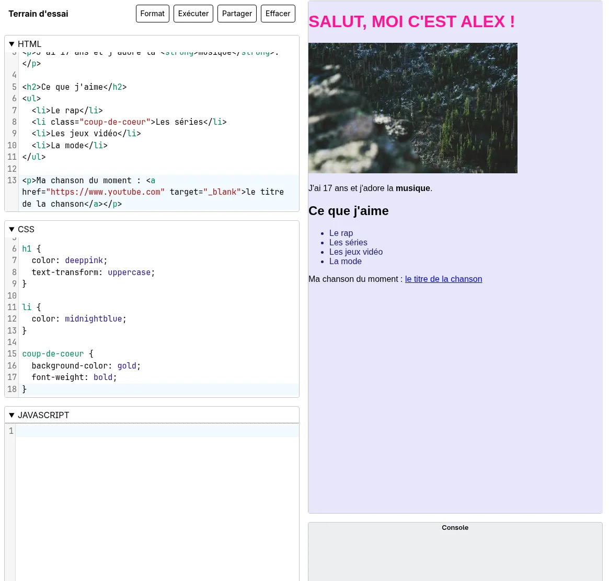

    Il redevient comme les autres : plus de fond doré, plus de gras. Sans le point, le navigateur cherche des éléments HTML qui s'appellent `<coup-de-coeur>`. Il n'y en a aucun, donc la règle ne s'applique à rien.

    **Correction** : remettre le point, `.coup-de-coeur`.

    **À retenir** : `li` vise un type d'élément, `.coup-de-coeur` vise une classe. Le point fait toute la différence.

→ Sur MDN : [Sélecteurs de base](https://developer.mozilla.org/fr/docs/Learn_web_development/Core/Styling_basics/Basic_selectors){target="_blank"}

### Étape 5 : Des boîtes et des espaces

En CSS, chaque élément est une **boîte**. Autour du contenu, on peut régler trois couches :

```text
┌──────────────── margin (marge extérieure) ───────────────┐
│  ┌───────────── border (bordure) ─────────────────────┐  │
│  │  ┌────────── padding (marge intérieure) ────────┐  │  │
│  │  │                                              │  │  │
│  │  │                  contenu                     │  │  │
│  │  │                                              │  │  │
│  │  └──────────────────────────────────────────────┘  │  │
│  └────────────────────────────────────────────────────┘  │
└──────────────────────────────────────────────────────────┘
```

Ajouter ces règles pour arrondir l'image et centrer la page :

```css
img {
  border-radius: 20px;
  border: 4px solid white;
}

body {
  max-width: 600px;
  margin: 0 auto;
  padding: 16px;
}
```

!!! note "Deux règles pour `body`"

    La règle `body` existe déjà depuis l'étape 1. On peut soit ajouter ces déclarations dans la règle existante, soit écrire une deuxième règle : le navigateur combine les deux.

| Déclaration | Effet |
|-------------|-------|
| `border-radius: 20px;` | Arrondit les coins |
| `border: 4px solid white;` | Bordure de 4 pixels, pleine, blanche |
| `max-width: 600px;` | La page ne dépasse pas 600 pixels de large |
| `margin: 0 auto;` | Marges automatiques à gauche et à droite : la page est centrée |
| `padding: 16px;` | De l'espace entre le bord de la page et le contenu |

??? info "Afficher la capture d'écran illustrant l'étape"

    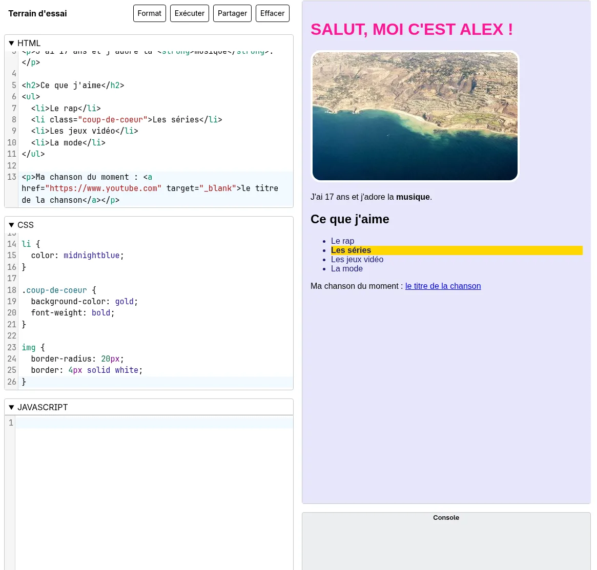

!!! bug "Bug volontaire"

    Dans la règle `img`, **retirer l'unité** `px` :

    ```css
    img {
      border-radius: 20;
      border: 4px solid white;
    }
    ```

    Que deviennent les coins de l'image ?

??? success "Explication et correction"

    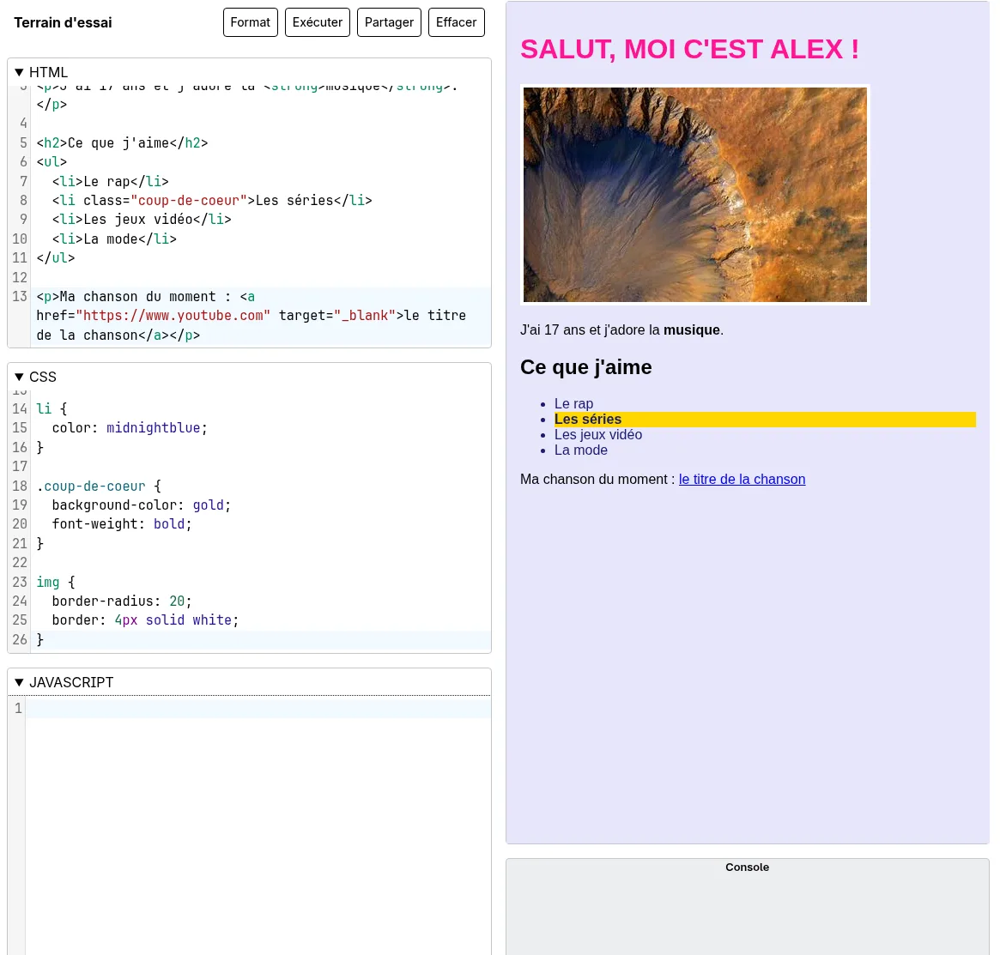

    Les coins redeviennent carrés. `20` tout seul ne veut rien dire : 20 pixels ? 20 % ? Le navigateur ne devine pas et ignore la déclaration.

    **Correction** : écrire `20px`. Seul `0` peut s'écrire sans unité, puisque zéro pixel ou zéro pour cent, c'est pareil.

→ Sur MDN : [Le modèle de boîte](https://developer.mozilla.org/fr/docs/Learn_web_development/Core/Styling_basics/Box_model){target="_blank"}

??? abstract "Code complet à la fin de l'étape 5"

    **HTML**

    ```html
    <h1>Salut, moi c'est Alex !</h1>
    
    <p>J'ai 17 ans et j'adore la <strong>musique</strong>.</p>

    <h2>Ce que j'aime</h2>
    <ul>
      <li>Le rap</li>
      <li class="coup-de-coeur">Les séries</li>
      <li>Les jeux vidéo</li>
      <li>La mode</li>
    </ul>

    <p>Ma chanson du moment : <a href="https://www.youtube.com" target="_blank">le titre de la chanson</a></p>
    ```

    **CSS**

    ```css
    body {
      font-family: sans-serif;
      background-color: lavender;
      max-width: 600px;
      margin: 0 auto;
      padding: 16px;
    }

    h1 {
      color: deeppink;
      text-transform: uppercase;
    }

    li {
      color: midnightblue;
    }

    .coup-de-coeur {
      background-color: gold;
      font-weight: bold;
    }

    img {
      border-radius: 20px;
      border: 4px solid white;
    }
    ```

### Étape 6 : À vous de jouer

Donner à sa page un style qui lui ressemble. Quelques idées :

- Un thème sombre : fond `#1e1e2e`, texte `white`
- Un trait sous les sous-titres : `h2 { border-bottom: 3px solid deeppink; }`
- Une couleur pour le lien : `a { color: teal; }`
- Un effet au survol de la souris, avec la *pseudo-classe* `:hover` :

    ```css
    li:hover {
      color: deeppink;
    }
    ```

!!! tip "Trouver un bug CSS avec les outils du navigateur"

    Contrairement au HTML, le navigateur peut **montrer** les erreurs CSS. Faire un clic droit sur l'élément mal affiché dans l'aperçu, puis **Inspecter** : dans le panneau *Styles*, les déclarations ignorées sont **barrées**, avec une petite icône d'avertissement.

→ Sur MDN : [Pseudo-classes et pseudo-éléments](https://developer.mozilla.org/fr/docs/Learn_web_development/Core/Styling_basics/Pseudo_classes_and_elements){target="_blank"} · [Déboguer le CSS](https://developer.mozilla.org/fr/docs/Learn_web_development/Core/Styling_basics/Debugging_CSS){target="_blank"}

### Récapitulatif

| Notion | Exemple | Rôle |
|--------|---------|------|
| Règle | `h1 { color: deeppink; }` | Un sélecteur et ses déclarations |
| Sélecteur d'élément | `li` | Vise tous les éléments `<li>` |
| Sélecteur de classe | `.coup-de-coeur` | Vise les éléments avec `class="coup-de-coeur"` |
| Couleurs | `color`, `background-color` | Couleur du texte, du fond |
| Texte | `font-family`, `font-weight`, `text-transform` | Police, gras, majuscules |
| Boîte | `padding`, `border`, `margin` | Espaces et bordure autour d'un élément |

!!! success "À retenir"

    - Une règle = un sélecteur + des déclarations `propriété: valeur;` entre accolades
    - Le point `.` vise une classe, sans point on vise un type d'élément
    - Une déclaration incorrecte (point-virgule ou unité oubliés) est ignorée sans message : les outils du navigateur (**Inspecter**) aident à la trouver

!!! tip "Garder son travail"

    Avant de fermer l'onglet : **Partager → Copier le Markdown**, puis coller le code dans un fichier ou un e-mail à soi-même.

---

## Mise en page : Flexbox et Grid

Jusqu'ici, les éléments de la page s'empilent les uns sous les autres. Pour les placer **côte à côte**, en colonnes ou en grille, le CSS propose deux outils de mise en page :

| Outil | Principe | Idéal pour |
|-------|----------|------------|
| **Flexbox** | Ranger des éléments sur **une ligne** (ou une colonne) et partager la place entre eux | Une rangée de cartes, une barre de menu, des boutons |
| **Grid** | Dessiner une **grille** de lignes et de colonnes, puis y placer les éléments | Une galerie d'images, la mise en page complète d'un site |

Ce chapitre reprend la page personnelle : Flexbox pour disposer ses sections en cartes, Grid pour créer une galerie d'images. Comme dans les chapitres précédents, quelques erreurs sont glissées **exprès**.

!!! info "Le tutoriel de référence"

    Ce chapitre suit la logique des pages [Boîtes flexibles](https://developer.mozilla.org/fr/docs/Learn_web_development/Core/CSS_layout/Flexbox){target="_blank"} et [Grilles](https://developer.mozilla.org/fr/docs/Learn_web_development/Core/CSS_layout/Grids){target="_blank"} du module [La mise en page avec CSS](https://developer.mozilla.org/fr/docs/Learn_web_development/Core/CSS_layout){target="_blank"} de MDN.

### Étape 1 : Regrouper ses sections en cartes

1. Dans la zone **HTML**, remplacer la section *Ce que j'aime* (le `<h2>` et sa liste) par ce code, puis adapter le contenu des cartes à ses goûts :

    ```html
    <div class="cartes">
      <div class="carte">
        <h2>Ce que j'aime</h2>
        <ul>
          <li>Le rap</li>
          <li class="coup-de-coeur">Les séries</li>
          <li>Les jeux vidéo</li>
          <li>La mode</li>
        </ul>
      </div>
      <div class="carte">
        <h2>Mon top 3</h2>
        <ol>
          <li>Une chanson</li>
          <li>Un film</li>
          <li>Un jeu</li>
        </ol>
      </div>
      <div class="carte">
        <h2>Mes projets</h2>
        <p>Créer mon propre site.</p>
      </div>
    </div>
    ```

2. Dans la zone **CSS**, ajouter le style d'une carte :

    ```css
    .carte {
      background-color: white;
      padding: 16px;
      border-radius: 12px;
    }
    ```

!!! note "`<div>`, une boîte pour regrouper"

    `<div>` n'a aucun effet visuel : c'est une boîte qui sert à **regrouper** des éléments, pour pouvoir les mettre en forme ensemble. Ici, chaque `<div class="carte">` regroupe un titre et son contenu, et le `<div class="cartes">` regroupe les trois cartes.

Les trois cartes blanches s'affichent... les unes sous les autres. C'est le **flux normal** de la page : par défaut, chaque bloc (`<h1>`, `<p>`, `<div>`...) prend toute la largeur disponible et se place sous le précédent.

### Étape 2 : Des cartes côte à côte

Dans la zone **CSS**, ajouter cette règle :

```css
.cartes {
  display: flex;
}
```

Les trois cartes se placent sur une même ligne, et elles ont toutes la **même hauteur**. Elles se touchent encore et n'ont pas la même largeur : chacune prend la place de son contenu. L'étape 4 s'en occupe.

| Terme | Signification |
|-------|---------------|
| **Conteneur flexible** | L'élément qui reçoit `display: flex` : ici, `.cartes` |
| **Éléments flexibles** | Ses enfants **directs** : ici, les trois `.carte` |
| **Axe principal** | La direction dans laquelle les éléments sont rangés : de gauche à droite, par défaut |

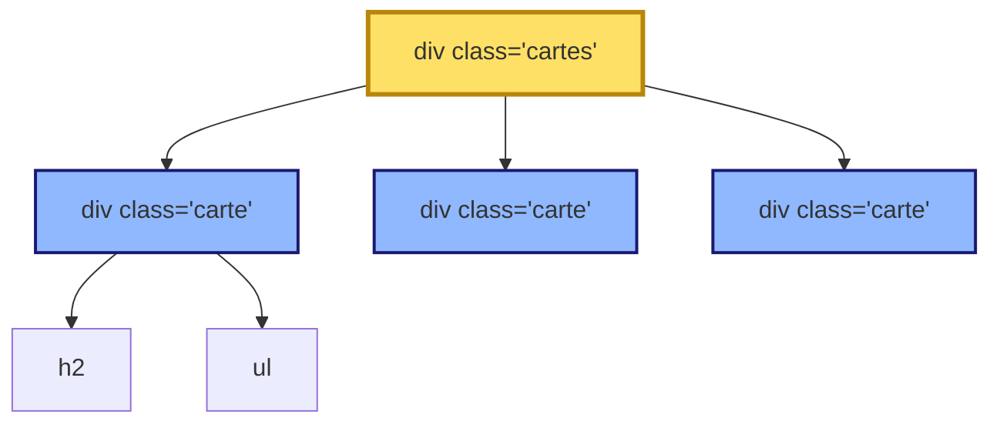

*En jaune : le conteneur flexible. En bleu : les éléments flexibles, rangés côte à côte. Le `h2` et la liste, à l'intérieur d'une carte, ne sont pas concernés.*

### Étape 3 : Le bug du mauvais conteneur

!!! bug "Bug volontaire"

    **Déplacer** la déclaration `display: flex;` de la règle `.cartes` vers la règle `.carte` :

    ```css
    .cartes {
    }

    .carte {
      display: flex;
      background-color: white;
      padding: 16px;
      border-radius: 12px;
    }
    ```

    Que deviennent les cartes ? Et l'intérieur de chaque carte ?

??? success "Explication et correction"

    Les cartes s'empilent de nouveau, mais à l'intérieur de chacune, le titre et la liste se retrouvent **côte à côte**.

    `display: flex` agit sur les **enfants directs** de l'élément qui le reçoit. Placé sur `.carte`, il range les enfants d'une carte, c'est-à-dire son `<h2>` et sa liste, et non les cartes elles-mêmes.

    **Correction** : remettre `display: flex;` dans la règle `.cartes`.

    **À retenir** : `display: flex` se place sur le **parent** des éléments à ranger. Pour savoir où l'écrire, se demander : *quel élément contient ceux que l'on veut placer côte à côte ?*

### Étape 4 : Partager la place

Compléter les deux règles :

```css
.cartes {
  display: flex;
  gap: 16px;
}

.carte {
  flex: 1;
  background-color: white;
  padding: 16px;
  border-radius: 12px;
}
```

Les cartes ont maintenant la même largeur, avec un espace entre elles.

| Déclaration | Où | Effet |
|-------------|----|-------|
| `gap: 16px;` | Sur le conteneur | De l'espace entre les éléments flexibles |
| `flex: 1;` | Sur les éléments | Chaque carte reçoit **une part** égale de la place disponible |

!!! question "À essayer"

    - Donner une deuxième classe à une carte, `<div class="carte large">` (un élément peut avoir plusieurs classes, séparées par une espace), puis ajouter la règle `.large { flex: 2; }` : cette carte reçoit deux parts de la place au lieu d'une
    - Ajouter `flex-direction: column;` dans `.cartes` : l'axe principal devient vertical, et les cartes s'empilent de nouveau
    - Ajouter `align-items: flex-start;` dans `.cartes` : les cartes ne s'étirent plus et gardent la hauteur de leur contenu

    Retirer ensuite ces essais pour la suite du chapitre.

→ Sur MDN : [Boîtes flexibles](https://developer.mozilla.org/fr/docs/Learn_web_development/Core/CSS_layout/Flexbox){target="_blank"}

### Étape 5 : Une galerie en grille

Un *mood board* est une planche d'images qui donne l'ambiance d'un projet : il est très utilisé en mode, en design et en création de contenu. C'est un bon terrain pour **Grid**.

1. Dans la zone **HTML**, ajouter ce code juste sous les cartes :

    ```html
    <h2>Mon mood board</h2>
    <div class="galerie">
      
      
      
      
      
      
    </div>
    ```

2. Dans la zone **CSS**, ajouter ces deux règles :

    ```css
    .galerie {
      display: grid;
      grid-template-columns: 1fr 1fr 1fr;
      gap: 8px;
    }

    .galerie img {
      width: 100%;
      border: none;
    }
    ```

Les six images se rangent en deux lignes de trois.

| Déclaration | Effet |
|-------------|-------|
| `display: grid;` | Fait de `.galerie` un **conteneur de grille** : ses enfants directs se rangent dans les cases |
| `grid-template-columns: 1fr 1fr 1fr;` | Dessine **trois colonnes**. L'unité `fr` (pour *fraction*) donne à chaque colonne une part de la place disponible |
| `gap: 8px;` | De l'espace entre les cases, comme avec Flexbox |

```text
        1fr          1fr          1fr
   ┌───────────┬───────────┬───────────┐
   │  image 1  │  image 2  │  image 3  │
   ├───────────┼───────────┼───────────┤
   │  image 4  │  image 5  │  image 6  │
   └───────────┴───────────┴───────────┘
```

Seules les colonnes sont définies : la grille crée toute seule autant de lignes que nécessaire.

!!! note "Un sélecteur dans un autre"

    `.galerie img` vise les images qui se trouvent **à l'intérieur** de `.galerie`, et seulement elles. `width: 100%` adapte chaque image à la largeur de sa case.

    `border: none` retire la bordure blanche donnée à toutes les images au chapitre CSS : sans cela, la bordure s'ajouterait à la largeur de l'image, qui déborderait de sa case. La règle `.galerie img` étant plus précise que la règle `img`, c'est elle qui l'emporte.

!!! question "À essayer"

    Remplacer les colonnes par `grid-template-columns: 2fr 1fr 1fr;` : la première colonne reçoit deux parts, elle est deux fois plus large que les autres.

### Étape 6 : Le bug des trois colonnes

!!! bug "Bug volontaire"

    Pour obtenir trois colonnes, écrire **une seule** valeur :

    ```css
    .galerie {
      display: grid;
      grid-template-columns: 3fr;
      gap: 8px;
    }
    ```

    Combien de colonnes la galerie a-t-elle maintenant ?

??? success "Explication et correction"

    Une seule : les images s'affichent les unes sous les autres, en très grand.

    Chaque valeur écrite après `grid-template-columns` crée **une** colonne. `3fr` est donc une seule colonne, qui reçoit trois parts... de toute la place, puisqu'elle est seule. Aucun message d'erreur : la déclaration est valide, mais elle ne fait pas ce qui était voulu.

    **Correction** : une valeur par colonne, `1fr 1fr 1fr`. Le raccourci `repeat(3, 1fr)` fait la même chose : *répéter trois fois `1fr`*.

    **À retenir** : le **nombre de valeurs** donne le nombre de colonnes, l'unité `fr` donne leur largeur les unes par rapport aux autres.

### Étape 7 : Une image vedette

1. Dans la zone **HTML**, donner une classe à la première image de la galerie :

    ```html
    
    ```

2. Dans la zone **CSS**, ajouter :

    ```css
    .vedette {
      grid-column: span 2;
      grid-row: span 2;
    }
    ```

L'image vedette occupe maintenant **deux colonnes et deux lignes**. Les autres images se rangent automatiquement dans les cases restantes :

```text
   ┌───────────────────────┬───────────┐
   │                       │  image 2  │
   │        vedette        ├───────────┤
   │                       │  image 3  │
   ├───────────┬───────────┼───────────┤
   │  image 4  │  image 5  │  image 6  │
   └───────────┴───────────┴───────────┘
```

!!! bug "Bug volontaire"

    Pour une vedette encore plus grande, lui demander **quatre** colonnes :

    ```css
    .vedette {
      grid-column: span 4;
      grid-row: span 2;
    }
    ```

    Que devient la galerie ?

??? success "Explication et correction"

    La galerie est complètement désorganisée : la vedette prend toute la largeur, et les autres images deviennent minuscules ou se retrouvent dispersées.

    La vedette demande quatre colonnes, alors que la grille n'en compte que trois. Le navigateur ajoute une quatrième colonne pour lui faire de la place, mais cette colonne n'a pas de largeur prévue : toute la grille est recalculée.

    **Correction** : revenir à `span 2`. Un élément ne doit jamais demander plus de colonnes que la grille n'en compte.

!!! tip "Voir la grille avec les outils du navigateur"

    Faire un clic droit sur la galerie, puis **Inspecter** : dans le panneau HTML, un petit badge `grid` apparaît à côté de `<div class="galerie">`. Un clic sur ce badge dessine les lignes et les colonnes de la grille par-dessus la page. Le badge `flex` fait de même pour `.cartes`. C'est le moyen le plus rapide de comprendre une mise en page qui ne se comporte pas comme prévu.

→ Sur MDN : [Grilles](https://developer.mozilla.org/fr/docs/Learn_web_development/Core/CSS_layout/Grids){target="_blank"}

??? abstract "Code complet à la fin du chapitre"

    **HTML**

    ```html
    <h1>Salut, moi c'est Alex !</h1>
    
    <p>J'ai 17 ans et j'adore la <strong>musique</strong>.</p>

    <div class="cartes">
      <div class="carte">
        <h2>Ce que j'aime</h2>
        <ul>
          <li>Le rap</li>
          <li class="coup-de-coeur">Les séries</li>
          <li>Les jeux vidéo</li>
          <li>La mode</li>
        </ul>
      </div>
      <div class="carte">
        <h2>Mon top 3</h2>
        <ol>
          <li>Une chanson</li>
          <li>Un film</li>
          <li>Un jeu</li>
        </ol>
      </div>
      <div class="carte">
        <h2>Mes projets</h2>
        <p>Créer mon propre site.</p>
      </div>
    </div>

    <h2>Mon mood board</h2>
    <div class="galerie">
      
      
      
      
      
      
    </div>

    <p>Ma chanson du moment : <a href="https://www.youtube.com" target="_blank">le titre de la chanson</a></p>
    ```

    **CSS**

    ```css
    body {
      font-family: sans-serif;
      background-color: lavender;
      max-width: 600px;
      margin: 0 auto;
      padding: 16px;
    }

    h1 {
      color: deeppink;
      text-transform: uppercase;
    }

    li {
      color: midnightblue;
    }

    .coup-de-coeur {
      background-color: gold;
      font-weight: bold;
    }

    img {
      border-radius: 20px;
      border: 4px solid white;
    }

    .cartes {
      display: flex;
      gap: 16px;
    }

    .carte {
      flex: 1;
      background-color: white;
      padding: 16px;
      border-radius: 12px;
    }

    .galerie {
      display: grid;
      grid-template-columns: repeat(3, 1fr);
      gap: 8px;
    }

    .galerie img {
      width: 100%;
      border: none;
    }

    .vedette {
      grid-column: span 2;
      grid-row: span 2;
    }
    ```

### Récapitulatif

| Notion | Exemple | Rôle |
|--------|---------|------|
| Conteneur flexible | `display: flex;` | Range ses enfants directs côte à côte |
| Partage de la place | `flex: 1;` | Donne à un élément flexible une part de la place disponible |
| Direction | `flex-direction: column;` | Change l'axe principal : de haut en bas au lieu de gauche à droite |
| Conteneur de grille | `display: grid;` | Range ses enfants directs dans les cases d'une grille |
| Colonnes | `grid-template-columns: repeat(3, 1fr);` | Une valeur par colonne, `fr` pour partager la place |
| Espacement | `gap: 16px;` | De l'espace entre les éléments, avec Flexbox comme avec Grid |
| Étendre un élément | `grid-column: span 2;` | Un élément occupe plusieurs colonnes (ou lignes avec `grid-row`) |

!!! success "À retenir"

    - Flexbox range sur **un axe**, Grid sur **deux axes** (lignes et colonnes)
    - `display: flex` et `display: grid` se placent sur le **parent** : ils agissent sur ses enfants directs
    - Une erreur de mise en page ne produit aucun message : **Inspecter** et les badges `flex` / `grid` montrent ce que fait vraiment le navigateur

### Pour aller plus loin

Trois jeux en ligne, gratuits et sans compte, permettent de s'exercer sur les notions de ce chapitre et d'aller au-delà :

| Jeu | Notion travaillée |
|-----|-------------------|
| [Flexbox Froggy](https://flexboxfroggy.com/#fr){target="_blank"} | Placer des grenouilles sur leurs nénuphars avec **Flexbox** : `justify-content`, `align-items`, `flex-direction`... (en français) |
| [CSS Grid Garden](https://cssgridgarden.com/#fr){target="_blank"} | Arroser un potager avec **Grid** : placer des éléments sur des lignes et des colonnes précises (en français) |
| [CSS Diner](https://flukeout.github.io){target="_blank"} | Choisir les bons plats sur la table avec des **sélecteurs** de plus en plus précis (en anglais) |

!!! tip "Garder son travail"

    Avant de fermer l'onglet : **Partager → Copier le Markdown**, puis coller le code dans un fichier ou un e-mail à soi-même.

---

## Atelier : personnaliser sa page

C'est le moment de faire de sa page personnelle **sa** page : ses goûts, son univers, son style. L'atelier propose trois niveaux de défis. Chaque personne avance à son rythme : le niveau 1 est la base, les niveaux 2 et 3 sont là pour aller plus loin.

!!! info "Avant de commencer"

    - Repartir de sa page de la fin du chapitre Mise en page (sinon, coller le code complet à la fin du chapitre [Mise en page : Flexbox et Grid](#mise-en-page-flexbox-et-grid))
    - Cette page reste personnelle : elle n'est **pas** publiée. Même ainsi, garder la bonne habitude de ne jamais mettre d'informations sensibles sur une page web (adresse, numéro de téléphone...)
    - Penser régulièrement à **Partager → Copier le Markdown** pour garder son travail

### Choisir son univers

Avant de coder, prendre deux minutes pour choisir :

- **Un thème** : sa musique, ses séries, son sport, la mode, un jeu, un voyage rêvé...
- **Deux ou trois couleurs** qui vont bien ensemble : une pour le fond, une pour les titres, une pour les éléments mis en avant
- **Une ambiance** : sobre, colorée, sombre, rétro...

!!! tip "Lisible avant tout"

    Le texte doit rester facile à lire : un texte clair sur un fond clair, ou foncé sur un fond foncé, se lit mal, surtout pour les personnes malvoyantes. On parle de **contraste**.

    → Sur MDN : [Contraste des couleurs](https://developer.mozilla.org/fr/docs/Web/Accessibility/Guides/Understanding_WCAG/Perceivable/Color_contrast){target="_blank"}

### Niveau 1 : la base

- [ ] Au moins **trois sections**, chacune avec son titre `<h2>` (par exemple : *Ce que j'aime*, *Mon top 3*, *Mes projets*)
- [ ] Au moins **une liste** (`<ul>` ou `<ol>`)
- [ ] Au moins **une image**, avec un vrai texte `alt` qui la décrit
- [ ] Au moins **un lien** vers une chanson, une vidéo ou un site aimé
- [ ] Ses **propres couleurs** et sa **police** pour la page et les titres
- [ ] Au moins **une classe** CSS pour mettre en avant un élément

### Niveau 2 : soigner les détails

- [ ] La page est **centrée**, avec des espaces confortables (`max-width`, `margin`, `padding`)
- [ ] Une **mise en page** à soi : des cartes avec Flexbox, une galerie avec Grid, avec ses propres contenus et ses propres images
- [ ] Les sous-titres ont un **style** à eux : un trait dessous, une couleur, des majuscules...
- [ ] Un effet au **survol** de la souris avec `:hover`
- [ ] Les **liens** ont une couleur assortie au thème

??? tip "Exemple : des sous-titres soulignés et un survol"

    ```css
    h2 {
      color: teal;
      border-bottom: 3px solid gold;
      padding-bottom: 4px;
    }

    li:hover {
      color: deeppink;
    }

    a {
      color: teal;
      font-weight: bold;
    }
    ```

→ Sur MDN : [Fondamentaux du texte et des polices](https://developer.mozilla.org/fr/docs/Learn_web_development/Core/Text_styling/Fundamentals){target="_blank"}

### Niveau 3 : les défis

Pour les personnes qui veulent aller plus loin. Chaque défi introduit une notion nouvelle : la lire sur MDN, essayer, casser, réparer !

??? example "Défi : des cartes qui passent à la ligne"

    Sur un écran étroit, comme celui d'un téléphone, trois cartes côte à côte deviennent trop serrées. `flex-wrap` permet de les faire passer à la ligne :

    ```css
    .cartes {
      display: flex;
      flex-wrap: wrap;
      gap: 16px;
    }

    .carte {
      flex: 1 1 200px;
    }
    ```

    `flex: 1 1 200px` signifie : *chaque carte mesure au moins 200 pixels et partage le reste de la place*. Quand il n'y a plus assez de place pour une carte de 200 pixels, elle passe à la ligne suivante. Pour tester, élargir ou rétrécir l'aperçu de MDN Playground.

    → Sur MDN : [Boîtes flexibles, l'enveloppement](https://developer.mozilla.org/fr/docs/Learn_web_development/Core/CSS_layout/Flexbox){target="_blank"}

??? example "Défi : une galerie qui s'adapte"

    Au lieu de fixer trois colonnes, laisser la grille choisir combien de colonnes tiennent dans la largeur :

    ```css
    .galerie {
      display: grid;
      grid-template-columns: repeat(auto-fill, minmax(150px, 1fr));
      gap: 8px;
    }
    ```

    `minmax(150px, 1fr)` : chaque colonne mesure au moins 150 pixels, et au plus une part de la place. `auto-fill` : la grille crée autant de colonnes qu'il en tient. Rétrécir l'aperçu pour voir le nombre de colonnes changer.

    → Sur MDN : [Grilles](https://developer.mozilla.org/fr/docs/Learn_web_development/Core/CSS_layout/Grids){target="_blank"}

??? example "Défi : une image qui bouge au survol"

    ```css
    img {
      transition: transform 0.3s;
    }

    img:hover {
      transform: scale(1.05) rotate(-2deg);
    }
    ```

    `transform` agrandit (`scale`) et tourne (`rotate`) l'image, `transition` rend le changement progressif au lieu d'instantané.

    → Sur MDN : [Utiliser les transitions CSS](https://developer.mozilla.org/fr/docs/Web/CSS/Guides/Transitions/Using){target="_blank"} · [transform](https://developer.mozilla.org/fr/docs/Web/CSS/transform){target="_blank"}

??? example "Défi : un thème sombre"

    Inverser les couleurs : un fond foncé (`#1e1e2e`, `midnightblue`...) et un texte clair (`white`, `#f5f5f5`). Attention au contraste des liens et des éléments mis en avant !

??? example "Défi : une chasse au bug CSS"

    Comme au chapitre HTML : échanger d'ordinateur avec sa voisine, glisser **une** erreur CSS dans sa page (un point-virgule, un point devant une classe, une unité oubliée...), puis se rendre les ordinateurs. Utiliser **Inspecter** pour trouver le bug plus vite !

### Montrer sa page

En fin d'atelier, deux ou trois personnes volontaires présentent leur page au projecteur : leur univers, leur style, et le bug qui leur a donné le plus de fil à retordre.

!!! success "Et cet après-midi ?"

    Le même HTML et le même CSS serviront à construire l'interface du **jeu des allumettes**. Il ne manquera plus qu'une chose : le **JavaScript**, pour que la page réagisse aux clics.

---

## Navigation

- [← Retour au programme du Mardi](index.md){target="_blank"}
- [Mardi après-midi →](apres-midi.md){target="_blank"}
