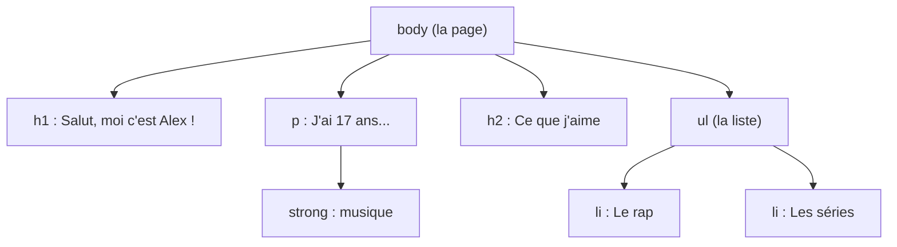

# Mardi Matin

> *HTML et CSS : créer et personnaliser sa page*

!!! warning "Page en construction"

    Seul le chapitre « Rappel HTML » est prêt. Les autres chapitres du matin arrivent bientôt.

---

## Le web et MDN Playground

*À venir.*

---

## Rappel HTML : sa page personnelle

Le **HTML** décrit le *contenu* d'une page web : des titres, des paragraphes, des listes, des liens, des images. Dans ce tutoriel, chaque personne crée **sa page personnelle** en partant d'une page qui fonctionne déjà, puis en la modifiant étape par étape.

Au passage, quelques erreurs sont glissées **exprès** : c'est en cassant une page qu'on comprend comment elle fonctionne, et comment la réparer.

!!! info "Le tutoriel de référence"

    Ce chapitre suit la logique du tutoriel [Créer le contenu](https://developer.mozilla.org/fr/docs/Learn_web_development/Getting_started/Your_first_website/Creating_the_content){target="_blank"} de MDN, la documentation de référence du web, écrite par Mozilla et sa communauté. Chaque étape renvoie vers la page MDN correspondante pour aller plus loin.

### Étape 1 : Une page qui fonctionne

1. Ouvrir [MDN Playground](https://developer.mozilla.org/fr/play){target="_blank"}
2. Copier le code ci-dessous et le coller dans la zone **HTML**
3. Observer le résultat à droite (cliquer sur **Exécuter** s'il ne s'affiche pas)

```html
<h1>Salut, moi c'est Alex !</h1>
<p>J'ai 17 ans et j'adore la <strong>musique</strong>.</p>

<h2>Ce que j'aime</h2>
<ul>
  <li>Le rap</li>
  <li>Les séries</li>
</ul>
```

Chaque morceau de la page est un **élément**, construit de la même façon :

```text
<p>J'ai 17 ans</p>
 │      │       │
 │      │       └── balise fermante (avec une barre /)
 │      └── contenu
 └── balise ouvrante
```

| Balise | Rôle |
|--------|------|
| `<h1>` | Titre principal de la page (un seul par page) |
| `<h2>` | Sous-titre |
| `<p>` | Paragraphe |
| `<strong>` | Texte important (affiché en gras) |
| `<ul>` et `<li>` | Liste à puces (`ul`) et chacun de ses éléments (`li`) |

Les éléments s'emboîtent les uns dans les autres, comme des poupées russes : la page forme un **arbre**.



!!! note "Et le reste de la page ?"

    Une vraie page HTML contient aussi `<!doctype html>`, `<html>`, `<head>` et `<body>`. MDN Playground les ajoute tout seul : la zone HTML correspond au contenu de `<body>`.

→ Sur MDN : [Syntaxe de base du HTML](https://developer.mozilla.org/fr/docs/Learn_web_development/Core/Structuring_content/Basic_HTML_syntax){target="_blank"}

### Étape 2 : En faire sa page

Modifier le code pour qu'il parle de soi :

1. Remplacer `Alex` par son prénom ou un pseudo
2. Remplacer l'âge et la passion
3. Ajouter **au moins deux** éléments `<li>` dans la liste : musique, artistes, séries, jeux, mode...

!!! tip "Astuce de MDN Playground"

    En tapant `<li>`, l'éditeur ajoute tout seul la balise fermante `</li>`. Il suffit d'écrire le texte entre les deux, sans retaper `</li>` : sinon, la balise fermante apparaît en double.

→ Sur MDN : [Titres et paragraphes](https://developer.mozilla.org/fr/docs/Learn_web_development/Core/Structuring_content/Headings_and_paragraphs){target="_blank"} · [Listes](https://developer.mozilla.org/fr/docs/Learn_web_development/Core/Structuring_content/Lists){target="_blank"}

### Étape 3 : Le bug de la balise oubliée

!!! bug "Bug volontaire"

    Dans le paragraphe, **supprimer** la balise fermante `</strong>` :

    ```html
    <p>J'ai 17 ans et j'adore la <strong>musique.</p>
    ```

    Observer la page. Que s'est-il passé ? Pourquoi ?

??? success "Explication et correction"

    Toute la suite de la page est passée **en gras**, jusqu'à la liste. Sans balise fermante, le navigateur ne sait pas où s'arrête le texte important : il continue jusqu'à la fin.

    **Correction** : remettre `</strong>` juste après le mot concerné.

    **À retenir** : le HTML n'affiche **jamais** de message d'erreur. Le navigateur fait de son mieux et affiche quelque chose, même avec une erreur. Pour trouver un bug en HTML, il faut donc **observer** la page et relire le code autour de l'endroit qui s'affiche mal.

??? abstract "Code complet à la fin de l'étape 3"

    ```html
    <h1>Salut, moi c'est Alex !</h1>
    <p>J'ai 17 ans et j'adore la <strong>musique</strong>.</p>

    <h2>Ce que j'aime</h2>
    <ul>
      <li>Le rap</li>
      <li>Les séries</li>
      <li>Les jeux vidéo</li>
      <li>La mode</li>
    </ul>
    ```

### Étape 4 : Ajouter un lien

Un lien utilise la balise `<a>` et un **attribut** `href`, qui indique l'adresse vers laquelle aller. Un attribut s'écrit dans la balise ouvrante : `nom="valeur"`.

Ajouter ce paragraphe à la fin de la page, avec un vrai lien vers une chanson, une vidéo ou un site aimé :

```html
<p>Ma chanson du moment : <a href="https://www.youtube.com" target="_blank">le titre de la chanson</a></p>
```

| Attribut | Rôle |
|----------|------|
| `href` | L'adresse du lien |
| `target="_blank"` | Ouvrir le lien dans un nouvel onglet |

!!! bug "Bug volontaire"

    Dans la balise `<a>`, écrire `herf` au lieu de `href` :

    ```html
    <a herf="https://www.youtube.com" target="_blank">le titre de la chanson</a>
    ```

    Que devient le lien ?

??? success "Explication et correction"

    Le texte n'est plus bleu ni souligné, et on ne peut plus cliquer dessus. Le navigateur ne connaît pas d'attribut `herf` : il l'ignore sans rien dire. L'élément `<a>` n'a donc plus d'adresse, et ce n'est plus un lien.

    **Correction** : écrire `href` (pour *hypertext reference*).

    **À retenir** : une seule lettre inversée suffit à casser une page. L'ordinateur exécute *exactement* ce qui est écrit, comme dans l'activité « Donner des instructions » du lundi.

→ Sur MDN : [Créer des liens](https://developer.mozilla.org/fr/docs/Learn_web_development/Core/Structuring_content/Creating_links){target="_blank"}

### Étape 5 : Ajouter une image

Ajouter cette image juste sous le titre `<h1>` :

```html

```

| Attribut | Rôle |
|----------|------|
| `src` | L'adresse de l'image (ici, un site qui donne une photo au hasard) |
| `alt` | Un texte qui décrit l'image |

!!! note "Une balise sans fermeture"

    `` n'a **pas** de balise fermante : l'élément n'a pas de contenu, tout est dans ses attributs. On parle d'élément *vide*.

!!! bug "Bug volontaire"

    Retirer le `s` de `photos` dans l'adresse :

    ```html
    
    ```

    Qu'affiche maintenant la page à la place de l'image ?

??? success "Explication et correction"

    Le navigateur ne trouve pas l'image à cette adresse : il affiche une **icône d'image cassée** et, à côté, le texte de l'attribut `alt`.

    C'est tout le rôle de `alt` : décrire l'image quand elle ne s'affiche pas, et surtout pour les personnes aveugles ou malvoyantes, dont le lecteur d'écran lit ce texte à voix haute. Une image sans `alt` est invisible pour elles.

    **Correction** : remettre `photos`. Pour utiliser sa propre image, remplacer l'adresse par celle d'une image trouvée en ligne (clic droit sur l'image → *Copier l'adresse de l'image*).

→ Sur MDN : [Les images en HTML](https://developer.mozilla.org/fr/docs/Learn_web_development/Core/Structuring_content/HTML_images){target="_blank"}

??? abstract "Code complet à la fin de l'étape 5"

    ```html
    <h1>Salut, moi c'est Alex !</h1>
    
    <p>J'ai 17 ans et j'adore la <strong>musique</strong>.</p>

    <h2>Ce que j'aime</h2>
    <ul>
      <li>Le rap</li>
      <li>Les séries</li>
      <li>Les jeux vidéo</li>
      <li>La mode</li>
    </ul>

    <p>Ma chanson du moment : <a href="https://www.youtube.com" target="_blank">le titre de la chanson</a></p>
    ```

### Étape 6 : À vous de jouer

Compléter sa page librement. Quelques idées :

- Une section `<h2>Mes projets</h2>` avec ce que l'on aimerait créer
- Une liste numérotée `<ol>` de son top 3 (chansons, films, jeux...)
- Un mot important avec `<em>` (mis en avant, en italique)
- Une deuxième image, avec un vrai texte `alt`

!!! question "Défi : chasse au bug"

    Échanger d'ordinateur avec sa voisine : chacune glisse **une** erreur dans la page de l'autre (une balise fermante oubliée, une faute dans un attribut...), puis on se rend les ordinateurs. Qui trouve et corrige le bug le plus vite ?

→ Sur MDN : [Déboguer le HTML](https://developer.mozilla.org/fr/docs/Learn_web_development/Core/Structuring_content/Debugging_HTML){target="_blank"}

### Récapitulatif

| Élément | Exemple | Rôle |
|---------|---------|------|
| Titres | `<h1>`, `<h2>` | Structurer la page |
| Paragraphe | `<p>` | Un bloc de texte |
| Mise en avant | `<strong>`, `<em>` | Texte important, texte accentué |
| Listes | `<ul>`, `<ol>`, `<li>` | Listes à puces, numérotées |
| Lien | `<a href="...">` | Aller vers une autre page |
| Image | `` | Afficher une image (élément vide) |

!!! success "À retenir"

    - Un élément = balise ouvrante + contenu + balise fermante
    - Les attributs (`href`, `src`, `alt`...) donnent des informations en plus
    - Le HTML n'affiche pas d'erreur : un bug se repère en **observant** la page

!!! tip "Garder son travail"

    Avant de fermer l'onglet : **Partager → Copier le Markdown**, puis coller le code dans un fichier ou un e-mail à soi-même.

---

## Rappel CSS : mettre en forme sa page

*À venir.*

---

## Atelier : personnaliser sa page

*À venir.*

---

## Navigation

- [← Retour au programme du Mardi](index.md){target="_blank"}
- [Mardi après-midi →](apres-midi.md){target="_blank"}
