# Mercredi Matin

> *micro:bit : le jeu des allumettes devient un objet*

Lundi, le jeu des allumettes vivait dans l'écran de MakeCode Arcade. Mardi, dans une page web. Ce matin, il quitte l'écran : il tient dans la main, s'allume, fait du bruit et communique par radio avec un autre appareil.

Les trois chapitres de la matinée se suivent :

1. **Premier programme** : afficher *HELLO* et parcourir tout le chemin, de l'éditeur jusqu'à la carte
2. **Le jeu des allumettes** : les quatre concepts de la semaine (variables, événements, conditions, boucles), avec du feu et du son
3. **Multijoueur par radio** : jouer à deux cartes, l'une contre l'autre

!!! info "Salles de pratique"

    Les séances de pratique ont lieu en **T147** et **T151**. Chaque équipe se rend dans la salle qui lui est attribuée.

    | Salle | Équipes |
    |-------|---------|
    | **T147** | Cerise, Kiwi, Lime, Mangue, Mangue 2, Myrtille, Orange, Pastèque, Pêche |
    | **T151** | Ananas, Banane, Citron, Coco, Fraise, Poire, Pomme, Raisin |

!!! tip "Une carte par binôme"

    Chaque binôme reçoit **un micro:bit et un câble USB**. Pendant le jeu des allumettes, les deux personnes du binôme se passent la carte, comme on se passait le clavier lundi.

---

## Programme

| Horaire | Activité | Salle |
|---------|----------|-------|
| 08h30 - 08h45 | Prise de température et objectifs | R102 |
| 08h45 - 09h05 | Le micro:bit : présentation et démonstration | R102 |
| 09h05 - 10h00 | Premier programme, puis jeu des allumettes : variables et événements | T147 / T151 |
| 10h00 - 10h30 | Pause | — |
| 10h30 - 11h15 | Jeu des allumettes : conditions, boucles, feu et sons | T147 / T151 |
| 11h15 - 12h00 | Multijoueur par radio et défis | T147 / T151 |

---

## Le micro:bit

Le **micro:bit** est un petit ordinateur de la taille d'une carte de crédit, conçu par la BBC pour apprendre à programmer. Il ne possède ni écran ni clavier : il se programme depuis un ordinateur, puis fonctionne tout seul, branché en USB ou sur une pile.

### Les deux faces de la carte

=== "Face avant"

    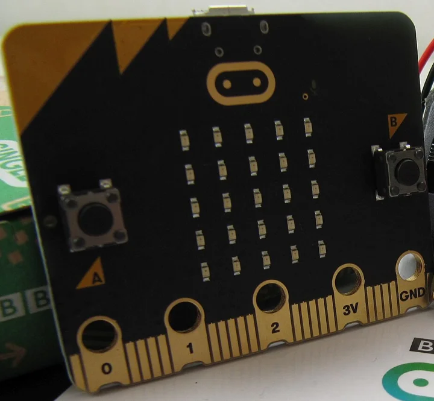{ width="480" }

    | Élément | Rôle |
    |---------|------|
    | **25 LED** (5 × 5) | Afficher du texte, des nombres, des images |
    | **Bouton A** et **bouton B** | Réagir quand on appuie (A, B, ou les deux en même temps) |
    | **Logo doré** | Bouton tactile : il réagit au toucher du doigt |
    | **Connecteurs** (0, 1, 2, 3V, GND) | Brancher des fils, des capteurs, des écouteurs |

=== "Face arrière"

    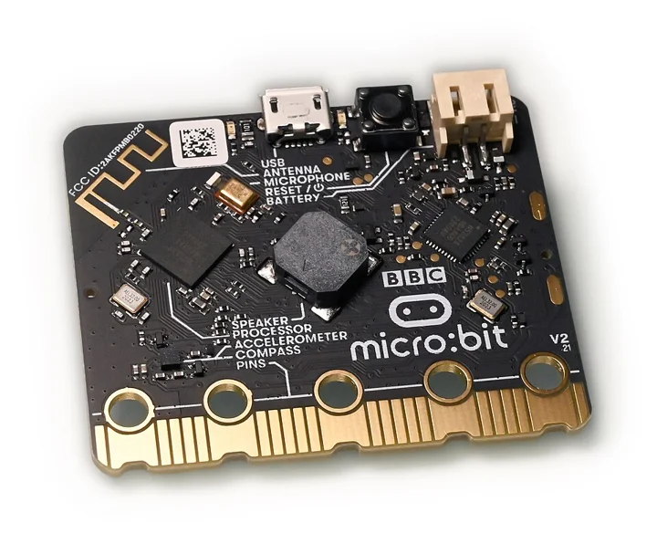{ width="480" }

    | Inscription sur la carte | Élément | Rôle |
    |--------------------------|---------|------|
    | **USB** | Prise micro-USB | Alimenter la carte et recevoir les programmes |
    | **Antenna** | Antenne radio | Envoyer et recevoir des messages vers d'autres micro:bit |
    | **Microphone** | Micro | Mesurer le niveau sonore |
    | **Reset** | Bouton de redémarrage | Relancer le programme depuis le début |
    | **Battery** | Prise pour pile | Fonctionner sans ordinateur |
    | **Speaker** | Haut-parleur | Jouer des sons et de la musique |
    | **Processor** | Processeur | Exécuter le programme |
    | **Accelerometer** / **Compass** | Accéléromètre et boussole | Détecter les mouvements (secouer, pencher) et le nord |

<small>Photos : face avant, [Crash48](https://commons.wikimedia.org/wiki/File:Micro-bit_v1_%26_v2.JPG){target="_blank"} (CC0) ; face arrière, [Simon Waldherr](https://commons.wikimedia.org/wiki/File:BBC_micro_bit_v2_(3).jpg){target="_blank"} (CC BY 4.0).</small>

### Entrées, programme, sorties

Tout ce que fait le micro:bit suit le même schéma : quelque chose se passe (**entrée**), le **programme** décide quoi faire, la carte réagit (**sortie**).

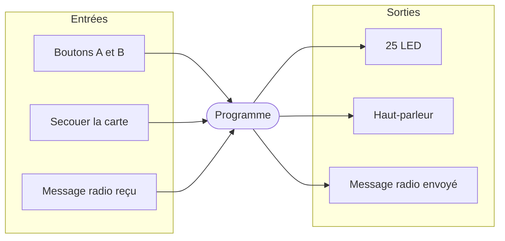

Ce sont exactement les **événements** de lundi et mardi : `lorsque le bouton A est pressé`, comme `quand bouton A est appuyé` dans Arcade ou `addEventListener("click", ...)` en JavaScript.

### Le chemin d'un programme

Le programme s'écrit dans le navigateur, mais il doit ensuite **voyager** jusqu'à la carte :

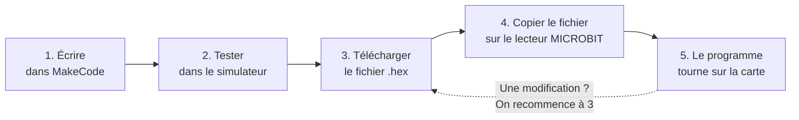

Le fichier `.hex` contient le programme traduit dans la langue du processeur : une longue suite de chiffres et de lettres, illisible pour un humain, mais exactement ce que la carte sait exécuter.

---

## Premier programme : HELLO

Le but de ce premier chapitre : appuyer sur le bouton A et voir *HELLO* défiler sur la carte. Le programme tient en deux blocs. L'important est de parcourir **tout le chemin** une première fois.

### Étape 1 : Créer un projet

1. Brancher le micro:bit à l'ordinateur avec le câble USB : une petite LED jaune s'allume au dos de la carte
2. Ouvrir **[makecode.microbit.org](https://makecode.microbit.org){target="_blank"}** dans le navigateur
3. Cliquer sur **Nouveau projet**

    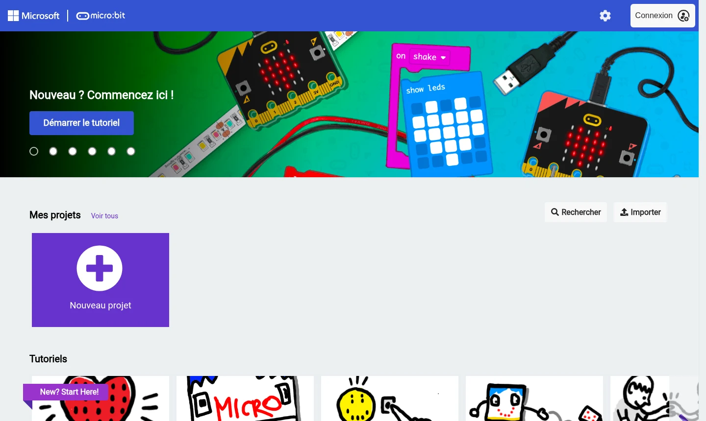

4. Nommer le projet **Premier test**, puis cliquer sur **Créer**

    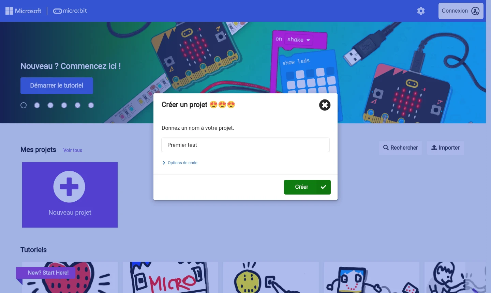

!!! tip "La visite guidée"

    À l'ouverture du premier projet, une bulle *Bienvenue !* propose une visite de l'éditeur en 7 étapes. Elle vaut la peine d'être suivie : deux minutes suffisent.

### Étape 2 : Découvrir l'éditeur

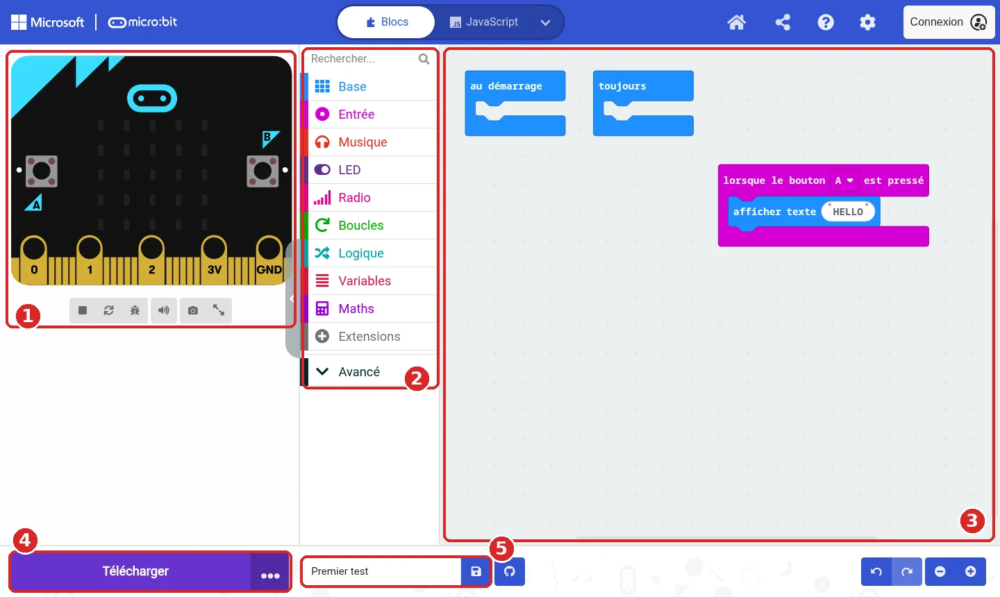

| N° | Zone | Rôle |
|----|------|------|
| **1** | **Simulateur** | Un micro:bit virtuel : on peut cliquer sur ses boutons pour tester le programme sans la carte |
| **2** | **Catégories de blocs** | Chaque couleur regroupe des blocs : **Base** (afficher), **Entrée** (boutons, mouvements), **Musique**, **LED**, **Radio**... |
| **3** | **Zone de programmation** | L'endroit où l'on assemble les blocs. Les blocs `au démarrage` et `toujours` y sont déjà |
| **4** | **Télécharger** | Transforme le programme en fichier `.hex` pour la carte |
| **5** | **Nom du projet** | Il donne son nom au fichier téléchargé |

C'est le même éditeur que MakeCode Arcade, lundi : les catégories changent, mais les blocs s'assemblent de la même façon.

### Étape 3 : Assembler le programme

1. Dans la catégorie **Entrée** (rose), glisser le bloc `lorsque le bouton A est pressé` dans la zone de programmation

    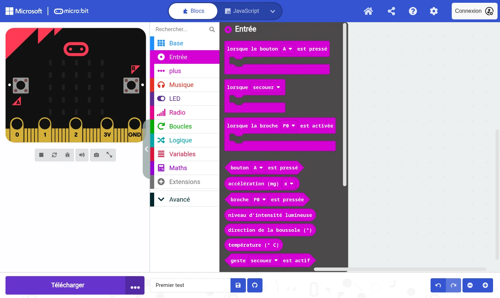

2. Dans la catégorie **Base** (bleu), glisser le bloc `afficher texte "Hello!"` **à l'intérieur** du bloc rose, jusqu'à ce qu'il s'emboîte

    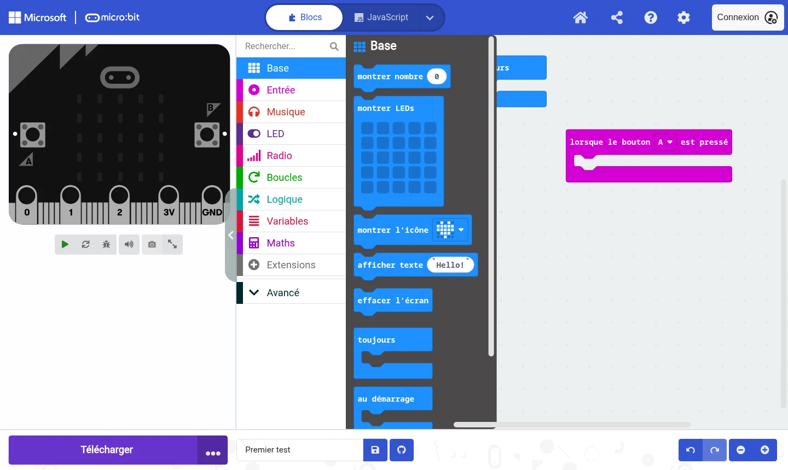

3. Cliquer sur le texte `Hello!` et le remplacer par `HELLO`

=== "Blocs"

    ```microbit
    input.onButtonPressed(Button.A, function () {
        basic.showString("HELLO")
    })
    ```

=== "Schéma"

    ```mermaid
    flowchart LR
        E(["Bouton A pressé"]) -->|déclenche| A["Afficher le texte HELLO"]
    ```

=== "JavaScript"

    ```js
    input.onButtonPressed(Button.A, function () {
        basic.showString("HELLO")
    })
    ```

    Cliquer sur **JavaScript**, en haut de l'éditeur, montre le même programme écrit en texte. C'est la même forme que mardi : *quoi écouter*, puis *quoi faire* entre accolades.

### Étape 4 : Tester dans le simulateur

Cliquer sur le **bouton A** du simulateur : *HELLO* défile sur les LED virtuelles.

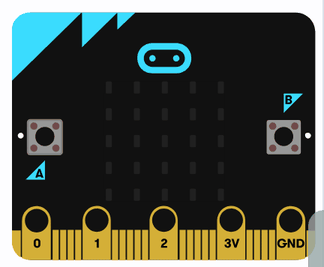{ width="324" }

Le simulateur redémarre tout seul à chaque modification du programme. C'est l'endroit idéal pour tester vite, avant de passer à la vraie carte.

### Étape 5 : Le bug du bloc détaché

!!! bug "Bug volontaire"

    Faire glisser le bloc `afficher texte "HELLO"` **hors** du bloc rose et le lâcher à côté. Cliquer ensuite sur le bouton A du simulateur. Que se passe-t-il ? De quelle couleur est le bloc ?

??? success "Explication et correction"

    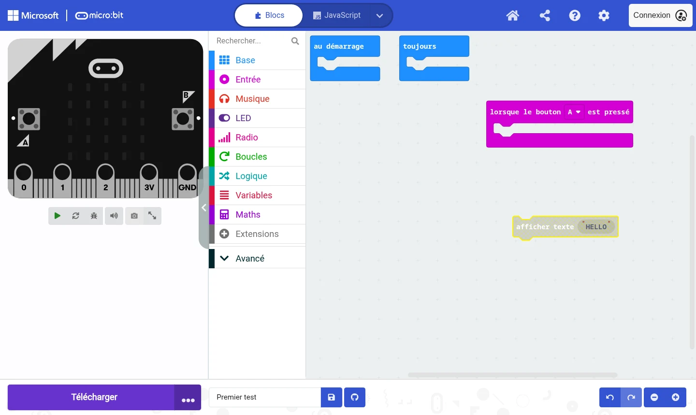

    Le bouton A ne fait plus rien, et le bloc détaché devient **gris et hachuré**. Un bloc qui n'est rattaché à aucun événement (ni `au démarrage`, ni `toujours`, ni `lorsque...`) n'est jamais exécuté : le programme ne sait pas *quand* le lancer. MakeCode le grise pour le signaler.

    **Correction** : remettre le bloc à l'intérieur du bloc rose, jusqu'à entendre le petit *clic* de l'emboîtement.

    **À retenir** : un bloc grisé est un bloc ignoré. C'est l'un des premiers réflexes à avoir quand un programme ne réagit pas.

### Étape 6 : Télécharger le fichier `.hex`

1. Cliquer sur les **trois points** (1), juste à droite du bouton **Télécharger**
2. Choisir **Télécharger en tant que fichier** (2)

    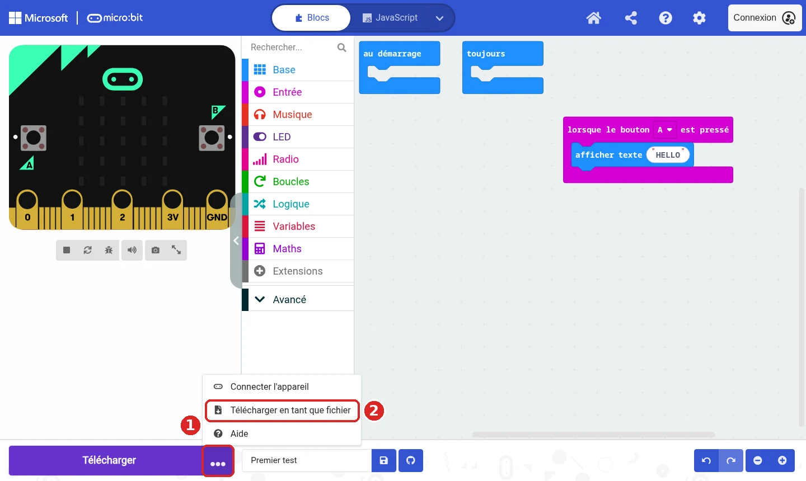

3. Une fenêtre confirme le téléchargement. Cliquer sur **Terminé**

    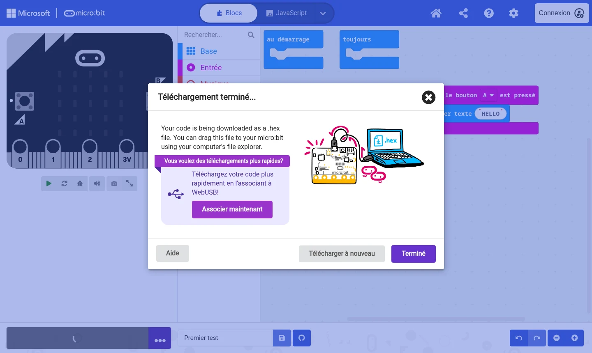

Le fichier `microbit-Premier-test.hex` se trouve maintenant dans le dossier **Téléchargements** de l'ordinateur. Par la suite, le grand bouton **Télécharger** refait directement la même chose.

??? info "Et l'option « Connecter l'appareil » ?"

    Avec Chrome ou Edge, MakeCode peut envoyer le programme directement à la carte, sans passer par un fichier (technique appelée *WebUSB*). C'est plus rapide, mais cela ne fonctionne pas dans tous les navigateurs. La méthode du fichier `.hex` fonctionne partout.

### Étape 7 : Copier le fichier sur le micro:bit

Branché en USB, le micro:bit apparaît sur l'ordinateur comme une **clé USB** nommée **MICROBIT**.

1. Ouvrir le dossier **Téléchargements** :
    - sous **Windows** : dans l'Explorateur de fichiers
    - sous **macOS** : dans le Finder
2. Faire glisser le fichier `microbit-Premier-test.hex` sur le lecteur **MICROBIT**, dans la colonne de gauche
3. Pendant la copie, la LED jaune au dos de la carte **clignote**. Attendre qu'elle s'arrête
4. Appuyer sur le **bouton A** de la vraie carte : *HELLO* défile !

!!! note "Le fichier a disparu ?"

    Après la copie, le fichier `.hex` n'apparaît **pas** sur le lecteur MICROBIT, qui se déconnecte puis se reconnecte tout seul. C'est normal : la carte a lu le fichier, l'a installé dans sa mémoire, puis l'a effacé. Le programme reste en mémoire, même débranché.

### Étape 8 : Le bug de la carte qui n'a rien appris

!!! bug "Bug volontaire"

    Dans MakeCode, remplacer `HELLO` par son prénom. Tester dans le simulateur : le prénom défile. Puis appuyer sur le bouton A de la **vraie** carte, sans rien faire d'autre. Qu'affiche-t-elle ?

??? success "Explication et correction"

    La carte affiche toujours *HELLO*. Le simulateur se met à jour tout seul, **la carte non** : elle exécute le dernier fichier `.hex` qu'elle a reçu.

    **Correction** : télécharger à nouveau le fichier (bouton **Télécharger**), puis le copier sur le lecteur **MICROBIT**. Le navigateur nomme parfois le nouveau fichier `microbit-Premier-test(1).hex` : peu importe le nom, c'est le dernier copié qui compte.

    **À retenir** : chaque modification doit refaire le chemin *Télécharger → Copier*. Sinon, la carte garde l'ancien programme.

### Récapitulatif

| Étape | Où | Action |
|-------|----|--------|
| **Écrire** | MakeCode | Assembler les blocs dans un événement |
| **Tester** | Simulateur | Cliquer sur les boutons virtuels |
| **Télécharger** | Bouton Télécharger | Obtenir le fichier `.hex` |
| **Copier** | Explorateur ou Finder | Glisser le `.hex` sur le lecteur MICROBIT |
| **Jouer** | La carte | Le programme démarre tout seul |

---

## Le jeu des allumettes

Place au fil rouge de la semaine, avec les mêmes règles que lundi et mardi :

- **20 allumettes** au départ
- Chaque joueuse retire **1, 2 ou 3** allumettes à son tour
- Celle qui retire la **dernière** allumette **perd**

| Bouton | Action |
|--------|--------|
| **A** | Retirer 1 allumette |
| **B** | Retirer 2 allumettes |
| **A + B** (les deux en même temps) | Retirer 3 allumettes |
| **Secouer la carte** | Recommencer une partie |

Voici le résultat à la fin du chapitre : les 20 LED du haut sont les 20 allumettes, la LED du bas indique à qui c'est le tour. Quand on retire des allumettes, elles **prennent feu** une par une, avec un crépitement.

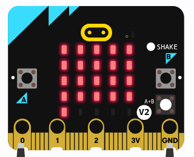{ width="320" }

!!! tip "Lundi, mardi, mercredi"

    Comme mardi, chaque étape montre **la même idée** de trois façons :

    - **Blocs** : le programme à construire dans MakeCode
    - **Schéma** : le fonctionnement, en image
    - **JavaScript** : le même programme en texte (onglet **JavaScript** de MakeCode), à comparer avec le code de mardi

Commencer par créer un **nouveau projet** nommé **Jeu des allumettes** (bouton **Accueil** en haut à droite, puis **Nouveau projet**).

### Les variables : compter les allumettes

#### Étape 1 : Une variable `allumettes`

1. Dans la catégorie **Variables** (rouge), cliquer sur **Créer une variable** et la nommer `allumettes`
2. Glisser `définir allumettes à 0` dans `au démarrage`, et remplacer `0` par `20`
3. Depuis **Base**, ajouter `montrer nombre` en dessous
4. Depuis **Variables**, glisser le bloc rond `allumettes` à la place du `0` de `montrer nombre`

=== "Blocs"

    ```microbit-full
    let allumettes = 20
    basic.showNumber(allumettes)
    ```

=== "Schéma"

    ```mermaid
    flowchart LR
        D(["Démarrage"]) --> A["allumettes = 20"]
        A --> B["Afficher allumettes"]
    ```

=== "JavaScript"

    ```js
    let allumettes = 20
    basic.showNumber(allumettes)
    ```

Le simulateur affiche *20* : les nombres de plus d'un chiffre défilent, comme le texte.

### Les événements : réagir aux boutons

#### Étape 2 : Le bouton A retire une allumette

1. Depuis **Entrée**, glisser `lorsque le bouton A est pressé`
2. Depuis **Variables**, y placer `modifier allumettes de 1`, et remplacer `1` par `-1`
3. Ajouter `montrer nombre allumettes` en dessous

=== "Blocs"

    ```microbit
    input.onButtonPressed(Button.A, function () {
        allumettes += -1
        basic.showNumber(allumettes)
    })
    ```

=== "Schéma"

    ```mermaid
    flowchart LR
        E(["Bouton A pressé"]) -->|déclenche| A["allumettes - 1"]
        A --> B["Afficher allumettes"]
    ```

=== "JavaScript"

    ```js
    input.onButtonPressed(Button.A, function () {
        allumettes += -1
        basic.showNumber(allumettes)
    })
    ```

Dans le simulateur, chaque clic sur A fait baisser le nombre : *19*, *18*, *17*...

#### Étape 3 : Le bug de l'affichage oublié

!!! bug "Bug volontaire"

    Retirer le bloc `montrer nombre` du bouton A (le glisser vers les catégories pour le supprimer). Cliquer plusieurs fois sur A. Que montre la carte ?

??? success "Explication et correction"

    La carte reste sur *20*. La variable diminue bien à chaque clic, mais **rien ne met l'affichage à jour**. C'est exactement le bug de mardi, quand `compteur.textContent` avait disparu : aucun message d'erreur, le programme fait ce qui est écrit, pas ce qu'on voulait.

    **Correction** : remettre `montrer nombre allumettes` à la fin du bouton A.

    **À retenir** : les LED ne changent jamais toutes seules. Après chaque modification d'une variable, il faut **réafficher**.

#### Étape 4 : Trois boutons

Ajouter deux événements de la même façon :

- `lorsque le bouton B est pressé` : `modifier allumettes de -2`, puis `montrer nombre allumettes`
- `lorsque le bouton A+B est pressé` (choisir **A+B** dans la liste du bloc) : `modifier allumettes de -3`, puis `montrer nombre allumettes`

```microbit
input.onButtonPressed(Button.B, function () {
    allumettes += -2
    basic.showNumber(allumettes)
})
input.onButtonPressed(Button.AB, function () {
    allumettes += -3
    basic.showNumber(allumettes)
})
```

!!! tip "A+B dans le simulateur et sur la carte"

    Dans le simulateur, un bouton rond **A+B** apparaît à droite de la carte dès que le programme l'utilise. Sur la vraie carte, il faut appuyer sur A et B **en même temps**, puis relâcher.

#### Étape 5 : Une fonction pour ne pas tout écrire trois fois

Les trois boutons font presque la même chose : seul le nombre change. Dans la suite, chaque retrait va s'enrichir (conditions, feu, son). Plutôt que tout recopier trois fois, on crée **son propre bloc** : une **fonction**.

1. Ouvrir **Avancé**, puis **Fonctions**, et cliquer sur **Créer une fonction...**
2. La nommer `retirer`, ajouter un paramètre **Nombre** (bouton **Nombre**) et le renommer `nombre`, puis cliquer sur **Terminé**
3. Dans la fonction, placer `définir allumettes à`, avec le bloc de **Maths** `allumettes - nombre` (glisser le bloc rond `nombre` depuis le haut de la fonction)
4. Ajouter `montrer nombre allumettes`
5. Dans chaque bouton, remplacer le contenu par le bloc `appel retirer` (catégorie **Fonctions**), avec `1`, `2` ou `3`

=== "Blocs"

    ```microbit
    function retirer (nombre: number) {
        allumettes = allumettes - nombre
        basic.showNumber(allumettes)
    }
    input.onButtonPressed(Button.A, function () {
        retirer(1)
    })
    input.onButtonPressed(Button.B, function () {
        retirer(2)
    })
    input.onButtonPressed(Button.AB, function () {
        retirer(3)
    })
    ```

=== "Schéma"

    ```mermaid
    flowchart LR
        A(["Bouton A"]) -->|"retirer(1)"| F["Fonction retirer(nombre)<br>allumettes - nombre<br>afficher"]
        B(["Bouton B"]) -->|"retirer(2)"| F
        AB(["Boutons A+B"]) -->|"retirer(3)"| F
    ```

=== "JavaScript"

    ```js
    function retirer (nombre: number) {
        allumettes = allumettes - nombre
        basic.showNumber(allumettes)
    }
    input.onButtonPressed(Button.A, function () {
        retirer(1)
    })
    ```

    Mardi, l'encadré *Pour aller plus loin* montrait la fonction `dessiner()`. Ici, la fonction reçoit en plus un **paramètre** : `nombre` vaut 1, 2 ou 3 selon le bouton qui l'appelle.

Le jeu se comporte exactement comme avant. La différence est invisible pour les joueuses, mais énorme pour la suite : **une seule** fonction à modifier au lieu de trois boutons.

### Les conditions : qui a perdu ?

#### Étape 6 : Détecter la fin de partie

Pour l'instant, le compteur descend sous zéro. Il faut que le programme **décide** : *si* plus aucune allumette ne reste, *alors* la joueuse qui vient de jouer a perdu, *sinon* c'est au tour de l'autre.

1. Créer une variable `joueuse`, et ajouter `définir joueuse à 1` dans `au démarrage`
2. Dans la fonction `retirer`, après `définir allumettes à...`, ajouter depuis **Logique** un bloc `si ... alors ... sinon`
3. Condition : `allumettes ≤ 0` (bloc de comparaison de **Logique**, choisir `≤`)
4. Dans **si** : `afficher texte` avec, depuis **Avancé → Texte**, le bloc `concaténation`, comme lundi : `"J"`, `joueuse`, `" PERD"` (le bouton ⊕ ajoute une case)
5. Dans **sinon** : un second `si joueuse = 1 alors définir joueuse à 2 sinon définir joueuse à 1`, puis `montrer nombre allumettes`

=== "Blocs"

    ```microbit
    function retirer (nombre: number) {
        allumettes = allumettes - nombre
        if (allumettes <= 0) {
            basic.showString("J" + joueuse + " PERD")
        } else {
            if (joueuse == 1) {
                joueuse = 2
            } else {
                joueuse = 1
            }
            basic.showNumber(allumettes)
        }
    }
    ```

=== "Schéma"

    ```mermaid
    flowchart TD
        A["allumettes - nombre"] --> C{"allumettes ≤ 0 ?"}
        C -->|oui| P["Afficher J… PERD"]
        C -->|non| J{"joueuse = 1 ?"}
        J -->|oui| J2["joueuse = 2"]
        J -->|non| J1["joueuse = 1"]
        J2 --> M["Afficher allumettes"]
        J1 --> M
    ```

=== "JavaScript"

    ```js
    if (allumettes <= 0) {
        basic.showString("J" + joueuse + " PERD")
    } else {
        if (joueuse == 1) {
            joueuse = 2
        } else {
            joueuse = 1
        }
        basic.showNumber(allumettes)
    }
    ```

    Le code de mardi, au détail près : `message.textContent = ...` devient `basic.showString(...)`.

#### Étape 7 : Et avec trois allumettes d'un coup ?

!!! question "Réfléchir"

    Dans la condition, remplacer `≤` par `=`. Puis, dans le simulateur, appuyer sur A+B jusqu'à ce qu'il reste **2** allumettes, et appuyer encore une fois sur A+B. La partie se termine-t-elle ?

??? success "Réponse"

    Non : `allumettes` vaut `-1`, et `-1 = 0` est faux. La partie continue avec un nombre négatif d'allumettes. Avec `≤` (*plus petit ou égal*), `-1 ≤ 0` est vrai : la fin de partie est bien détectée.

    C'est le même piège que lundi et mardi. Remettre `≤`.

### Les boucles : dessiner les allumettes

Afficher *17*, c'est bien. **Voir** 17 allumettes, c'est mieux ! Le micro:bit a 25 LED : de quoi en dessiner 20, sur 4 rangées de 5.

#### Étape 8 : Le plan des LED

Chaque LED a deux coordonnées : **x** (la colonne, de gauche à droite) et **y** (la rangée, de haut en bas), toutes deux de 0 à 4. Les 20 allumettes portent un numéro, de 0 à 19 :

| | x = 0 | x = 1 | x = 2 | x = 3 | x = 4 |
|---|:---:|:---:|:---:|:---:|:---:|
| **y = 0** | 0 | 1 | 2 | 3 | 4 |
| **y = 1** | 5 | 6 | 7 | 8 | 9 |
| **y = 2** | 10 | 11 | 12 | 13 | 14 |
| **y = 3** | 15 | 16 | 17 | 18 | 19 |
| **y = 4** | *joueuse 1* | | | | *joueuse 2* |

Pour passer du numéro aux coordonnées :

- **x** = le **reste** de la division du numéro par 5. Allumette 13 : 13 ÷ 5 = 2, reste **3**
- **y** = le **quotient** entier de la division par 5. Allumette 13 : 13 ÷ 5 = **2**, reste 3

L'allumette 13 est donc en x = 3, y = 2. On peut vérifier dans le tableau.

#### Étape 9 : La boucle `pour`

1. Créer une fonction `dessiner` (sans paramètre)
2. Y placer `effacer l'écran` (**Base**)
3. Depuis **Boucles**, ajouter `pour index variant de 0 à 4`
4. Remplacer `4` par le bloc de **Maths** `allumettes - 1`
5. Dans la boucle, ajouter `allumer x 0 y 0` (**LED**), avec :
    - pour **x** : le bloc de **Maths** `reste de 0 / 1`, avec `index` et `5`
    - pour **y** : le bloc de **Maths** `0 / 0`, avec `index` et `5`, en choisissant **integer /** (division entière) dans sa liste
6. Remplacer **tous** les `montrer nombre allumettes` (dans `au démarrage` et dans `retirer`) par `appel dessiner`

=== "Blocs"

    ```microbit
    function dessiner () {
        basic.clearScreen()
        for (let index = 0; index <= allumettes - 1; index++) {
            led.plot(index % 5, Math.idiv(index, 5))
        }
    }
    ```

=== "Schéma"

    ```mermaid
    flowchart TD
        E["Effacer l'écran"] --> I["index = 0"]
        I --> C{"index ≤ allumettes - 1 ?"}
        C -->|oui| A["Allumer la LED x = reste de index ÷ 5, y = index ÷ 5"]
        A --> P["index + 1"]
        P --> C
        C -->|non| F(["Fin"])
    ```

=== "JavaScript"

    ```js
    function dessiner () {
        basic.clearScreen()
        for (let index = 0; index <= allumettes - 1; index++) {
            led.plot(index % 5, Math.idiv(index, 5))
        }
    }
    ```

    Mardi : `for (let i = 0; i < allumettes; i++)`. Ici : `for (let index = 0; index <= allumettes - 1; index++)`. Les deux font exactement le même nombre de tours.

La carte affiche les 20 allumettes, et le tas diminue à chaque appui.

#### Étape 10 : Le bug de l'allumette en trop

!!! bug "Bug volontaire"

    Dans la boucle, remplacer `allumettes - 1` par `allumettes` tout court. Compter les LED allumées au démarrage.

??? success "Explication et correction"

    Il y en a **21** : une LED s'allume en trop, seule sur la dernière rangée. Le bloc `pour index variant de 0 à ...` de MakeCode **inclut** la dernière valeur : de 0 à 20, cela fait 21 tours.

    **Correction** : remettre `allumettes - 1`. De 0 à 19, cela fait bien 20 tours.

    **À retenir** : c'est l'*erreur de un*, déjà rencontrée mardi avec `<=`. En cas de doute, dérouler la boucle à la main avec un petit nombre : avec 3 allumettes, `index` doit valoir 0, 1, 2.

#### Étape 11 : À qui le tour ?

La dernière rangée est libre : elle peut indiquer la joueuse dont c'est le tour. À la fin de la fonction `dessiner`, après la boucle, ajouter :

```microbit
if (joueuse == 1) {
    led.plot(0, 4)
} else {
    led.plot(4, 4)
}
```

En bas à gauche : joueuse 1. En bas à droite : joueuse 2. Une **condition** et une **boucle** dans la même fonction !

### Le feu et les sons

Le jeu fonctionne. Maintenant, place au spectacle : des allumettes qui **brûlent** quand on les retire, et une musique pour la fin de partie. Le micro:bit V2 possède un haut-parleur au dos : pas besoin d'écouteurs.

!!! warning "Volume en salle"

    Dans une salle où une vingtaine de cartes jouent en même temps, le bruit monte vite. Garder des sons **courts**. Pour baisser le volume, ajouter `régler le volume à 100` (**Musique**) dans `au démarrage` : la valeur va de 0 à 255.

#### Étape 12 : Une allumette qui prend feu

L'idée : faire **vaciller** la dernière allumette (sa LED change de luminosité au hasard plusieurs fois), avec un bruit de crépitement, avant de l'éteindre.

1. Créer une variable `derniere` et une fonction `bruler` (sans paramètre, et sans accent : MakeCode les refuse dans les noms)
2. Dans `bruler`, construire :
    - `définir derniere à allumettes - 1` : le numéro de la dernière allumette du tas
    - depuis **Musique**, `jouer son ... en arrière-plan` (voir l'encadré ci-dessous pour fabriquer le crépitement)
    - depuis **Boucles**, `répéter 8 fois`, avec à l'intérieur :
        - depuis **LED** (sous **... plus**), `tracer x y luminosité`, avec les mêmes calculs que dans `dessiner`, mais avec `derniere` à la place de `index`, et pour la luminosité `choisir au hasard de 10 à 255` (**Maths**)
        - `pause (ms) 50` (**Base**)
    - `modifier allumettes de -1`, puis `appel dessiner`
3. Dans `retirer`, remplacer `définir allumettes à allumettes - nombre` par une boucle `répéter nombre fois`, qui contient `si allumettes > 0 alors appel bruler`

=== "Blocs"

    ```microbit
    // @hide
    function dessiner () {}
    function bruler () {
        derniere = allumettes - 1
        music.play(music.createSoundExpression(WaveShape.Noise, 1600, 1, 255, 0, 400, SoundExpressionEffect.None, InterpolationCurve.Linear), music.PlaybackMode.InBackground)
        for (let index = 0; index < 8; index++) {
            led.plotBrightness(derniere % 5, Math.idiv(derniere, 5), randint(10, 255))
            basic.pause(50)
        }
        allumettes += -1
        dessiner()
    }
    function retirer (nombre: number) {
        for (let index = 0; index < nombre; index++) {
            if (allumettes > 0) {
                bruler()
            }
        }
    }
    ```

=== "Schéma"

    ```mermaid
    flowchart TD
        R(["retirer(3)"]) --> B1["bruler : la dernière allumette vacille puis s'éteint"]
        B1 --> B2["bruler : la suivante"]
        B2 --> B3["bruler : la troisième"]
        B3 --> F["Tester la fin de partie"]
    ```

=== "JavaScript"

    ```js
    function retirer (nombre: number) {
        for (let index = 0; index < nombre; index++) {
            if (allumettes > 0) {
                bruler()
            }
        }
    }
    ```

    Le `si allumettes > 0` empêche de brûler une allumette qui n'existe plus : avec 2 allumettes restantes et A+B, la troisième n'est pas brûlée.

??? info "Fabriquer le crépitement dans l'éditeur de son"

    Cliquer sur l'image du son dans le bloc `jouer son` : l'éditeur de son s'ouvre.

    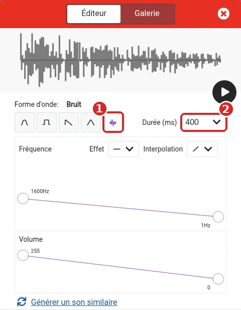{ width="480" }

    1. Choisir la forme d'onde **Bruit**, la dernière à droite (1) : c'est elle qui donne le crépitement
    2. Régler la **durée** sur **400** ms (2), le temps que l'allumette vacille
    3. Cliquer sur le bouton ▶ pour écouter, et ajuster la fréquence et le volume à son goût

    L'onglet **Galerie**, en haut, propose aussi des sons tout faits.

Le bloc `en arrière-plan` est important : le son joue **pendant** que la LED vacille. Avec `jusqu'à la fin`, la carte attendrait la fin du son avant de commencer l'animation.

#### Étape 13 : La musique de fin

Dans la fonction `retirer`, ajouter le test de fin de partie **après** la boucle `répéter`. C'est le `si allumettes ≤ 0` de l'étape 6, enrichi :

- dans **si** : `jouer mélodie power up en arrière-plan` (**Musique**, choisir la mélodie dans la liste), `afficher texte` avec la `concaténation` de l'étape 6, puis `montrer l'icône` tête de mort
- dans **sinon** : le changement de joueuse, puis `appel dessiner`

```microbit
// @hide
function dessiner () {}
if (allumettes <= 0) {
    music.play(music.builtInPlayableMelody(Melodies.PowerUp), music.PlaybackMode.InBackground)
    basic.showString("J" + joueuse + " PERD")
    basic.showIcon(IconNames.Skull)
} else {
    if (joueuse == 1) {
        joueuse = 2
    } else {
        joueuse = 1
    }
    dessiner()
}
```

#### Étape 14 : Secouer pour rejouer

1. Créer une fonction `nouvellePartie`, qui contient `définir allumettes à 20`, `définir joueuse à 1` et `appel dessiner`
2. Remplacer le contenu de `au démarrage` par `appel nouvellePartie`
3. Depuis **Entrée**, ajouter `lorsque secouer`, avec `appel nouvellePartie` à l'intérieur

```microbit-full
// @hide
function dessiner () {}
function nouvellePartie () {
    allumettes = 20
    joueuse = 1
    dessiner()
}
input.onGesture(Gesture.Shake, function () {
    nouvellePartie()
})
nouvellePartie()
```

Dans le simulateur, un bouton **SHAKE** apparaît pour simuler la secousse.

Le jeu est terminé : il est temps de **télécharger** le fichier `.hex` et de le copier sur la carte. Le binôme peut faire une vraie partie en se passant le micro:bit.

??? abstract "Code complet à la fin du chapitre"

    ```microbit-full
    function nouvellePartie () {
        allumettes = 20
        joueuse = 1
        dessiner()
    }
    function dessiner () {
        basic.clearScreen()
        for (let index = 0; index <= allumettes - 1; index++) {
            led.plot(index % 5, Math.idiv(index, 5))
        }
        if (joueuse == 1) {
            led.plot(0, 4)
        } else {
            led.plot(4, 4)
        }
    }
    function bruler () {
        derniere = allumettes - 1
        music.play(music.createSoundExpression(WaveShape.Noise, 1600, 1, 255, 0, 400, SoundExpressionEffect.None, InterpolationCurve.Linear), music.PlaybackMode.InBackground)
        for (let index = 0; index < 8; index++) {
            led.plotBrightness(derniere % 5, Math.idiv(derniere, 5), randint(10, 255))
            basic.pause(50)
        }
        allumettes += -1
        dessiner()
    }
    function retirer (nombre: number) {
        for (let index = 0; index < nombre; index++) {
            if (allumettes > 0) {
                bruler()
            }
        }
        if (allumettes <= 0) {
            music.play(music.builtInPlayableMelody(Melodies.PowerUp), music.PlaybackMode.InBackground)
            basic.showString("J" + joueuse + " PERD")
            basic.showIcon(IconNames.Skull)
        } else {
            if (joueuse == 1) {
                joueuse = 2
            } else {
                joueuse = 1
            }
            dessiner()
        }
    }
    input.onButtonPressed(Button.A, function () {
        retirer(1)
    })
    input.onButtonPressed(Button.B, function () {
        retirer(2)
    })
    input.onButtonPressed(Button.AB, function () {
        retirer(3)
    })
    input.onGesture(Gesture.Shake, function () {
        nouvellePartie()
    })
    let derniere = 0
    let joueuse = 0
    let allumettes = 0
    nouvellePartie()
    ```

    → [Télécharger la solution (.hex)](../../code-templates/makecode-microbit/chapitre-2-jeu-allumettes.hex){ download="chapitre-2-jeu-allumettes.hex" }, à copier sur la carte ou à ouvrir dans MakeCode (voir [Ouvrir une solution](#ouvrir-une-solution-dans-makecode))

---

## Multijoueur par radio

Jusqu'ici, les deux joueuses se passent la carte. Et si chacune avait **sa propre** carte ? Tous les micro:bit possèdent une **radio** : ils peuvent s'envoyer des messages, sans fil, jusqu'à une dizaine de mètres. Ce chapitre se fait avec **deux cartes** : celle d'une autre équipe, ou une deuxième carte prêtée par l'équipe enseignante (voir plus bas).

### Les groupes radio

Comme les canaux d'un talkie-walkie, la radio du micro:bit a **256 groupes**, numérotés de 0 à 255. Une carte n'entend que les messages de **son** groupe. Toutes les cartes de la salle partagent les mêmes ondes : pour éviter les interférences, **chaque équipe a son propre numéro**, utilisé par aucune autre :

| Équipe | Groupe | Équipe | Groupe | Équipe | Groupe |
|--------|:------:|--------|:------:|--------|:------:|
| Ananas | **1** | Kiwi | **7** | Pastèque | **13** |
| Banane | **2** | Lime | **8** | Pêche | **14** |
| Cerise | **3** | Mangue | **9** | Poire | **15** |
| Citron | **4** | Mangue 2 | **10** | Pomme | **16** |
| Coco | **5** | Myrtille | **11** | Raisin | **17** |
| Fraise | **6** | Orange | **12** | | |

#### Jouer avec une autre équipe

Deux équipes qui veulent jouer ensemble choisissent **l'un de leurs deux numéros**, et les deux cartes utilisent ce numéro. Par exemple, Kiwi (**7**) et Banane (**2**) se mettent toutes les deux sur le groupe **2**, ou toutes les deux sur le groupe **7**.

Ne jamais prendre le numéro d'une troisième équipe : ses messages arriveraient au milieu de la partie, et inversement.

#### Une deuxième carte pour son équipe

Une équipe qui a **terminé les deux premiers chapitres** (le jeu des allumettes fonctionne sur la vraie carte, avec le feu et les sons) peut demander une deuxième carte à l'équipe enseignante. Les deux cartes utilisent alors le numéro de l'équipe.

### Étape 1 : HELLO par radio

Retour au premier programme, mais cette fois le message **voyage** d'une carte à l'autre.

1. Créer un nouveau projet nommé **HELLO radio**
2. Dans `au démarrage`, placer `radio définir groupe` (**Radio**) avec le numéro de son équipe
3. Ajouter `lorsque le bouton A est pressé` avec `envoyer la chaîne "HELLO" par radio`
4. Ajouter `quand une donnée est reçue par radio receivedString` : choisir la version avec **receivedString** (chaîne reçue). Y placer `afficher texte`, et glisser le bloc rond `receivedString` dedans

=== "Blocs"

    ```microbit-full
    input.onButtonPressed(Button.A, function () {
        radio.sendString("HELLO")
    })
    radio.onReceivedString(function (receivedString) {
        basic.showString(receivedString)
    })
    radio.setGroup(1)
    ```

=== "Schéma"

    ```mermaid
    sequenceDiagram
        participant A as Carte 1
        participant B as Carte 2
        Note over A: Bouton A pressé
        A->>B: radio : "HELLO"
        Note over B: Affiche HELLO
    ```

=== "JavaScript"

    ```js
    radio.onReceivedString(function (receivedString) {
        basic.showString(receivedString)
    })
    ```

    Encore un événement : *quoi écouter* (un message radio), puis *quoi faire* avec le message reçu, rangé dans `receivedString`.

Dans le simulateur, un **second micro:bit** apparaît dès le premier envoi : il reçoit le message et l'affiche. On peut donc tester la radio sans deuxième carte.

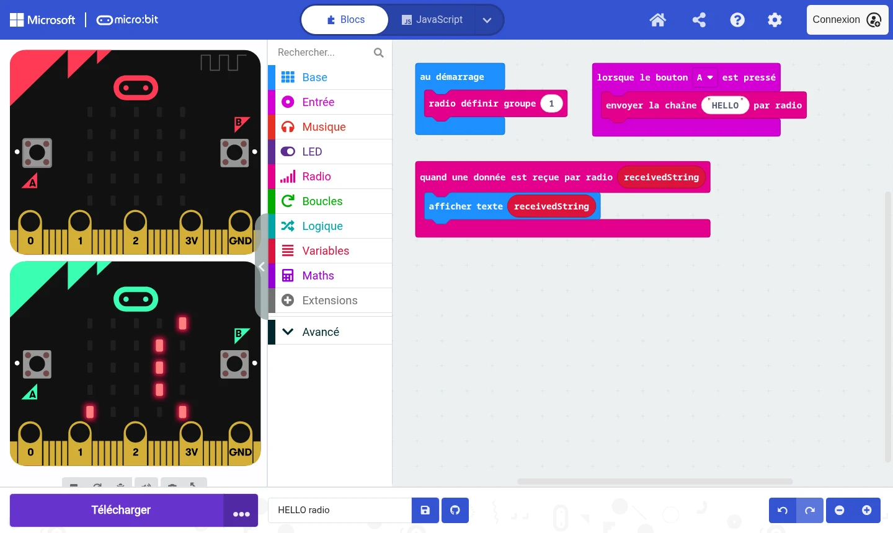

Ensuite, copier le fichier `.hex` sur les **deux** cartes, l'une après l'autre. Appuyer sur A d'une carte : *HELLO* défile sur l'autre. Remplacer `HELLO` par un autre message pour se répondre.

### Étape 2 : Le bug du mauvais groupe

!!! bug "Bug volontaire"

    Sur **une seule** des deux cartes, changer le numéro dans `radio définir groupe` (par exemple `42`) et recopier le programme. Appuyer sur A, d'un côté puis de l'autre. Que se passe-t-il ?

??? success "Explication et correction"

    Plus rien n'arrive. Les deux cartes émettent bien, mais sur deux canaux différents : chacune parle dans le vide. Il n'y a aucun message d'erreur, puisqu'il est tout à fait normal qu'aucune carte n'écoute.

    L'inverse est aussi possible : si une autre équipe utilise le même groupe, ses messages s'affichent sur ses propres cartes. C'est pour cela que chaque équipe a son numéro.

    **Correction** : les deux cartes utilisent le même numéro : celui de l'équipe, ou l'un des deux numéros choisi avec l'autre équipe.

    **À retenir** : en radio, deux appareils ne se comprennent que s'ils sont réglés sur le **même groupe**. C'est le premier point à vérifier quand un message n'arrive pas.

### Étape 3 : Le jeu des allumettes à deux cartes

Chaque joueuse joue sur **sa** carte. Quand une joueuse retire des allumettes, sa carte envoie le **nombre retiré** à l'autre carte, qui le retire aussi : les deux tas restent identiques.

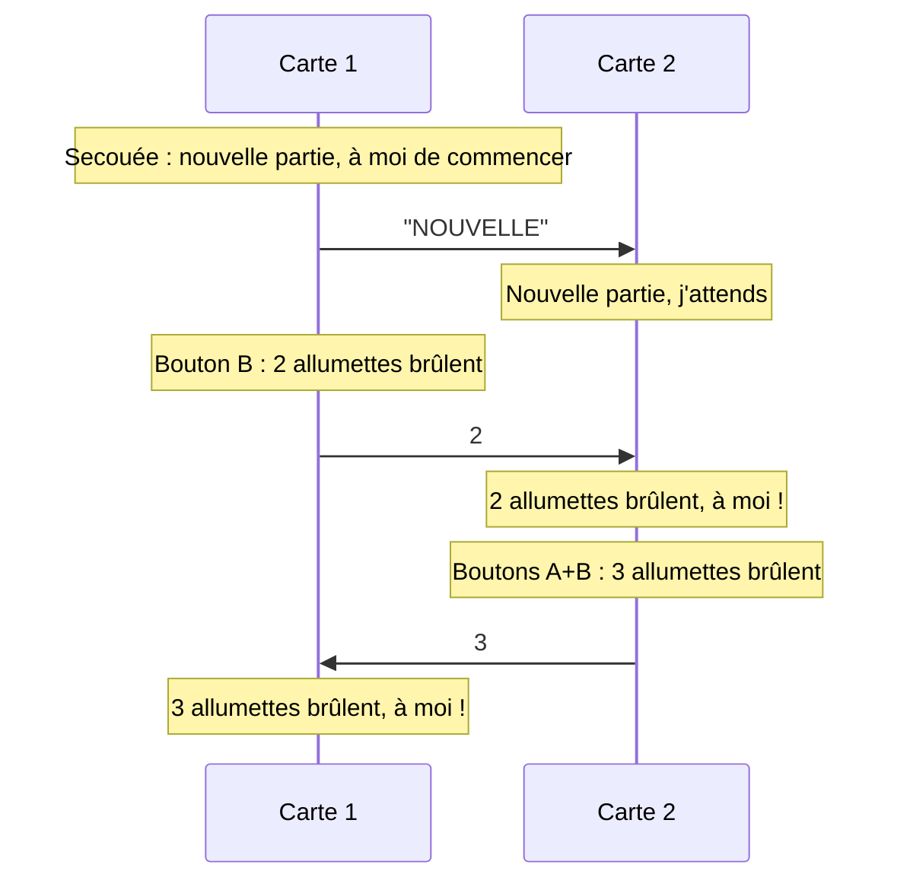

Partir du jeu du chapitre précédent et le transformer :

| Avant (une carte) | Après (deux cartes) |
|-------------------|---------------------|
| Variable `joueuse` (1 ou 2) | Variable `monTour` (**vrai** ou **faux**, blocs de **Logique**) |
| LED en bas à gauche ou à droite | LED en bas au milieu, allumée seulement si `monTour` est vrai |
| Les boutons appellent `retirer` | Les boutons appellent une nouvelle fonction `jouer`, qui vérifie que c'est bien son tour, **envoie le nombre** par radio, puis appelle `retirer` |
| Après `retirer`, la joueuse change | `quand une donnée est reçue par radio receivedNumber` : retirer le nombre reçu, puis `monTour` devient vrai |
| *J1 PERD* | La carte qui retire la dernière allumette affiche *PERDU*, l'autre *GAGNE* |
| Secouer : nouvelle partie | Secouer : nouvelle partie, **et** envoyer `"NOUVELLE"` à l'autre carte. La carte secouée commence |

!!! tip "Garder une copie"

    Avant de transformer le jeu, télécharger son fichier `.hex` : il sert de sauvegarde, et on pourra le rouvrir dans MakeCode si besoin (voir [Ouvrir une solution](#ouvrir-une-solution-dans-makecode)).

La partie se lance en **secouant** l'une des deux cartes. La fonction `bruler` ne change pas.

??? abstract "Code complet du jeu à deux cartes"

    ```microbit-full
    function nouvellePartie () {
        allumettes = 20
        dessiner()
    }
    function dessiner () {
        basic.clearScreen()
        for (let index = 0; index <= allumettes - 1; index++) {
            led.plot(index % 5, Math.idiv(index, 5))
        }
        if (monTour) {
            led.plot(2, 4)
        }
    }
    function bruler () {
        derniere = allumettes - 1
        music.play(music.createSoundExpression(WaveShape.Noise, 1600, 1, 255, 0, 400, SoundExpressionEffect.None, InterpolationCurve.Linear), music.PlaybackMode.InBackground)
        for (let index = 0; index < 8; index++) {
            led.plotBrightness(derniere % 5, Math.idiv(derniere, 5), randint(10, 255))
            basic.pause(50)
        }
        allumettes += -1
        dessiner()
    }
    function retirer (nombre: number) {
        for (let index = 0; index < nombre; index++) {
            if (allumettes > 0) {
                bruler()
            }
        }
    }
    function jouer (nombre: number) {
        if (monTour && allumettes > 0) {
            monTour = false
            radio.sendNumber(nombre)
            retirer(nombre)
            if (allumettes <= 0) {
                music.play(music.builtinPlayableSoundEffect(soundExpression.sad), music.PlaybackMode.InBackground)
                basic.showString("PERDU")
                basic.showIcon(IconNames.Skull)
            }
        }
    }
    input.onButtonPressed(Button.A, function () {
        jouer(1)
    })
    input.onButtonPressed(Button.B, function () {
        jouer(2)
    })
    input.onButtonPressed(Button.AB, function () {
        jouer(3)
    })
    radio.onReceivedNumber(function (receivedNumber) {
        retirer(receivedNumber)
        if (allumettes <= 0) {
            music.play(music.builtInPlayableMelody(Melodies.PowerUp), music.PlaybackMode.InBackground)
            basic.showString("GAGNE")
            basic.showIcon(IconNames.Happy)
        } else {
            monTour = true
            dessiner()
        }
    })
    input.onGesture(Gesture.Shake, function () {
        radio.sendString("NOUVELLE")
        monTour = true
        nouvellePartie()
    })
    radio.onReceivedString(function (receivedString) {
        if (receivedString == "NOUVELLE") {
            monTour = false
            nouvellePartie()
        }
    })
    let derniere = 0
    let allumettes = 0
    let monTour = false
    radio.setGroup(0)
    nouvellePartie()
    ```

    → [Télécharger la solution (.hex)](../../code-templates/makecode-microbit/chapitre-3-jeu-allumettes-radio.hex){ download="chapitre-3-jeu-allumettes-radio.hex" }

    La solution utilise le groupe **0** : l'ouvrir dans MakeCode et remplacer `0` par le numéro choisi (celui de son équipe, ou l'un des deux numéros choisi avec l'autre équipe) **avant** de la copier sur les cartes.

??? question "Pourquoi les deux cartes ne peuvent-elles pas jouer en même temps ?"

    Grâce à `monTour`. Au départ, seule la carte secouée a `monTour` à vrai. Dès qu'elle joue, `monTour` passe à faux : ses boutons ne font plus rien. C'est la réception du nombre qui rend la main à l'autre carte. Sans cette variable, les deux joueuses pourraient retirer des allumettes en même temps, et les deux tas ne seraient plus identiques.

---

## Défis

Le jeu fonctionne sur une ou deux cartes ? Il reste du temps pour le rendre unique. Les défis sont classés du plus simple au plus ambitieux.

### Niveau 1 : personnaliser

- **Ses propres sons** : un autre bruit pour le feu, une autre mélodie pour la victoire (onglet **Galerie** de l'éditeur de son, ou liste des mélodies)
- **Ses propres images** : remplacer la tête de mort par une icône de son choix, ou dessiner la sienne avec `montrer LEDs`
- **Un feu plus spectaculaire** : modifier le nombre de répétitions, la pause ou la luminosité dans `bruler`

### Niveau 2 : enrichir

- **Compter les victoires** : une variable par joueuse, affichée au début de chaque partie
- **Le logo tactile** : `lorsque le logo est appuyé` (**Entrée**) pour afficher le nombre d'allumettes restantes
- **Choisir le nombre d'allumettes** au départ, par exemple entre 10 et 20 avec le bouton A avant de secouer

### Niveau 3 : l'ordinateur joue

Lundi matin, le jeu des allumettes a livré sa **stratégie gagnante** : laisser à l'adversaire un nombre d'allumettes de la forme 4 × n + 1 (1, 5, 9, 13, 17). Programmer une carte qui joue seule contre une joueuse, en appliquant cette stratégie.

??? tip "Indice"

    Le nombre d'allumettes à retirer pour laisser un multiple de 4 plus 1 est le **reste** de `allumettes - 1` divisé par 4. Si ce reste vaut 0, la position est perdante : retirer 1 et espérer une erreur de l'adversaire.

    ```microbit
    // @hide
    function retirer (nombre: number) {}
    coup = (allumettes - 1) % 4
    if (coup == 0) {
        coup = 1
    }
    retirer(coup)
    ```

### Tutoriels officiels

Pour découvrir d'autres possibilités du micro:bit, MakeCode propose des tutoriels pas à pas :

- [Multi Dice](https://makecode.microbit.org/#tutorial:/projects/multi-dice){target="_blank"} : un dé qui compare son résultat avec celui des autres cartes, par radio
- [Rock Paper Scissors](https://makecode.microbit.org/#tutorial:/projects/rock-paper-scissors){target="_blank"} : pierre-feuille-ciseaux en secouant la carte
- [Radio Games](https://makecode.microbit.org/projects/radio-games){target="_blank"} : d'autres idées de jeux à plusieurs cartes (patate chaude, lucioles...)

!!! info "Et vendredi ?"

    Le micro:bit fait partie des trois technologies possibles pour le projet de vendredi. Le jeu de ce matin peut servir de base à l'[option A](../vendredi.md#projet-final){target="_blank"} : une amélioration par membre de l'équipe.

---

## Ouvrir une solution dans MakeCode

Un fichier `.hex` téléchargé depuis MakeCode contient le programme pour la carte, **et** les blocs. On peut donc le rouvrir pour le modifier :

1. Sur la page d'accueil de MakeCode, cliquer sur **Importer**, puis **Importer un fichier...**
2. Choisir le fichier `.hex`, puis cliquer sur **Continuer**

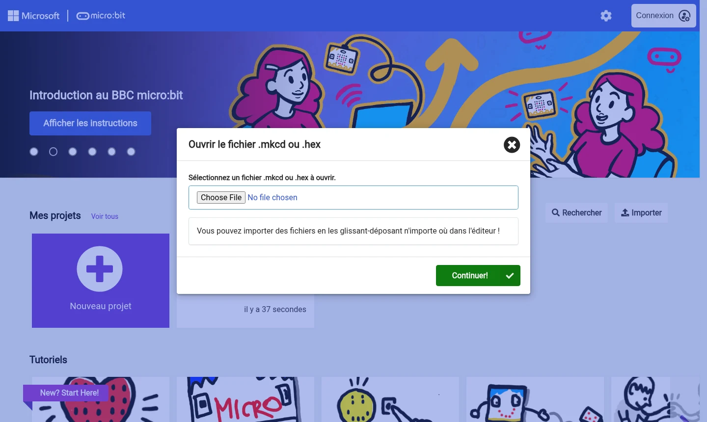

Il suffit aussi de **glisser** le fichier `.hex` directement sur l'éditeur MakeCode ouvert.

| Solution | Fichier |
|----------|---------|
| Premier programme : HELLO | [chapitre-1-hello.hex](../../code-templates/makecode-microbit/chapitre-1-hello.hex){ download="chapitre-1-hello.hex" } |
| Jeu des allumettes, une carte | [chapitre-2-jeu-allumettes.hex](../../code-templates/makecode-microbit/chapitre-2-jeu-allumettes.hex){ download="chapitre-2-jeu-allumettes.hex" } |
| HELLO par radio | [chapitre-3-radio-hello.hex](../../code-templates/makecode-microbit/chapitre-3-radio-hello.hex){ download="chapitre-3-radio-hello.hex" } |
| Jeu des allumettes, deux cartes | [chapitre-3-jeu-allumettes-radio.hex](../../code-templates/makecode-microbit/chapitre-3-jeu-allumettes-radio.hex){ download="chapitre-3-jeu-allumettes-radio.hex" } |

---

## Ressources MakeCode micro:bit

| Ressource | URL | Description |
|-----------|-----|-------------|
| **Éditeur** | [makecode.microbit.org](https://makecode.microbit.org){target="_blank"} | Créer et modifier des projets |
| **Tutoriels** | [makecode.microbit.org/tutorials](https://makecode.microbit.org/tutorials){target="_blank"} | Guides pas à pas officiels |
| **Documentation** | [makecode.microbit.org/reference](https://makecode.microbit.org/reference){target="_blank"} | Référence complète des blocs |
| **Fondation micro:bit** | [microbit.org/fr](https://microbit.org/fr/){target="_blank"} | Idées de projets et présentation de la carte |

---

## Questions fréquentes

??? question "Le lecteur MICROBIT n'apparaît pas ?"

    Vérifier que le câble est bien branché des deux côtés et que la LED jaune au dos de la carte est allumée. Certains câbles USB ne transportent que le courant, pas les données : essayer un autre câble, ou un autre port de l'ordinateur.

??? question "La carte affiche une erreur 504, ou un fichier FAIL.TXT apparaît ?"

    La copie a été trop lente et la carte a abandonné. Le fichier `FAIL.TXT`, sur le lecteur MICROBIT, l'explique : *The transfer timed out*. Ce n'est pas grave :

    - **copier à nouveau** le fichier `.hex`, et attendre que la LED jaune arrête de clignoter
    - avec deux cartes, les brancher et les programmer **l'une après l'autre**, pas en même temps
    - ne pas débrancher la carte pendant la copie

??? question "Le fichier .hex a disparu du lecteur MICROBIT ?"

    C'est normal. La carte lit le fichier, l'installe dans sa mémoire, puis l'efface, et le lecteur se reconnecte. Le programme est bien sur la carte : appuyer sur ses boutons pour le vérifier.

??? question "La carte affiche un visage triste et des chiffres ?"

    Le programme a rencontré une erreur sur la carte (par exemple un manque de mémoire). Vérifier le programme dans le simulateur, puis le copier à nouveau. Si le problème persiste, appeler l'équipe enseignante avec le numéro affiché.

??? question "Le simulateur fonctionne, mais pas la carte ?"

    Le plus souvent, le dernier fichier `.hex` n'a pas été copié (voir [l'étape 8 du premier programme](#etape-8-le-bug-de-la-carte-qui-na-rien-appris)). Télécharger à nouveau, puis copier sur le lecteur MICROBIT.

??? question "Comment relancer le programme depuis le début ?"

    Appuyer sur le bouton **Reset**, à l'arrière de la carte, à côté de la prise USB. Dans le jeu, secouer la carte suffit.

??? question "Où sont enregistrés les projets ?"

    MakeCode enregistre les projets **dans le navigateur**, sur cet ordinateur : ils apparaissent dans **Mes projets** sur la page d'accueil. Pour retrouver un projet sur un autre ordinateur, garder son fichier `.hex` (par exemple sur une clé USB ou dans un e-mail) et l'importer.

??? question "Le son est trop fort ?"

    Ajouter `régler le volume à` (**Musique**) dans `au démarrage`, avec une valeur entre 0 (muet) et 255 (maximum).

---

## Navigation

- [← Retour au programme du Mercredi](index.md){target="_blank"}
- [Mercredi après-midi →](apres-midi.md){target="_blank"}
