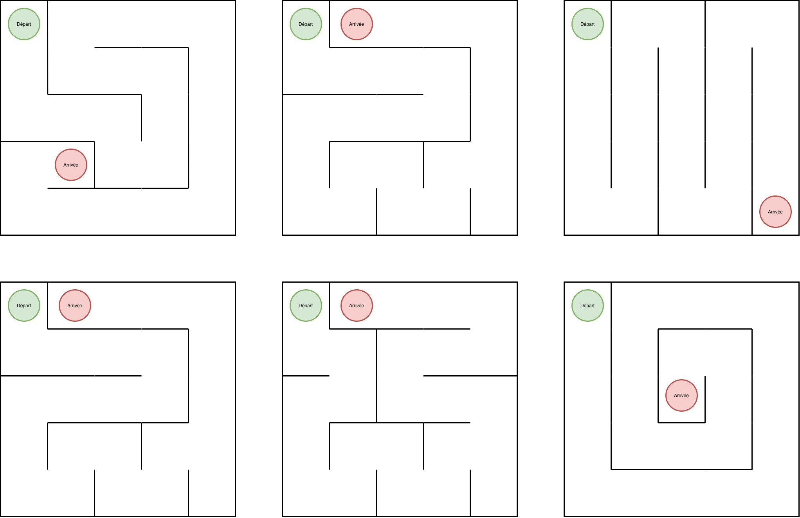
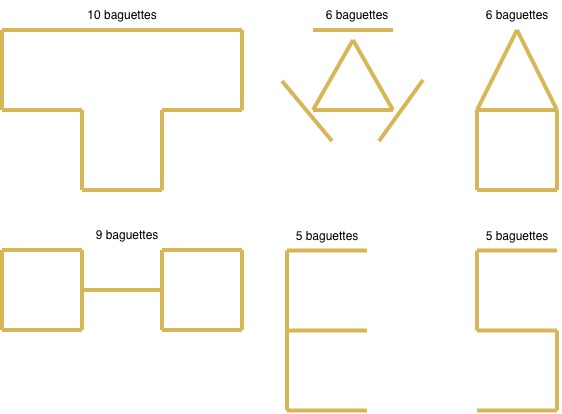
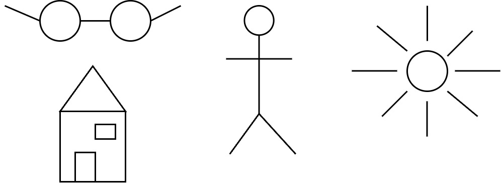

# Donner des instructions

## Aperçu

| Durée | Format | Matériel |
|-------|--------|----------|
| 45 min | Binômes | Labyrinthes imprimés, baguettes/allumettes, feuilles et crayons |

## Objectifs pédagogiques

- Comprendre qu'un ordinateur exécute exactement ce qui lui est indiqué
- Expérimenter la difficulté de formuler des instructions précises
- **Découvrir les différents niveaux d'abstraction des langages de programmation**
- Faire le lien entre instructions humaines et code informatique

## Concept clé

!!! quote "Le fil rouge de l'activité"

    Cette activité se déroule en **trois niveaux progressifs** avec un vocabulaire de plus en plus riche :

    - **Niveau 1** : 4 mots seulement (très limité)
    - **Niveau 2** : Plus de mots, mais pas de raccourcis
    - **Niveau 3** : Des raccourcis puissants (formes, tailles)

    Plus le vocabulaire est riche, moins il faut d'instructions — mais l'ordinateur doit toujours tout décomposer en opérations simples.

---

## Vue d'ensemble des trois niveaux

| Niveau | Activité | Ce qu'on peut dire |
|--------|----------|-------------------|
| **1. Labyrinthe** | Guider dans un labyrinthe | 4 mots seulement |
| **2. Baguettes** | Former un dessin avec des baguettes | Placements, mais pas de formes |
| **3. Dessin** | Dessiner au crayon | Formes, tailles, positions |

**Principe** : plus le vocabulaire est riche, moins il faut d'instructions pour arriver au même résultat.

---

## Niveau 1 — Le labyrinthe

### Description

Une personne ferme les yeux (ou tourne le dos). Sa partenaire la guide à travers un labyrinthe dessiné sur papier en utilisant **uniquement** des commandes de direction très basiques.

### Pourquoi ce niveau ?

!!! info "Vocabulaire minimal"

    Avec seulement 4 mots possibles, chaque action doit être décomposée au maximum. C'est exactement ce que fait un ordinateur au plus bas niveau : des opérations très simples, une par une.

### Vocabulaire autorisé (à afficher)

| Commande | Signification |
|----------|---------------|
| `AVANCE` | Avancer d'une case |
| `RECULE` | Reculer d'une case |
| `GAUCHE` | Tourner à gauche (90°) |
| `DROITE` | Tourner à droite (90°) |

**C'est tout.** Pas de "avance de 3 cases", pas de "va vers le haut", pas de "attention au mur".

### Règles strictes

- La personne qui exécute trace le chemin sur le labyrinthe au crayon
- La personne qui donne les instructions voit le labyrinthe avec la solution
- **Aucune question autorisée**
- **Uniquement les 4 commandes ci-dessus**
- Si le crayon touche un mur = "crash" → retour au début

---

## Niveau 2 — Les baguettes

### Description

Une personne a un dessin simple devant elle (carré, triangle, lettre). Elle doit guider sa partenaire pour reproduire ce dessin en **posant des baguettes une par une** sur la table, sans jamais nommer la forme finale.

### Pourquoi ce niveau ?

!!! info "Vocabulaire élargi, mais pas de raccourcis"

    On peut maintenant parler de positions et d'orientations, mais toujours pas de formes. Pour faire un carré, il faut placer 4 baguettes une par une. Le vocabulaire est plus riche qu'au niveau 1, mais il n'y a pas encore de "raccourci".

### Vocabulaire autorisé (à afficher)

| Commande | Signification |
|----------|---------------|
| `PRENDS UNE BAGUETTE` | Saisir une baguette |
| `POSE` | Poser la baguette |
| `HORIZONTAL` | Orientation horizontale |
| `VERTICAL` | Orientation verticale |
| `DIAGONAL GAUCHE` | Inclinée vers la gauche (/) |
| `DIAGONAL DROITE` | Inclinée vers la droite (\) |
| `À GAUCHE DE` | Position relative |
| `À DROITE DE` | Position relative |
| `AU-DESSUS DE` | Position relative |
| `EN DESSOUS DE` | Position relative |
| `AU BOUT DE` | À l'extrémité de la baguette précédente |
| `BAGUETTE 1, 2, 3...` | Référence aux baguettes déjà posées |

**Interdit** : nommer des formes ("fais un carré"), utiliser des mesures ("à 5 cm"), montrer avec les mains.

### Règles strictes

- Poser **une baguette à la fois**
- Chaque baguette doit être placée **par rapport aux précédentes**
- La personne qui exécute ne voit **jamais** le modèle original
- Pas de "non, pas comme ça" — une fois posée, c'est posé

---

## Niveau 3 — Le dessin libre

### Description

Une personne décrit un dessin que sa partenaire doit reproduire au crayon sur une feuille blanche. Cette fois, le vocabulaire est **enrichi** : on peut utiliser des noms de formes, des tailles, des positions absolues.

### Pourquoi ce niveau ?

!!! info "Vocabulaire riche avec des raccourcis"

    On peut maintenant dire "cercle" ou "carré" : ce sont des **raccourcis** qui représentent plein d'opérations simples. Une seule instruction remplace des dizaines de placements. Mais la personne qui dessine doit quand même tracer chaque trait — le raccourci facilite la communication, pas l'exécution.

### Vocabulaire autorisé (à afficher)

| Commande | Signification |
|----------|---------------|
| `CERCLE` | Forme ronde |
| `CARRÉ` | Forme carrée |
| `RECTANGLE` | Forme rectangulaire |
| `TRIANGLE` | Forme triangulaire |
| `LIGNE` | Trait droit |
| `PETIT / MOYEN / GRAND` | Taille relative |
| `EN HAUT / EN BAS` | Position verticale |
| `À GAUCHE / À DROITE` | Position horizontale |
| `AU CENTRE` | Au milieu de la feuille |
| `DANS` | À l'intérieur d'une forme |
| `À CÔTÉ DE` | Adjacent à une forme |
| `AU-DESSUS DE / EN DESSOUS DE` | Position relative |
| `RELIE ... À ...` | Trace une ligne entre deux éléments |

**Interdit** : "c'est un soleil", "tu connais la forme d'une maison ?", montrer avec les mains.

### Règles

- La personne qui exécute **ne pose aucune question**
- La personne qui donne les instructions ne voit **pas** ce qui est dessiné
- On ne peut **pas corriger** une forme déjà dessinée

---

## Annexes

Les trois annexes suivantes sont des idées de labyrinthes, de motifs avec baguettes et de dessins simples à reproduire. Vous pouvez les utiliser telles quelles ou créer vos propres modèles pour varier les exercices.

### Annexe — Labyrinthes à imprimer (Niveau 1)

Six parcours de difficulté variée, avec point de **Départ** (vert) et **Arrivée** (rouge).

---

### Annexe — Formes pour les baguettes (Niveau 2)

Six motifs de 5 à 10 baguettes, de difficulté croissante.

**Rappel** : Il est interdit de nommer les formes ("carré", "triangle", "maison"...).

---

### Annexe — Idées de dessins (Niveau 3)

Dessins de difficulté variée à reproduire.
