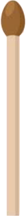

# Images pour le jeu des allumettes

Cette page regroupe les images disponibles pour le jeu des allumettes. Ces ressources peuvent être utilisées pour illustrer le projet web ou tout autre support visuel.

---

## Images disponibles

### Allumette normale

{ width="80" }

Représente une allumette intacte, prête à être retirée.

---

### Allumette en feu

{ width="80" }

Représente une allumette en train de brûler.

---

### Allumette brûlée

{ width="80" }

Représente une allumette déjà utilisée ou retirée du jeu.

---

## Utilisation dans le projet

Ces images se trouvent dans le dossier `assets/images/allumettes/` et peuvent être intégrées dans une page web avec la balise HTML suivante :

```html

```

Les trois fichiers disponibles sont :

| Fichier | Description |
|---------|-------------|
| `base.png` | Allumette normale |
| `burning.png` | Allumette en feu |
| `burned.png` | Allumette brûlée |
