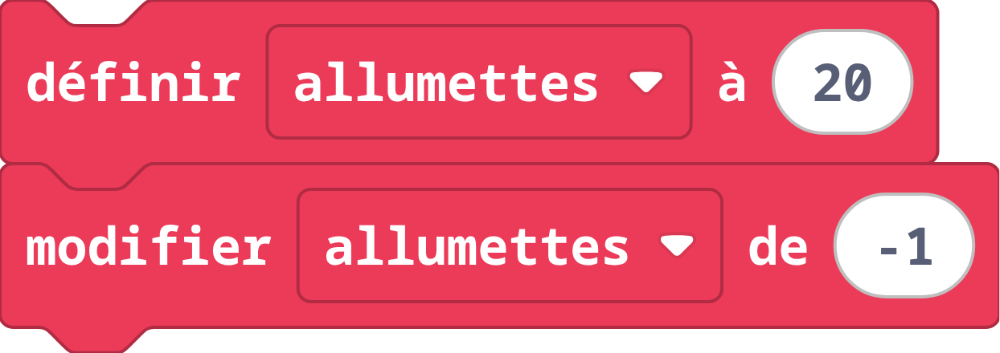
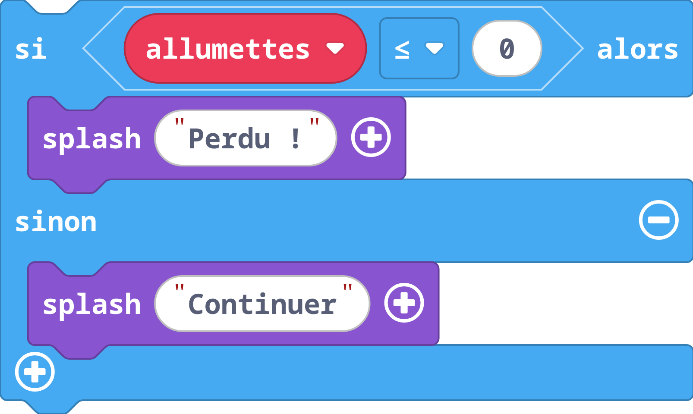
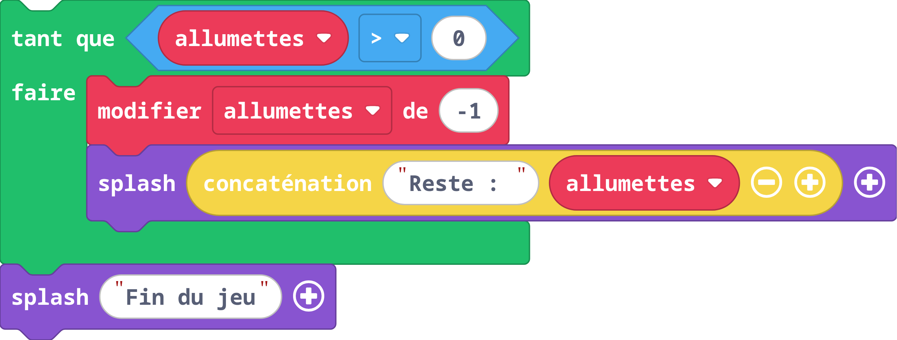
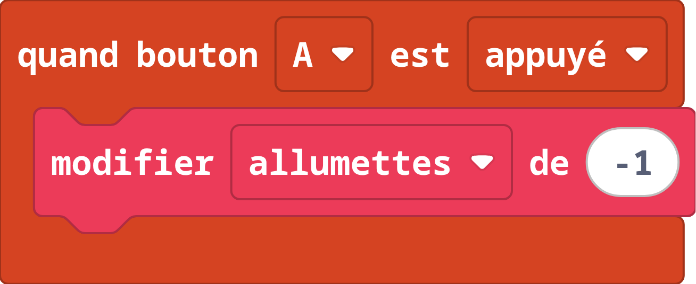
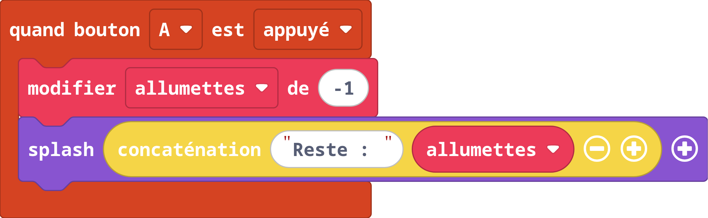

# Lundi : Introduction (Après-midi)

## Programmation visuelle avec MakeCode Arcade

**Lundi 19 octobre 2026**

---

# Planning de l'après-midi

| Horaire | Activité |
|---------|----------|
| 13h00 | Introduction à la programmation |
| 13h15 | Découverte de MakeCode Arcade |
| 14h00 | Atelier : Création du jeu des allumettes |
| 14h45 | Pause |
| 15h00 | Atelier : Suite et personnalisation |
| 15h30 | Partage des projets |
| 15h45 | Synthèse et quiz Wooclap |

---

<!-- _class: invert -->

# Introduction à la programmation

## 13h00 - 13h15

---

# Qu'est-ce qu'un programme ?

## Une suite d'instructions précises

```
1. Prendre 20 allumettes
2. Demander combien retirer
3. Retirer ce nombre
4. Vérifier s'il en reste
5. Recommencer ou terminer
```

*On peut écrire ces instructions avec des blocs ou du texte*

---

# La variable

## Un espace de stockage avec un nom

<div class="two-columns">
<div>


</div>
<div>



</div>
</div>

**Exemples** : `allumettes = 20`, `joueuse = 1`, `nom = "Alice"`

---

# La condition

## Prendre une décision selon un test

<div class="two-columns">
<div>



</div>
<div>



</div>
</div>

**Opérateurs** : `==` (égal), `<=` (inférieur ou égal), `>` (supérieur)

---

# La boucle

## Répéter tant qu'une condition est vraie

<div class="two-columns">
<div>



</div>
<div>



</div>
</div>

---

# L'événement

## Réagir quand quelque chose se produit

<div class="two-columns">
<div>


</div>
<div>



</div>
</div>

**QUAND** un événement arrive, **ALORS** exécuter une action.

---

# Cinq concepts, un jeu

| Concept | Rôle dans le jeu |
|---------|------------------|
| **Variable** | Stocker le nombre d'allumettes |
| **Condition** | Vérifier si la partie est finie |
| **Boucle** | Répéter jusqu'à la fin |
| **Événement** | Réagir aux appuis sur les boutons |
| **Opérateur** | Calculer et comparer |

---

<!-- _class: invert -->

# Découverte de MakeCode Arcade

## 13h15 - 14h00

---

# MakeCode Arcade

## arcade.makecode.com

Un outil gratuit pour créer des **jeux 2D rétro**

- Fonctionne dans le navigateur (rien à installer)
- Sauvegarde automatique
- Simulateur intégré pour tester immédiatement

---

# L'interface en 3 zones

```
┌──────────────┬─────────────┬────────────────┐
│  SIMULATEUR  │  TOOLBOX    │  ZONE DE CODE  │
│   (gauche)   │  (centre)   │   (droite)     │
│              │             │                │
│   Tester     │ Catégories  │  Assembler     │
│   le jeu     │ de blocs    │  les blocs     │
│              │             │  ici           │
│   [A]  [B]   │             │                │
└──────────────┴─────────────┴────────────────┘
```

---

# Zone 1 : Le simulateur (gauche)

## Tester sans attendre

- Le jeu se lance **automatiquement**
- Boutons virtuels **A** et **B** cliquables
- Bouton **Redémarrer** pour recommencer
- Bouton **Plein écran** pour agrandir

---

# Zone 2 : La Toolbox (centre)

## Les catégories de blocs

Chaque catégorie contient des blocs spécifiques :

| Catégorie | Couleur | Utilité |
|-----------|---------|---------|
| **Boucles** | Vert | Répéter des actions |
| **Logique** | Bleu | Conditions if/then/else |
| **Variables** | Rouge | Stocker des valeurs |
| **Contrôleur** | Orange | Réagir aux boutons |
| **Jeu** | Violet | Messages, fin de partie |

---

# Zone 3 : Zone de code (droite)

## L'espace de travail

- **Glisser-déposer** les blocs depuis la Toolbox
- Les blocs **s'emboîtent** comme des puzzles
- **Supprimer** : glisser vers la Toolbox ou touche Suppr
- **Zoom** : molette de souris ou boutons +/-

---

# Les boutons de jeu

## Comment interagir avec le jeu

| Bouton | Sur l'écran | Au clavier |
|--------|-------------|------------|
| **A** | Bouton gauche | `Z` ou Espace |
| **B** | Bouton droit | `X` ou Entrée |
| **Flèche haut** | Haut de la croix directionnelle | Flèche ↑ du clavier |

*Pour notre jeu des allumettes, on utilisera A, B et la flèche haut*

---

# Les catégories utiles pour notre jeu

## Ce qu'il faut connaître

- **Variables** : créer `allumettes` et `joueuse`
- **Contrôleur** : `quand bouton A est appuyé`
- **Jeu** : `splash` (message) et `fin de jeu`
- **Logique** : `si ... alors ... sinon`

---

# Live coding

## Suivez sur vos écrans

1. Ouvrez **arcade.makecode.com**
2. Cliquez sur **"Nouveau Projet"**
3. Nommez-le **"Jeu-Allumettes"**

---

# Étape 1 : La variable

## Créer le compteur

1. **Variables** → **Créer une Variable**
2. Nom : `allumettes`
3. **définir allumettes à 20**

---

# Étape 2 : Afficher

## Montrer le nombre

Utilisez le bloc **splash** :

```
splash "20 allumettes"
```

---

# Étape 3 : Les boutons

## Réagir aux clics

- **Bouton A** : Retirer 1
- **Bouton B** : Retirer 2
- **Flèche haut** : Retirer 3

---

# Code du bouton A



---

<!-- _class: invert -->

# Atelier : Création du jeu des allumettes

## 14h00 - 14h45

---

# À vous de jouer

## Créez votre jeu des allumettes

**Objectifs :**
- Variable pour le nombre d'allumettes
- Boutons A, B et flèche haut pour retirer 1, 2 ou 3
- Détection de fin de partie
- Affichage du nombre restant

Nous passons dans les groupes pour vous aider.
---

<!-- _class: invert -->
<!-- _paginate: false -->

<div class="center">

# PAUSE

## 15 minutes

*Retour à 15h00*

</div>

---

<!-- _class: invert -->

# Atelier : Suite et personnalisation

## 15h00 - 15h30

---

# Continuez votre jeu

## Finalisez et personnalisez

- Terminez les fonctionnalités de base
- Ajoutez vos touches personnelles (graphismes, sons, messages)
- Testez avec votre binôme

Nous continuons à passer dans les groupes.

---

<!-- _class: invert -->

# Partage des projets

## 15h30 - 15h45

---

# Qui veut montrer ?

## Présentations volontaires

*2-3 équipes qui souhaitent partager leur création...*

---

# Version de référence

## Si besoin, voici comment ça peut fonctionner

- **Joueuse contre joueuse** : [arcade.makecode.com/S32221-15913-36189-53679](https://arcade.makecode.com/S32221-15913-36189-53679)
- **Contre l'ordinateur** : [arcade.makecode.com/S19881-31620-38681-62591](https://arcade.makecode.com/S19881-31620-38681-62591)

*Aussi disponibles sur le site du cours, page « Solution »*

---

# Sauvegarder et partager

## Le projet est sauvegardé automatiquement

Mais pour le **partager** :

1. Cliquer sur le bouton **Partager** (en haut)
2. Donner un **nom** au projet
3. Cliquer sur **Publier le projet**
4. Copier le **lien** généré

---

# Retrouver ses projets

## Depuis la page d'accueil

- Les projets récents apparaissent automatiquement
- Cliquer sur **Mes Projets** pour voir tout
- Possible de **renommer** ou **supprimer**

---

<!-- _class: invert -->

# Synthèse et quiz Wooclap

## 15h45 - 16h15

---

# Rejoignez le quiz

## Scannez le QR code

<div class="center">


</div>

**wooclap.com** → Code : <b class="secondary"> BLCNLQZ </b>

---

# Récapitulatif de la journée

## Vous avez appris...

1. L'importance des **instructions précises**
2. La **stratégie gagnante** (multiples de 4 + 1)
3. Les concepts : **variable, condition, boucle**
4. Créer un jeu avec **MakeCode Arcade**

---

# Demain

## HTML, CSS et JavaScript

On crée la **page web** du jeu des allumettes

Avec du **vrai code** cette fois

---

# À demain

## 8h30 - Salle R102

**Merci pour cette première journée**
