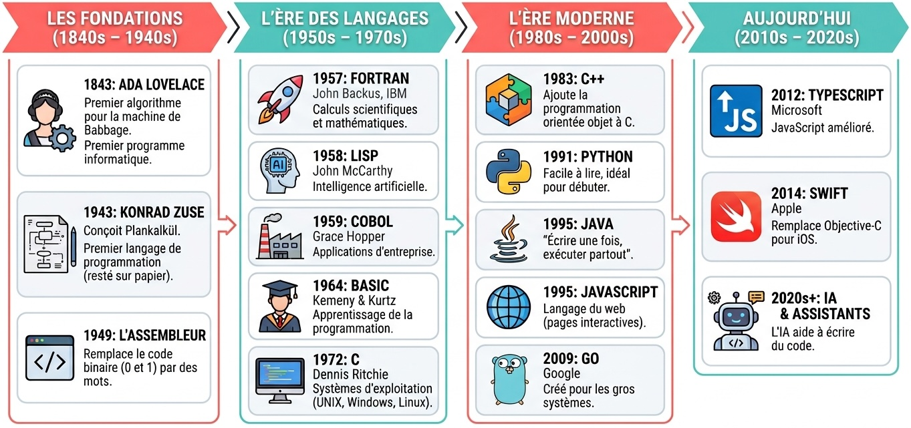

# Lundi : Introduction (Matin)

## Bienvenue au cours Algorithmique et programmation

**Lundi 19 octobre 2026**

---

# Qui sommes-nous ?

## L'équipe enseignante

<div class="two-columns center">
<div>

**Clarisse Estelle Fleurimont**

Ingénieure logiciel, formatrice, assistante de recherche HEIG-VD

[clarisse.fleurimont@heig-vd.ch](mailto:clarisse.fleurimont@heig-vd.ch)
[GitHub - Stellucidam](https://github.com/Stellucidam)

</div>
<div>

**Vincent Claude Guidoux**

Ingénieur logiciel, entrepreneur, chargé de cours et comédien.

[vincent.guidoux1@heig-vd.ch](mailto:vincent.guidoux1@heig-vd.ch)
[GitHub - Nortalle](https://github.com/Nortalle)

</div>
</div>

---

# Cette semaine

## Créer un jeu vidéo ensemble

- **Lundi** : Découvrir l'algorithmique
- **Mardi** : Créer une page web
- **Mercredi** : Programmer un objet physique
- **Vendredi** : Présenter vos créations

*Jeudi : travail libre à la maison*

---

# Planning du jour

## Matin : Introduction

| Horaire | Activité |
|---------|----------|
| 08h30 | Accueil et prise de contact |
| 09h00 | Élaboration de la charte et formation des équipes |
| 09h45 | Histoire de la programmation |
| 10h00 | Pause |
| 10h30 | Activité : Donner des instructions |
| 11h15 | Découverte du jeu des allumettes |

---

# Planning du jour

## Après-midi : Programmation visuelle

| Horaire | Activité |
|---------|----------|
| 13h00 | Introduction à la programmation |
| 13h15 | Découverte de MakeCode Arcade |
| 14h00 | Atelier : Jeu des allumettes en blocs - Partie 1 |
| 14h45 | Pause |
| 15h00 | Atelier : Jeu des allumettes en blocs - Partie 2 |
| 15h30 | Partage des projets |
| 15h45 | Synthèse et quiz Wooclap |

---

# Objectifs du jour

## À la fin de la journée, vous saurez :

1. Pourquoi les **instructions précises** sont la base de la programmation
2. La **stratégie gagnante** du jeu des allumettes
3. Créer un **jeu en blocs visuels** avec MakeCode Arcade

---

# Le projet de la semaine

## Le Jeu des Allumettes

Un fil rouge qui traverse toute la semaine :

- **Lundi** : Comprendre les règles et la stratégie
- **Mardi** : Créer l'interface web
- **Mercredi** : Version physique avec micro:bit
- **Vendredi** : Présentation finale

---

<!-- _class: invert -->

# Élaboration de la charte et formation des équipes

## 09h00 - 09h45 · Salle R102

---

# Wooclap : Construisons ensemble

## Scannez le QR code

<div class="center">


</div>

**wooclap.com** → Code : <b class="secondary"> SLNZGPB </b>

Répondez aux questions en un ou deux mots, ou par un mot-clé, nous en ferons la synthèse pour créer notre charte de fonctionnement.

---

# Formation des équipes

## Environ 20 équipes de 3-4 personnes

Chaque équipe porte un **nom de fruit** (ex. : Pomme, Poire, Banane, Kiwi, etc.).

Choisissez votre nom d'équipe et notez-le sur cette Google Sheet : [https://tinylink.net/YeCH0](https://tinylink.net/YeCH0) (ou scannez le QR code ci-dessous).

<div class="center">


</div>

---

<!-- _class: invert -->

# Histoire de la programmation

## 09h45 - 10h00 · Salle R102

---

# Un bref voyage dans le temps

<div class="center">



<span class="tiny gray">*Image générée par Gemini AI*</span>

</div>

---

# Ada Lovelace

## La première programmeuse de l'histoire (1843)

<div class="thirty-seventy-columns">
<div>


<span class="tiny gray">*Source (image) : [snl.no](https://snl.no/Ada_Lovelace)*</span>
</div>
<div>

- Fille du poète Lord Byron
- À 27 ans, écrit le **premier algorithme**
- Pour une machine qui n'existait pas encore

> La machine analytique ne prétend nullement créer quoi que ce soit. Elle peut exécuter tout ce que nous savons lui ordonner d'accomplir.

</div>
</div>

---

# Grace Hopper

## Le premier « bug » documenté (1947)

<div class="seventy-thirty-columns">
<div>

- Contre-amirale de la marine américaine
- Trouve un **vrai insecte** (un papillon de nuit) dans l'ordinateur
- Crée COBOL (1959) : langage proche de l'anglais

> La phrase la plus dangereuse de la langue est : "Nous avons toujours fait comme ça".

</div>
<div>


<span class="tiny gray">*Source (image) : [wikimedia.org](https://commons.wikimedia.org/wiki/File:Grace_Murray_Hopper,_in_her_office_in_Washington_DC,_1978,_©Lynn_Gilbert.jpg)*</span>
</div>
</div>

---

# L'évolution des langages

## De plus en plus proches du langage humain

| Époque | Exemple | Ce que ça veut dire |
|--------|---------|---------------------|
| **1940s** | `01101000` | Très difficile à lire |
| **1950s** | `MOV AX, 5` | Codes courts, plus lisibles |
| **1970s** | `printf("Bonjour")` | Mots anglais |
| **1990s** | `print("Bonjour")` | Phrase simple |
| **2020s** | "Écris un programme..." | IA générative |

---

# Et dans votre quotidien ?

## Chaque application = des millions d'instructions

| Application | Langages utilisés |
|-------------|-------------------|
| **TikTok** | Swift, Python, C++ |
| **Spotify** | Python, Java |
| **Instagram** | Python, JavaScript |
| **Minecraft** | Java |
| **Discord** | Python, Rust |

*Chaque fonctionnalité que vous utilisez a été écrite ligne par ligne.*

---

# Le point clé

## Le principe reste le même depuis 1843

Donner des instructions **précises** à une machine

- **Ada Lovelace** (1843) : instructions sur papier
- **Grace Hopper** (1959) : instructions en anglais
- **Vous** (2026) : instructions en blocs visuels

Ce qui change : les langages deviennent plus **humains**.
Ce qui reste : la **précision** est essentielle.

---

# Prochaine étape

## Mettre en pratique

Maintenant que nous avons vu l'histoire, passons à l'action :

**Activité : Donner des instructions**

*Découvrir par vous-même pourquoi la précision est si importante.*

---

<!-- _class: invert -->
<!-- _paginate: false -->

<div class="center">

# PAUSE

## 30 minutes

*Retour à 10h30 · Salles T155 et T157*

</div>

---

<!-- _class: invert -->

# Activité : Donner des instructions

## 10h30 - 11h15 · Salles T155 / T157

---

# Trois activités, trois niveaux de vocabulaire

## En binôme : une personne guide, l'autre exécute

**Règles strictes :**

1. La personne qui exécute ne pose **AUCUNE question**
2. La personne qui guide utilise **UNIQUEMENT** les mots autorisés
3. **Pas de gestes**, pas de "oui/non", pas de corrections
4. **4 minutes** par essai, puis on inverse les rôles

---

# Activité 1 : Labyrinthe

<style scoped>table { font-size: 0.8em; }</style>

Guidez votre partenaire (yeux fermés) : elle trace le chemin au crayon sur le labyrinthe.

| Commande | Signification |
|----------|---------------|
| `AVANCE` | Avancer d'une case |
| `RECULE` | Reculer d'une case |
| `GAUCHE` | Tourner à gauche (90°) |
| `DROITE` | Tourner à droite (90°) |

**Interdit** : "avance de 3 cases", "attention au mur"... Mur touché = retour au départ

---

# Activité 2 : Baguettes

<style scoped>table { font-size: 0.7em; }</style>

Faites reproduire un motif avec des baguettes/cure-dents.

| Commande | Signification |
|----------|---------------|
| `PRENDS UNE BAGUETTE` / `POSE` | Saisir / poser une baguette |
| `HORIZONTAL` / `VERTICAL` | Orientation |
| `DIAGONAL GAUCHE` / `DIAGONAL DROITE` | Inclinée ( / ) ou ( \ ) |
| `À GAUCHE DE` / `À DROITE DE` / `AU-DESSUS DE` / `EN DESSOUS DE` | Position relative |
| `AU BOUT DE` / `BAGUETTE 1, 2, 3...` | Par rapport aux baguettes déjà posées |

**Interdit** : nommer une forme ("carré", "lettre L"...) ou une mesure

---

# Activité 3 : Dessin

Faites reproduire un dessin simple sur papier.

| Commande | Exemples |
|----------|----------|
| **Formes** | `CERCLE`, `CARRÉ`, `TRIANGLE`, `LIGNE` |
| **Tailles** | `PETIT`, `MOYEN`, `GRAND` |
| **Positions** | `AU CENTRE`, `EN HAUT`, `À GAUCHE` |
| **Relations** | `DANS`, `À CÔTÉ DE`, `AU-DESSUS DE`, `RELIE ... À ...` |

**Interdit** : "tu vois ?", "c'est comme...", montrer avec les mains

---
<div class="center">

# C'est parti !

</div>

<div class="two-columns">
<div>

## Les trois activités en parallèle

**Labyrinthe**
4 mots seulement

**Baguettes**
Pas de noms de formes

**Dessin**
Vocabulaire riche

</div>
<div>

### Déroulement

1. **4 min** — Premier essai
2. **Révélation** — Comparez !
3. **4 min** — On inverse les rôles
4. Passez à l'activité suivante

</div>
</div>

---

# Débriefing

## Qu'est-ce qui était difficile ?

- Les **malentendus** ?
- La **précision** des instructions ?
- La **frustration** de ne pas pouvoir poser de questions ?
- La différence entre les **trois niveaux** de vocabulaire ?

---

# La leçon

## Un ordinateur = votre binôme

Il exécute **EXACTEMENT** ce qu'on lui dit.

Pas d'interprétation. Pas de "bon sens".  Pas de questions.

| Activité | Comme en programmation... |
|----------|--------------------------|
| **Labyrinthe** | Langage machine (très basique) |
| **Baguettes** | Assembleur (un peu plus riche) |
| **Dessin** | Langage moderne (plus expressif) |

---

<!-- _class: invert -->

# Découverte du jeu des allumettes

## 11h15 - 12h00 · Salles T155 / T157

---

# Les règles du jeu

```
| | | | | | | | | | | | | | | | | | | |
1 2 3 4 5 6 7 8 9 ...                20
```

- **20 allumettes** au départ
- À tour de rôle, retirer **1, 2 ou 3** allumettes
- La personne qui prend la **dernière** a **PERDU**

---

# Jouons

## En équipes de 2

1. Prenez le plateau imprimé (ou 20 baguettes)
2. Jouez plusieurs parties
3. Cherchez une stratégie...

**15 minutes**

---

# Qui a trouvé une stratégie ?

## Partagez vos découvertes

---

# Le secret

## Les positions gagnantes

```
20 → 17 → 13 → 9 → 5 → 1 → GAGNÉ
```

*Multiples de 4 + 1*

---

# Pourquoi cela fonctionne ?

## La règle du complément à 4

Quoi que l'adversaire joue, on peut compléter pour faire 4 :

- Adversaire prend **1** → on prend **3** (1+3=4)
- Adversaire prend **2** → on prend **2** (2+2=4)
- Adversaire prend **3** → on prend **1** (3+1=4)

---

<!-- _class: invert -->

<div class="center">

# REPAS

## Bon appétit

*Retour à 13h00*

</div>
