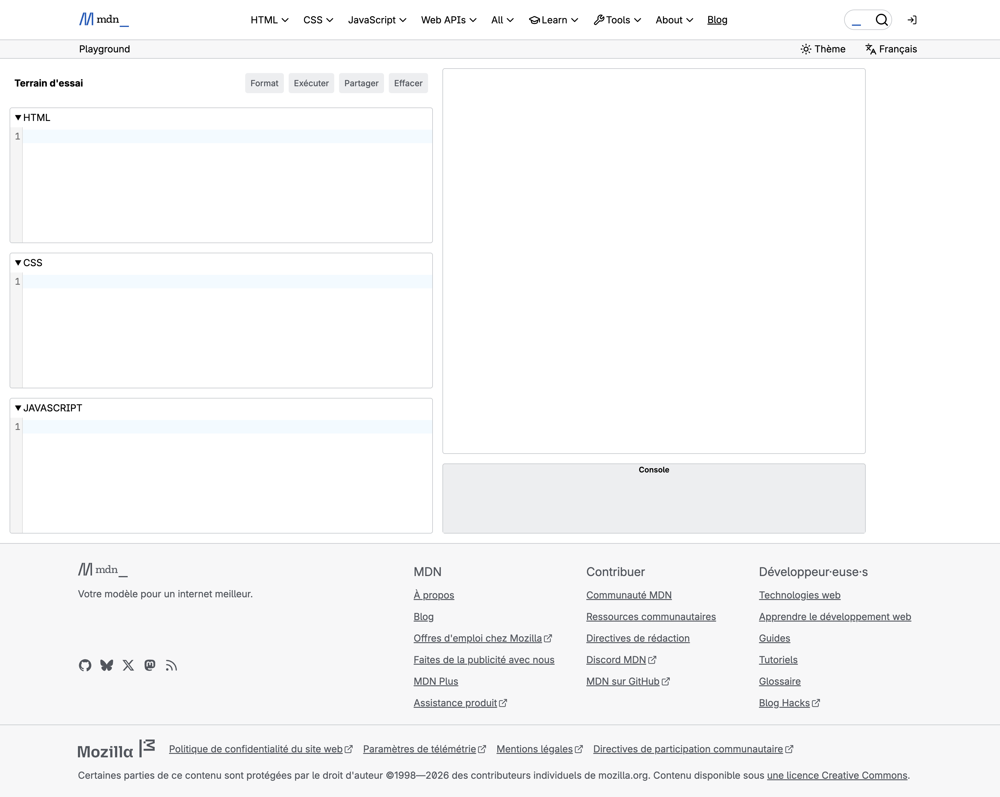

# Mardi : HTML et CSS (Matin)

## Un site sur un sujet qui vous plaît

**Mardi 20 octobre 2026**

---

# Le contenu complet est sur le site

## Cette présentation n'en est qu'un résumé

<div class="seventy-thirty-columns">
<div>

- Les slides **effleurent** la théorie
- Le **site du cours** contient tout : explications, tutoriels pas à pas, bugs volontaires et corrections
- À lire et à suivre **sur sa machine**, en classe puis après le cours

<span class="small gray">Un clic sur l'en-tête des slides ouvre la page du site.</span>

</div>
<div class="center">


<span class="small">Programme → Mardi → Matin</span>

</div>
</div>

---

# Retour sur lundi

## Une bonne première journée

- Un point à améliorer : le **niveau de bruit**
- L'équipe enseignante est là pour **aider à apprendre et à créer**, pas pour faire la police
- S'intéresser au cours reste un choix personnel
- Le **respect** est attendu : <b class="primary">le silence pendant les explications</b>, même sur son téléphone

---

<!-- _class: invert -->

# Évaluation de vendredi

## L'écrit, le projet et les critères

[Ouvrir la présentation dédiée](https://heig-vd-msci-course.github.io/heig-vd-msci-course/slides/vendredi-evaluation.html)

---

# Planning du matin

<style scoped>table { font-size: 0.85em; }</style>

| Activité | Au programme | Salle |
|----------|--------------|-------|
| Accueil | Retour sur lundi, évaluation de vendredi | R102 |
| Théorie | Le web, HTML, CSS, Flexbox et Grid | R102 |
| Pratique | Les tutoriels du site, puis son propre site | T155 / T157 |

---

# Objectifs du matin

## À la fin de la matinée, vous saurez :

1. Expliquer le rôle de **HTML**, **CSS** et **JavaScript**
2. Structurer une page avec des **balises** HTML
3. La mettre en forme avec des **règles** CSS
4. Placer des éléments côte à côte avec **Flexbox** et **Grid**
5. Repérer et corriger un **bug** en HTML et en CSS

---

# La journée

## Le jeu des allumettes passe sur le web

- **Matin** : un site sur un sujet qui vous plaît, en HTML et CSS
- **Après-midi** : l'interface du jeu des allumettes, en JavaScript
- **Avant 16h30** : chaque équipe envoie son projet, publié en ligne le soir même

---

<!-- _class: invert -->

# Le web et MDN Playground

## Le web en bref et l'outil de la journée

---

# Comment fonctionne le web

## Demander, recevoir, assembler, afficher

```text
+--------------+   1. demande la page   +--------------+
|  NAVIGATEUR  | ---------------------> |   SERVEUR    |
| (sa machine) | <--------------------- |  (le site)   |
+--------------+ 2. envoie HTML, CSS... +--------------+
```

- **Navigateur** : Firefox, Chrome, Safari, Edge...
- **Serveur** : un ordinateur qui stocke le site
- **URL** : l'adresse d'une page, `https://developer.mozilla.org/fr/`

---

# Trois langages, trois rôles

## Toutes les pages web, de TikTok à Spotify

<style scoped>table { font-size: 0.85em; }</style>

| Langage | Rôle | Comme pour une tenue... |
|---------|------|-------------------------|
| **HTML** | Le **contenu** : titres, textes, images | Les vêtements |
| **CSS** | L'**apparence** : couleurs, polices | Le style, la coupe, les accessoires |
| **JavaScript** | Le **comportement** : réagir, calculer | Les mouvements : marcher, danser |

Ce matin : **HTML** et **CSS**. Cet après-midi : **JavaScript**.

---

# Inspecter une page

## Démonstration : les outils du navigateur

- Clic droit → **Inspecter** : le HTML et le CSS de n'importe quelle page
- On peut même **modifier** le texte, mais seulement **dans son navigateur**, sur sa copie de la page
- En rechargeant la page, l'**original** revient
- <b class="primary">Une capture d'écran n'est pas une preuve</b> : mieux vaut vérifier à la source

---

# MDN Playground

## L'éditeur de Mozilla, gratuit et sans compte

<style scoped>
.capture { height: 370px; overflow: hidden; border: 1px solid var(--color-table-border); border-radius: 6px; }
.capture p { margin: 0; }
.capture img { width: 100%; }
</style>

<div class="forty-sixty-columns">
<div class="small">

- Trois zones de code, un **aperçu** et une **console**
- **Exécuter** : mettre à jour l'aperçu
- <b class="primary">Effacer</b> vide **tout** : prudence
- Les liens ne s'ouvrent **pas** : c'est normal

</div>
<div class="capture">



</div>
</div>

---

<!-- _class: invert -->

# Rappel HTML

## Structurer le contenu

---

# Le HTML décrit le contenu

## Balise ouvrante, contenu, balise fermante

```text
<p>J'ai 17 ans</p>
 |      |       |
 |      |       +-- balise fermante (avec une barre /)
 |      +-- contenu
 +-- balise ouvrante
```

Les éléments s'emboîtent comme des poupées russes : la page forme un **arbre**.

---

# Les balises de base

<style scoped>table { font-size: 0.8em; }</style>

| Élément | Exemple | Rôle |
|---------|---------|------|
| Titres | `<h1>`, `<h2>` | Structurer la page |
| Paragraphe | `<p>` | Un bloc de texte |
| Mise en avant | `<strong>`, `<em>` | Texte important, accentué |
| Listes | `<ul>`, `<ol>`, `<li>` | Listes à puces, numérotées |
| Lien | `<a href="...">` | Aller vers une autre page |
| Image | `` | Afficher une image |

Une nouvelle balise ? Chercher sur internet « MDN » suivi de son nom, par exemple **« MDN ol »**.

---

# Les attributs

## Des informations en plus : `nom="valeur"`

```html
<a href="https://www.youtube.com" target="_blank">Ma chanson</a>

```

- `href` et `src` : l'**adresse** du lien, de l'image
- `alt` : décrit l'image, lu à voix haute par les **lecteurs d'écran**
- `` n'a **pas** de balise fermante : c'est un élément *vide*

---

# Trouver un bug en HTML

## Aucun message d'erreur

- Le navigateur fait **de son mieux** et affiche quand même quelque chose
- Pour trouver un bug : **observer** la page, relire le code autour
- Une seule lettre suffit : `herf` au lieu de `href`, et le lien ne fonctionne plus

<div class="info">

L'ordinateur exécute **exactement** ce qui est écrit, comme lundi.

</div>

---

<!-- _class: invert -->

# Rappel CSS

## Mettre en forme le contenu

---

# Le CSS décrit l'apparence

## Une règle : un sélecteur et des déclarations

```text
h1 {  color: deeppink;  }
|     |      |       |
|     |      |       +-- point-virgule : fin de la déclaration
|     |      +-- valeur
|     +-- propriété
+-- sélecteur : les éléments HTML concernés
```

Le HTML dit *ce qu'il y a* sur la page, le CSS dit *à quoi ça ressemble*.

---

# Les classes : cibler un élément

<div class="two-columns">
<div>

```html
<li class="coup-de-coeur">
  Les séries
</li>
```

```css
.coup-de-coeur {
  background-color: gold;
  font-weight: bold;
}
```

</div>
<div>

- `li` vise **tous** les éléments `<li>`
- `.coup-de-coeur` vise les éléments qui ont cette **classe**
- Le **point** fait toute la différence

</div>
</div>

---

# Des boîtes et des espaces

## Chaque élément est une boîte

```text
+---------------- margin (marge extérieure) ---------------+
|  +------------- border (bordure) ---------------------+  |
|  |  +---------- padding (marge intérieure) --------+  |  |
|  |  |                                              |  |  |
|  |  |                  contenu                     |  |  |
|  |  |                                              |  |  |
|  |  +----------------------------------------------+  |  |
|  +----------------------------------------------------+  |
+----------------------------------------------------------+
```

`border-radius` arrondit les coins, `margin: 0 auto` centre la page.

---

# Trouver un bug en CSS

## Une déclaration incorrecte est ignorée

- **Aucun message** : la page s'affiche simplement sans ce style
- Erreurs fréquentes : le **point-virgule**, le **point** devant une classe ou l'**unité** oubliés
- Clic droit → **Inspecter** : les déclarations ignorées sont <b class="primary">barrées</b>

---

<!-- _class: invert -->

# Mise en page

## Flexbox et Grid

---

# Deux outils de mise en page

## Par défaut, les blocs s'empilent

<style scoped>table { font-size: 0.8em; }</style>

| Outil | Principe | Idéal pour |
|-------|----------|------------|
| **Flexbox** | Ranger sur **une ligne** (ou une colonne) | Des cartes, un menu, des boutons |
| **Grid** | Dessiner une **grille** de lignes et de colonnes | Une galerie, la mise en page d'un site |

Flexbox range sur **un axe**, Grid sur **deux axes**.

---

# Flexbox : des cartes côte à côte

<div class="two-columns">
<div>

```css
.cartes {
  display: flex;
  gap: 16px;
}

.carte {
  flex: 1;
}
```

</div>
<div>

- `display: flex` : les **enfants directs** se rangent côte à côte
- `gap` : de l'espace entre eux
- `flex: 1` : chaque carte reçoit **une part** égale de la place

</div>
</div>

---

# Le bon parent

## `display: flex` agit sur les enfants directs

```text
div.cartes        <- display: flex : le conteneur
+-- div.carte     <- les cartes, rangées côte à côte
|   +-- h2        <- pas concernés
|   +-- ul
+-- div.carte
+-- div.carte
```

Pour savoir où l'écrire : *quel élément contient ceux que l'on veut placer côte à côte ?*

---

# Grid : une galerie en grille

<div class="two-columns">
<div>

```css
.galerie {
  display: grid;
  grid-template-columns: 1fr 1fr 1fr;
  gap: 8px;
}
```

</div>
<div>

```text
    1fr       1fr       1fr
+---------+---------+---------+
| image 1 | image 2 | image 3 |
+---------+---------+---------+
| image 4 | image 5 | image 6 |
+---------+---------+---------+
```

</div>
</div>

- Une valeur par **colonne** : `1fr 1fr 1fr` donne trois colonnes
- `fr` : une **part** de la place disponible
- Les lignes se créent toutes seules

---

# Une image vedette

## Occuper plusieurs cases

<div class="forty-sixty-columns">
<div>

```css
.vedette {
  grid-column: span 2;
  grid-row: span 2;
}
```

</div>
<div>

```text
+-------------------+---------+
|                   | image 2 |
|      vedette      +---------+
|                   | image 3 |
+---------+---------+---------+
| image 4 | image 5 | image 6 |
+---------+---------+---------+
```

</div>
</div>

<div class="warning">

Jamais plus de colonnes que la grille n'en compte.

</div>

---

# Les bugs de mise en page

## Aucun message d'erreur

- Le code est valide, mais il ne fait **pas ce qui était voulu**
- Clic droit → **Inspecter** : un badge `flex` ou `grid` apparaît à côté de l'élément
- Un clic sur le badge **dessine** les lignes et les colonnes par-dessus la page

---

# Récapitulatif

## À retenir avant de pratiquer

1. HTML = **contenu**, CSS = **apparence**
2. Un élément : balise ouvrante, contenu, balise fermante
3. Une règle CSS : sélecteur `{ propriété: valeur; }`
4. `display: flex` ou `grid` se place sur le **parent**
5. Pas de message d'erreur : **observer** et **Inspecter**

---

<!-- _class: invert -->

# Pratique

## Salles T155 / T157

---

# Les tutoriels du site, dans l'ordre

<style scoped>table { font-size: 0.85em; }</style>

| Chapitre | Au programme |
|----------|--------------|
| Le web et MDN Playground | Inspecter une page, premier essai |
| Rappel HTML | Étapes 1 à 6 |
| Rappel CSS | Étapes 1 à 6 |
| Mise en page : Flexbox et Grid | Étapes 1 à 7 |
| Atelier | Son propre site, trois niveaux de défis |

Dès le début, remplacer le contenu de l'exemple par **son sujet**. Ce site reste sur sa machine : il n'est **pas publié**.

---

# Choisir son sujet

## Deux minutes avant de coder

- **Un sujet** : un sport, un hobby, un intérêt spécifique...
- **Deux ou trois couleurs** : le fond, les titres, les éléments mis en avant
- **Une ambiance** : sobre, colorée, sombre, rétro...

<div class="info">

Lisible avant tout : un bon **contraste** entre le texte et le fond, surtout pour les personnes malvoyantes.

</div>

---

# Garder son travail

## Le code n'est pas gardé pour toujours

1. Cliquer sur **Partager**
2. Cliquer sur **Copier le Markdown** : HTML, CSS et JavaScript d'un coup
3. Coller le tout dans un fichier texte ou un e-mail à soi-même

<div class="warning">

À faire avant de fermer l'onglet, et à la fin de chaque chapitre.

</div>

---

# Trois niveaux de défis

## Une fois les tutoriels terminés

<style scoped>table { font-size: 0.75em; }</style>

| Niveau | Par exemple |
|--------|-------------|
| **1. La base** | Trois sections avec un titre `<h2>`, une liste, une image avec `alt`, un lien, ses couleurs, une classe |
| **2. Les détails** | Page centrée, cartes et galerie, sous-titres stylés, effet au survol `:hover` |
| **3. Les défis** | Cartes qui passent à la ligne, galerie qui s'adapte, image qui bouge, thème sombre, chasse au bug |

Chaque personne avance à son rythme : le détail est sur le site.

---

# Pour aller plus loin

## Trois jeux en ligne, gratuits et sans compte

<style scoped>table { font-size: 0.85em; }</style>

| Jeu | Notion travaillée |
|-----|-------------------|
| [Flexbox Froggy](https://flexboxfroggy.com/#fr) | **Flexbox** : placer des grenouilles sur leurs nénuphars |
| [CSS Grid Garden](https://cssgridgarden.com/#fr) | **Grid** : arroser un potager |
| [CSS Diner](https://flukeout.github.io) | Les **sélecteurs** (en anglais) |

---

# Montrer son site

## En fin de matinée

Deux ou trois volontaires présentent leur site :

- leur **sujet**
- leur **style**
- le **bug** qui leur a donné le plus de fil à retordre

---

# Cet après-midi

## JavaScript : donner vie à la page

- Le même HTML et le même CSS pour l'**interface du jeu des allumettes**
- Le **JavaScript** pour que la page réagisse aux clics
- Avant **16h30** : chaque équipe envoie son projet

---

<!-- _class: invert -->

<div class="center">

# REPAS

## Bon appétit

*Retour à 13h00*

</div>
