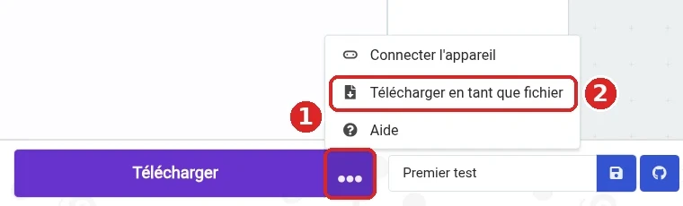

# Mercredi : micro:bit (Matin)

## Le jeu des allumettes devient un objet

**Mercredi 21 octobre 2026**

---

# Le contenu complet est sur le site

## Cette présentation n'en est qu'un résumé

- Les slides **effleurent** la théorie
- Le **site du cours** contient tout : tutoriel pas à pas, bugs volontaires, solutions à télécharger
- À suivre **sur sa machine**, dans les salles de pratique

Un clic sur l'en-tête des slides ouvre la page du site.

Programme → Mercredi → Matin

---

# Planning du matin

| Activité | Au programme | Salle |
|----------|--------------|-------|
| Accueil | Prise de température, objectifs | R102 |
| Théorie | Le micro:bit, le chemin d'un programme, démonstration | R102 |
| Pratique | Premier programme, jeu des allumettes | T147 / T151 |
| Pratique | Multijoueur par radio, défis | T147 / T151 |

---

# Objectifs du matin

## À la fin de la matinée, vous saurez :

1. **Programmer** un micro:bit avec MakeCode
2. **Transférer** un programme de l'ordinateur vers la carte
3. **Réutiliser** les concepts de la semaine : variables, événements, conditions, boucles
4. **Faire communiquer** deux cartes par radio

---

# La semaine du jeu des allumettes

## Même jeu, trois supports

| Jour | Outil | Le jeu vit... |
|------|-------|---------------|
| Lundi | MakeCode Arcade | dans un écran de console |
| Mardi | HTML, CSS, JavaScript | dans une page web |
| **Mercredi** | **MakeCode micro:bit** | **dans la main** : LED, sons, radio |

---

<!-- _class: invert -->

# Le micro:bit

## Un ordinateur de la taille d'une carte de crédit

---

# Les deux faces de la carte

**25 LED**, **boutons A et B**, logo tactile, connecteurs

**Haut-parleur**, micro, **antenne radio**, accéléromètre, prise USB

Photos : Crash48 (CC0), Simon Waldherr (CC BY 4.0), Wikimedia Commons

---

# Entrées, programme, sorties

## Toujours le même schéma

| Entrées | | Sorties |
|---------|:---:|---------|
| Boutons A, B, A+B | | 25 LED |
| Secouer la carte | → **Programme** → | Haut-parleur |
| Message radio reçu | | Message radio envoyé |

- `lorsque le bouton A est pressé` : un **événement**, comme lundi et mardi
- Le programme décide quoi faire de chaque entrée

---

# Le chemin d'un programme

## De l'éditeur jusqu'à la carte

1. **Écrire** dans MakeCode : [makecode.microbit.org](https://makecode.microbit.org)
2. **Tester** dans le simulateur
3. **Télécharger** le fichier `.hex`
4. **Copier** le fichier sur le lecteur **MICROBIT**
5. Le programme **tourne sur la carte**

<b class="primary">Une modification ? Recommencer à l'étape 3</b>

---

# Télécharger en tant que fichier

## Le fichier `.hex` contient le programme

- **⋯** à côté de **Télécharger**, puis **Télécharger en tant que fichier**
- Glisser le fichier de **Téléchargements** sur le lecteur **MICROBIT**
- La LED jaune clignote, puis le fichier **disparaît** : c'est normal

---

<!-- _class: invert -->

# Démonstration

## HELLO, du bloc à la carte

---

# La radio

## Comme les canaux d'un talkie-walkie

- Tous les micro:bit ont une **radio** : messages sans fil
- **256 groupes** (0 à 255) : une carte n'entend que **son** groupe
- <b class="primary">Chaque équipe a son propre numéro</b>, sur le site
- Jouer avec une autre équipe : se mettre sur **l'un des deux numéros**, jamais sur celui d'une troisième équipe
- Chapitres 1 et 2 terminés ? Une **deuxième carte** peut être prêtée
- Le simulateur affiche un **second micro:bit** pour tester

---

# Au travail !

## Une carte et un câble par binôme

1. **Premier programme** : HELLO, et tout le chemin jusqu'à la carte
2. **Le jeu des allumettes** : variables, événements, conditions, boucles, avec du **feu** et du **son**
3. **Multijoueur par radio** : deux cartes, avec une autre équipe ou une carte prêtée

Salles T147 et T151 : voir la répartition des équipes sur le site.
